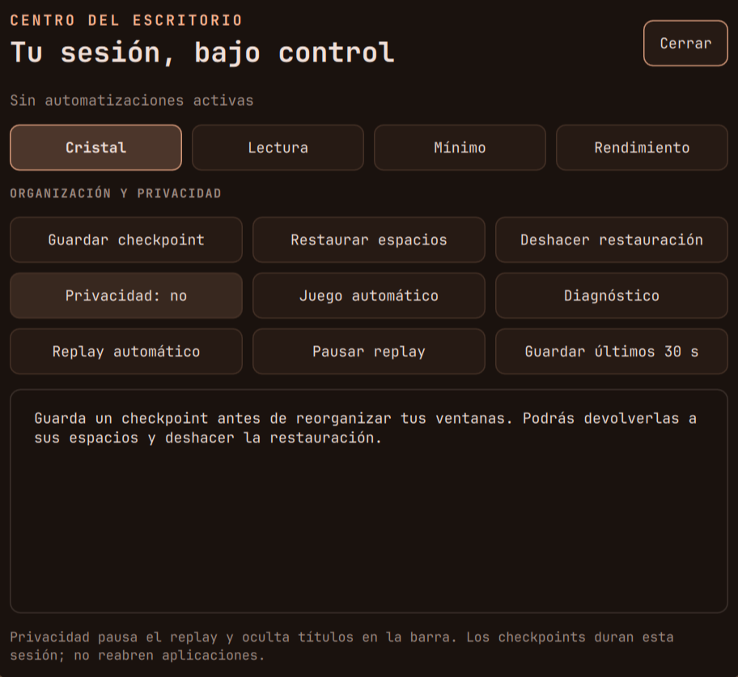

# Dotfiles · Ayu Dark Glass

Un escritorio personal para **Arch Linux**, con **Hyprland en Lua** y una interfaz propia en
**Quickshell/QML**. La paleta Ayu acompaña el arranque, las ventanas, la terminal y las aplicaciones;
matugen permite generar colores desde el fondo de pantalla.



## Tres documentos, un sistema

| Documento | Para qué sirve |
|---|---|
| [Manual de usuario](docs/manual.md) | Primeros pasos, todas las funciones, ejemplos, capturas, solución de problemas y referencia central de atajos |
| [Manual técnico](docs/manual-tecnico.md) | Arquitectura, instalación, módulos, servicios, datos, IPC, comandos, mantenimiento y recuperación |
| [Guía de estudio](docs/guia-estudio.md) | Explicaciones de cómo funciona el conjunto y una ruta práctica para aprender a modificarlo |

**Empieza con SUPER+R** para buscar una función y **SUPER+H** para consultar atajos.
La referencia de teclado vive en el manual de usuario y alimenta esas dos herramientas.

## Instalar

Desde un Arch instalado, con internet y un usuario con sudo:

```bash
bash <(curl -fsSL https://raw.githubusercontent.com/EchoStrokes08/dotfiles/main/instalar.sh)
```

Con el repositorio en `~/dotfiles`, revisa primero la simulación:

```bash
cd ~/dotfiles
./instalar.sh --simular
```

La [instalación explicada](docs/manual-tecnico.md#3-instalación-y-portabilidad) detalla las etapas,
las opciones para instalar solo la configuración del usuario, los respaldos de archivos en conflicto
y los requisitos que dependen de cada máquina. El respaldo externo se instala por separado.

## Qué incluye

Ventanas en mosaico, cuatro layouts, grupos, scratchpads, gestos y vista general; barra, dashboard,
lanzador, notificaciones y bloqueo; perfiles coordinados, privacidad, captura y replay; Mesa con
plantillas y reuniones; continuidad de proyectos; Brújula con contexto, agenda, búsqueda, sesión
y salud; dictado, OCR, IA local y agente con memoria semántica, integración móvil y herramientas de recuperación.

| Área | Incluye |
|---|---|
| Escritorio | Hyprland, Quickshell, perfiles, Mesa y Brújula |
| Productividad | Proyectos, notas, plantillas, concentración y agente con memoria |
| Apariencia | Ayu, matugen, wallpapers y temas de arranque y aplicaciones |
| Herramientas | Kitty, Zsh, Neovim, Yazi, capturas, dictado y OCR |
| Integraciones | Audio, móvil, sincronización, red privada y respaldo externo |

El [mapa técnico del repositorio](docs/manual-tecnico.md#4-mapa-del-repositorio) explica cada
paquete y los componentes opcionales o de respaldo.

Buds Manager se mantiene en su propio repositorio:
[Buds-Manager](https://github.com/EchoStrokes08/Buds-Manager). Aquí se documenta su integración.

## Recuperación rápida

Si el bloqueo se cuelga: **Ctrl+Alt+F3**, inicia sesión y ejecuta
`~/.config/hypr/scripts/desbloqueo-emergencia.sh`. Regresa con **Ctrl+Alt+F1** y desbloquea con
hyprlock. Consulta [diagnóstico y recuperación](docs/manual-tecnico.md#12-diagnóstico-y-recuperación)
para entender el procedimiento y sus límites.
