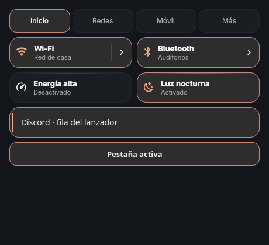

# Sistema de diseño

La referencia para cualquier panel nuevo de Quickshell. Los valores viven en dos archivos:

- `quickshell/.config/quickshell/Paleta.qml`: colores (leídos de la paleta activa de `tema.sh`).
- `quickshell/.config/quickshell/EstiloPanel.qml`: escalas de letra, radio, espacio, capas y movimiento.

`tests/test_estilo.py` falla si algo se sale de estas escalas.

## Color

Los nombres dicen la función, no el tono. En modo wallpaper `acento` puede ser azul o ámbar.

| Token | Ayu | Uso |
|---|---|---|
| `acento` | `#f19618` | Foco, selección, acción principal. El único color «de marca». |
| `acento2` | `#36a3d9` | Solo en parejas con `acento`: hora y minutos, dos series de una gráfica, ventanas aparcadas, privacidad. |
| `exito` | `#b8cc52` | Conectado, cargando, hecho. Fijo en todos los modos. |
| `aviso` | `#e6c446` | Atención sin urgencia. Fijo. |
| `peligro` | `#ff3333` | Error, batería baja, borrar. Fijo (en modo wallpaper `#ff5c57`). |
| `fondo` · `texto` · `seleccion` · `gris` | | Neutros. |
| `serie[]` | | Datos por categoría (barras de tiempo de pantalla, contextos de Brújula). No es decoración. |
| `sobreImagen` | `#f3efe0` | Texto encima del wallpaper (widgets del escritorio). |

Reglas:

- Un panel no tiene color propio. Todos usan `acento`; el color se reserva para estados.
- Éxito, aviso y peligro no salen de matugen: su mezcla los vuelve pasteles y dejan de leerse como estados.
- Un color escrito a mano (`"#rrggbb"`) solo puede estar en `Paleta.qml`.

Las paletas están en `tema/.config/tema/{ayu,ayu-claro,plantillas}/` (`colores.css` para Quickshell, `hyprland.lua` para Hyprland), con los mismos nueve nombres.

## Letra

Familia: Adwaita Sans (`Paleta.fuente`). Mono: JetBrainsMono Nerd Font (`Paleta.mono`) para atajos, código y cifras alineadas.

| px | Uso |
|---|---|
| 11 | Etiquetas en mayúsculas (`Etiqueta`), metadatos, horas. Mínimo absoluto. |
| 12 | Texto de botones y controles. |
| 13 | Texto de interfaz general. |
| 14 | Cuerpo y título de filas de lista. |
| 16 | Subtítulos, iconos de fila. |
| 20 | Títulos de tarjeta, iconos de tarjeta. |
| 26 | Título de panel. |
| 36 · 44 · 62 · 104 · 150 | Cifras grandes y relojes. |

Las etiquetas en mayúsculas llevan `letterSpacing: 1.4` y `bold`.

## Radio

| px | Uso |
|---|---|
| 4 | Puntos y barras finas. |
| 8 | Teclas (`Tecla`) y chips. |
| 12 | Botones y campos (`EstiloPanel.rControl`). |
| 16 | Tarjetas dentro de un panel (`TarjetaPanel`). |
| 24 | Paneles (`FondoPanel`, `EstiloPanel.rPanel`). |
| `height / 2` | Círculos y píldoras. Nunca un número fijo. |

Las ventanas de Hyprland usan 10 (`politicas.lua`), entre el control y la tarjeta.

## Espacio

`e1` 4 · `e2` 8 · `e3` 12 · `e4` 16 · `e5` 24 · `e6` 32. Entre elementos de una fila, 8; entre tarjetas, 12 o 16; margen interior de un panel, 24.

## Capas

El texto a distintas opacidades sobre el fondo del panel. Usa el token, no `Qt.alpha(Paleta.texto, …)`.

| Token | Opacidad | Uso |
|---|---|---|
| `relleno` | 4 % | Fondo de tarjeta o control en reposo. |
| `rellenoActivo` | 8 % | Encima o elegido. |
| `borde` | 8 % | Contorno de tarjeta. |
| `bordeFuerte` | 14 % | Contorno de campo o control. |
| `velo` | 25 % | Pistas de deslizador, separadores marcados. |
| `apagado` | 45 % | Desactivado, marcadores de posición. |
| `tenue` | 68 % (opaco) | Texto secundario. |
| `secundario` | 85 % | Texto de apoyo sobre un resaltado. |

## Cristal

- Paneles al 93 % con blur detrás (`EstiloPanel.opacidadPanel`), opacos cuando no hay blur (batería, perfiles lectura, mínimo y rendimiento, juego). Nunca por debajo.
- Las ventanas son opacas. Solo kitty tiene su fondo translúcido (90 %).
- Una sola luz del acento arriba a la izquierda en `FondoPanel`.

## Movimiento

| Token | ms | Uso |
|---|---|---|
| `rapido` | 120 | Hover, pulsar, cambios de color. |
| `normal` | 200 | Abrir y cerrar paneles, cambiar de página. |
| `lento` | 320 | Elementos grandes que se desplazan. |

Valen 0 cuando el perfil apaga las animaciones. Curva `Easing.OutCubic`; `Easing.OutBack` solo en la entrada de un panel o tarjeta. Duraciones a mano solo por debajo de 100 ms (micro-efectos) o desde 500 ms (fundidos del escritorio).

## Componentes

| Componente | Para |
|---|---|
| `FondoPanel` | El cristal de cualquier panel flotante. |
| `Superpuesta` | Esqueleto de panel centrado con velo, Esc y clic fuera para cerrar. |
| `EncabezadoPanel` | Medalla, sección, título y botón de cerrar. |
| `TarjetaPanel` | Sección dentro de un panel. |
| `BotonPanel` | Botón que reparte el ancho de una fila. |
| `BotonCompacto` | Botón de ancho natural para filas de acciones. |
| `FondoBoton` | Fondo de cualquier botón con estilo propio. |
| `FondoSeleccion` | Lo elegido: pestaña activa, fila actual de una lista, botón destacado. `marca: true` añade la barra lateral. |
| `ControlRapido` | Interruptor confirmado por su servicio. `compacto: true` = fila de 52 px; `conDetalle` = flecha integrada. |
| `AyudaSuper` | Capa de ayuda al mantener SUPER; no toma teclado ni ratón. |
| `CampoPanel` · `Interruptor` · `Deslizador` | Campos de texto, interruptores y deslizadores. |
| `Etiqueta` | Rótulo de sección en mayúsculas. |
| `Tecla` | Un atajo de teclado con relieve. |

Un panel no define su propio botón (`component X: Button`). Si falta una variante, se añade al componente compartido.

## Hyprland

Bordes, sombras y pestañas de grupo toman sus colores de `modulos/colores.lua` (misma paleta, mismos nombres). Al cambiar de tema, `tema.sh` llama en caliente a `colores_tema()` (definida en `apariencia.lua`) en lugar de `hyprctl reload`.

## ORION · Fase 2

El acento viene de Ayu o del wallpaper. Las superficies son neutras en ambos modos:
oscuro `#121519` y claro `#f5f6f8`, con texto `#edf0f5` / `#262c35`. El motor ajusta
acentos y estados hasta 4,5:1 sobre el fondo. `sobreAcento` es exclusivamente el texto
sobre una selección de acento **sólida**; en una selección tintada se usa `texto`.
Las tarjetas usan `superficie`, los controles `elevada` y bordes neutros. El cristal
conserva sombra y una luz muy tenue; mínimo conserva la jerarquía tonal sin efectos.

`tema.py` extrae JSON con matugen en modo `--dry-run`, rellena los roles de las plantillas,
valida y prepara una generación completa. Los archivos públicos apuntan a `actual/`;
un cambio de enlace publica la generación y `version` avisa a Paleta. Se cachea por
imagen/fecha/variante/plantillas. Un cerrojo impide mezclar generaciones y un identificador
de petición descarta resultados obsoletos. Las generaciones viven en el directorio de
estado: limpiar la caché del usuario no rompe los enlaces activos. Un fallo conserva
la generación anterior y avisa una sola vez hasta recuperarse.

El acento se funde en **500 ms** al seguir un fondo nuevo. Cambiar claro/oscuro es
inmediato para evitar contrastes transitorios incorrectos. Mínimo, rendimiento y la
preferencia **Reducir movimiento** desactivan el fundido. Esta preferencia es independiente
de estar enchufado o usar batería; batería/juego siguen gobernando los efectos costosos.

Hoy reserva el primer nivel a agenda y calendario vinculados, clima y resumen de pantalla.
La frase, sugerencias y cierre viven en «Más de tu día». Salud usa cuatro métricas compactas
y revisiones sobrias: no usa anillos ni medallas de colores. Los avisos van primero y la
rutina se despliega sin perder comprobaciones ni acciones. Se usa un desplazamiento por vista.

El centro separa **Perfil visual** de **Energía alta**. Los estados globales explican políticas
y el replay explica si graba, está pausado por privacidad o desactivado. Favoritos de controles:
máximo dos, para conservar espacio para los avisos. La bandeja conserva iconos originales,
ofrece favoritos y mantiene las solicitudes de atención visibles. Buds conserva los iconos y porcentajes de I/D en la barra, más estuche cuando esté disponible,
por preferencia explícita del usuario; desconocido se representa con «—».

## Selección (ORION 5.3)

Lo elegido no se tiñe del acento. Con fondos cálidos u oscuros, un tinte del 15–25 % del acento
sobre el fondo se vuelve marrón. La selección es una superficie neutra con un borde del acento:

| Token | Valor | Uso |
|---|---|---|
| `seleccionado` | `elevada` + 7 % del acento | Fondo de lo elegido en reposo. |
| `seleccionadoEncima` | texto al 10 % + 9 % del acento | Elegido y con el ratón encima o pulsado. |
| `bordeSeleccion` | acento al 80 % | Borde de lo elegido, medallas e iconos de cabecera. |

Sin degradados ni resplandor de color en botones, pestañas o filas: la sombra, si la hay, es negra.
El acento queda para el borde, el icono y la marca lateral.

Se reproduce con `python3 tests/previsualizar_orion.py --fase5` (componentes reales, datos simulados). El mensaje propio en el agente usa
`elevada` con `bordeFuerte`. Las medallas de cabecera usan `elevada` con `bordeSeleccion`.

## ORION · Profundidad (23-11-2026)

Dos interruptores distintos en `EstiloPanel`:

- **`efectos`** = cristal translúcido con blur. Solo en el perfil cristal, enchufado y sin juego.
- **`profundidad`** = sombras, luz ambiental del tema y filos de luz. Siguen en lectura y con batería,
  porque son estáticas y casi gratis. Se apagan en mínimo, rendimiento y juego.

Lectura es opaco, no plano. Todo componente nuevo usa `profundidad` para sus sombras y luces.

`FondoPanel` ilumina la tarjeta desde dos lados: el acento arriba a la izquierda (8,5 %) y una
contraluz de `acento2` abajo a la derecha (5,5 %), más un filo superior que se nota.

Ventanas (Hyprland): esquinas de 14 px. La ventana activa lleva un borde en degradado de 45°
(acento → acento2), que gira una vez al recibir el foco (`borderangle`, `once`: sin bucle, no gasta
batería), y proyecta un resplandor del acento. Las inactivas llevan una sombra neutra.
En la Lua de Hyprland el degradado se escribe `{ colors = { … }, angle = 45 }`, no como texto.
