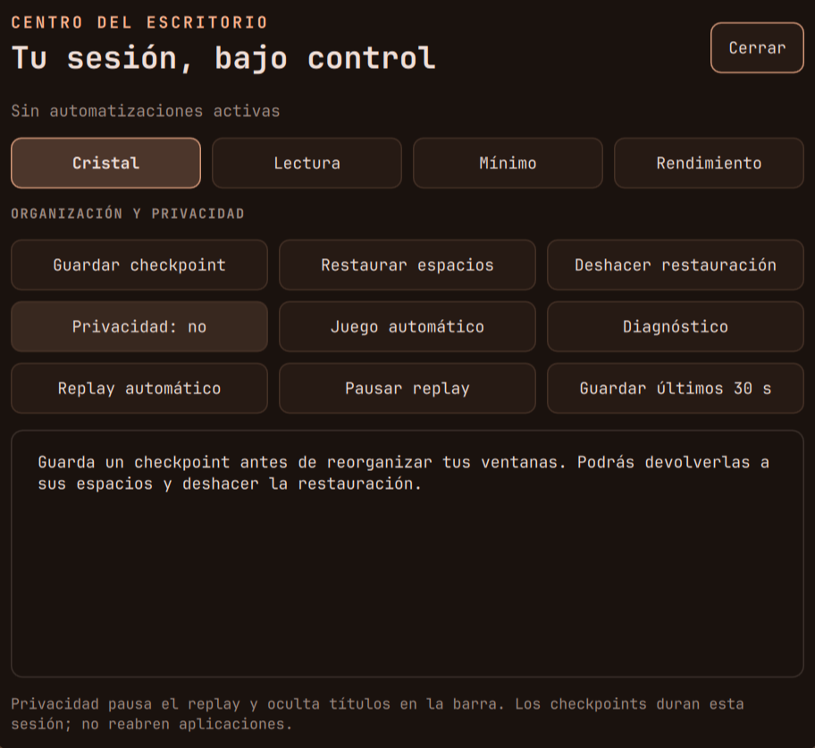

# Centro del escritorio y perfiles coordinados

Esta evolución añade un punto de control para perfiles, privacidad, replay, distribución de
ventanas y diagnóstico. Se abre con **SUPER+CTRL+ESPACIO**, pulsando el perfil en la barra o
buscando «Centro del escritorio» en el lanzador.



## Empezar a usarlo

1. Elige **Lectura** para ventanas opacas o **Cristal** para tu apariencia habitual.
2. Antes de reorganizar ventanas, pulsa **Guardar checkpoint**.
3. Cuando quieras volver, pulsa **Restaurar espacios**. Si cambias de idea, usa **Deshacer restauración**.
4. Activa **Privacidad** para pausar el replay, ocultar títulos de la barra y activar No molestar.
5. Consulta **Diagnóstico** si algo falla. El resultado se muestra en el panel y puede seleccionarse.

El panel admite Tab/Shift+Tab, Enter, Escape y **Alt+1…4** para elegir perfil mientras está abierto.
Los botones muestran ayuda al pasar el puntero. Las acciones indican su resultado y se ejecutan
de una en una. El panel usa un fondo opaco para mantener la lectura clara.

## Perfiles y automatizaciones

| Perfil | Comportamiento |
|---|---|
| Cristal | Transparencia, blur, sombras y animaciones de la apariencia habitual |
| Lectura | Ventanas opacas y sin blur; conserva animaciones y sombras salvo ahorro |
| Mínimo | Sin animaciones, blur ni sombras; opaco; pausa el replay automático |
| Rendimiento | Sin efectos; sin huecos generales; borde reducido; ventanas opacas |

El perfil visual no cambia el perfil energético del procesador. Este último sigue disponible en
el centro de control y mediante `powerprofilesctl`; no son el mismo ajuste.

Un coordinador calcula el resultado de los motivos activos:

- Batería elimina blur y sombras y pausa el replay **automático**.
- Juego elimina efectos y huecos y activa No molestar. Tiene selección explícita «sí», «no» o
  «automático». El botón **Juego automático** devuelve el control a la detección de Roblox.
- Presentación y concentración activan No molestar de forma independiente.
- Privacidad activa No molestar y pausa el replay incluso si lo encendiste manualmente.
- No molestar manual conserva su propio estado; las reglas por lugar usan otro motivo independiente.

Salir de un modo no cancela el silencio que otro todavía necesita. El centro de control distingue
el silencio automático del interruptor manual. Las notificaciones críticas mantienen su tratamiento
habitual: no es un filtro absoluto de toda información sensible.

Los cambios de modos ya no necesitan recargar toda la configuración. Perfil, privacidad y selección
de juego sobreviven a `hyprctl reload` dentro de la misma instancia. Al iniciar otra sesión se vuelve
a Cristal y juego automático. Batería, ventanas de juego y monitores se vuelven a detectar.

## Checkpoints: alcance preciso

Se guardan las ventanas normales existentes y su workspace. La restauración comprueba dirección,
PID y clase; omite ventanas cerradas o con identidad diferente y mueve sin seguir el foco.
Antes de restaurar guarda la distribución actual para poder deshacer. Las operaciones se serializan.

No guarda documentos, títulos, geometría, grupos, árbol del layout ni comandos de aplicaciones.
No reabre apps tras reiniciar ni sustituye respaldos. Se excluyen los workspaces especiales, también
los de concentración, para no interferir con ventanas ocultas por otro modo.

El checkpoint solo sirve en la misma instancia de Hyprland. Un nuevo login comienza sin checkpoint.
Deshacer recupera los espacios previos a la última restauración; volver a usarlo intercambia esas
dos distribuciones. Una aplicación cerrada no puede recuperarse con esta función.

## Replay con control de procesos

El modo **automático** graba con cargador y pausa por batería, privacidad o perfil Mínimo.
**Pausar replay** mantiene el apagado hasta que lo cambies. El atajo tradicional
`SUPER+ALT+PRINT` alterna una preferencia manual y muestra el resultado en el OSD.
`SUPER+SHIFT+PRINT` o **Guardar últimos 30 s** solicita guardar el buffer disponible.

El encendido manual puede superar el ahorro por batería; privacidad siempre impide grabar.
Salir de privacidad respeta la preferencia anterior, incluido un apagado manual.

El gestor verifica usuario, ejecutable, destino de replay y tiempo de inicio del proceso. Evita
duplicados mediante bloqueo de archivo y no usa un `pkill` general que detenga grabaciones ajenas.
Al migrar reconoce un replay anterior del mismo usuario y destino. Los errores de arranque quedan
en `replay.log` bajo el directorio runtime privado de la instancia.

## Bloqueo

Se retiró el IPC de prueba que liberaba la sesión a los 12 segundos. El script de bloqueo espera
la confirmación `secure` del compositor; «bloqueando» no significa «bloqueado». Si no hay un bloqueo
pendiente, utiliza hyprlock de respaldo. Si Quickshell queda pendiente sin confirmación, informa
el error y no lanza simultáneamente otro bloqueador que competiría por la sesión.

La recuperación TTY sigue en `~/.config/hypr/scripts/desbloqueo-emergencia.sh`. No se modificó PAM.
Las pruebas automatizadas simulan las respuestas; la comprobación física de contraseña, TTY,
suspensión y monitores debe hacerse con trabajo guardado.

La diferencia entre solicitar bloqueo y confirmarlo está descrita en
[WlSessionLock de Quickshell 0.3.2](https://quickshell.org/docs/v0.3.2/types/Quickshell.Wayland/WlSessionLock/).

## Comandos

```bash
~/.config/hypr/scripts/escritorio.py menu
~/.config/hypr/scripts/escritorio.py perfil lectura
~/.config/hypr/scripts/escritorio.py privacidad
~/.config/hypr/scripts/escritorio.py juego automatico
~/.config/hypr/scripts/escritorio.py checkpoint guardar
~/.config/hypr/scripts/escritorio.py checkpoint restaurar
~/.config/hypr/scripts/escritorio.py checkpoint deshacer
~/.config/hypr/scripts/escritorio.py diagnostico
~/.config/hypr/scripts/replay.sh auto
~/.config/hypr/scripts/replay.sh estado
```

`diagnostico` resume configuración, unidades fallidas, energía, pantallas, replay y bloqueo.
No vuelca títulos, SSID, IP ni registros completos. Una dependencia ausente se indica sin impedir
consultar las demás. No confirma por sí solo salud del disco, restauraciones o seguridad de red.

## Desarrollo y validación

- `modulos/politicas.lua`: motor puro y valores base de los perfiles.
- `modulos/escritorio.lua`: estado de la instancia, combinación de motivos y aplicación.
- `EstadoEscritorio.qml`: suscripción al estado mediante FileView; sin sondeo periódico.
- `CentroEscritorio.qml`: acciones, navegación y resultados.
- `scripts/escritorio.py`: CLI, diagnóstico y checkpoints sin ejecutar comandos guardados.
- `scripts/replay.py`: identidad de procesos y política de captura.

```bash
cd ~/dotfiles
lua tests/test_politicas.lua
python3 -m unittest discover -s tests -v
./instalar.sh --simular
hyprctl configerrors
```

El motor tiene pruebas de 384 combinaciones. Las regresiones verifican identidad de ventanas,
rechazo de datos inválidos, deshacer, dependencias ausentes, privacidad del replay y confirmación
del bloqueo. GitHub Actions comprueba políticas, regresiones y sintaxis Lua/shell/Python.
La simulación del instalador devuelve ahora 0 sin avisos y rechaza pasos desconocidos.

En esta máquina se comprobaron perfiles, batería+juego, No molestar por privacidad, pausa del
replay, estado reactivo QML y conservación tras reload. Se inspeccionó el panel y se guardó la
captura recortada. Qmllint no reportó errores de sintaxis en los componentes modificados;
sus advertencias sobre tipos de Quickshell/singletons no equivalen a una validación funcional total.
Los movimientos y deshacer de checkpoints se prueban con datos y comandos simulados; no se
reorganizaron las ventanas personales durante la validación.

## Recuperación y límites

Los archivos anteriores se copiaron a `~/.local/state/hypr-avanzado/respaldo-20261111-154302/`
antes de activar los cambios. Su `manifest.json` enumera originales y archivos nuevos.
Para revertir la configuración, restaura primero los originales enumerados conservando permisos,
retira después los archivos nuevos enumerados y ejecuta `hyprctl reload`. Quickshell recarga sus
fuentes al guardarlas. La copia es local y no se publica.

Los datos de la instancia están en `$XDG_RUNTIME_DIR`: perfiles y motivos en
`hypr-escritorio-<instancia>.state`, checkpoints en `hypr-checkpoints-<instancia>/` y control de
replay en `hypr-replay-<instancia>/`. Los datos personales y el estado generado quedan fuera de Git.

La [revisión inicial](revision-sistema-2026-11-11.md) sigue como registro histórico. Los errores USB,
la prueba de restauración externa y la hibernación requieren trabajo específico; estos cambios
no los dan por resueltos. La [ruta de aprendizaje](ruta-hyprland.md) permite seguir profundizando.
