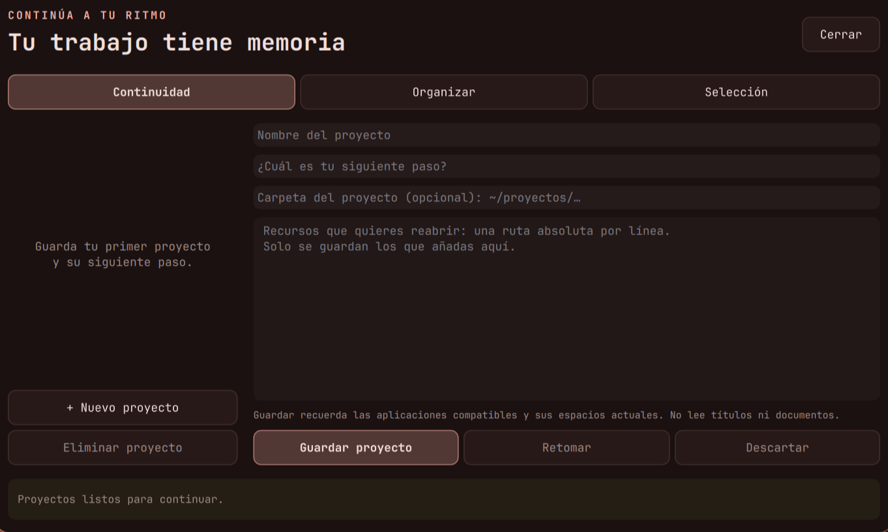
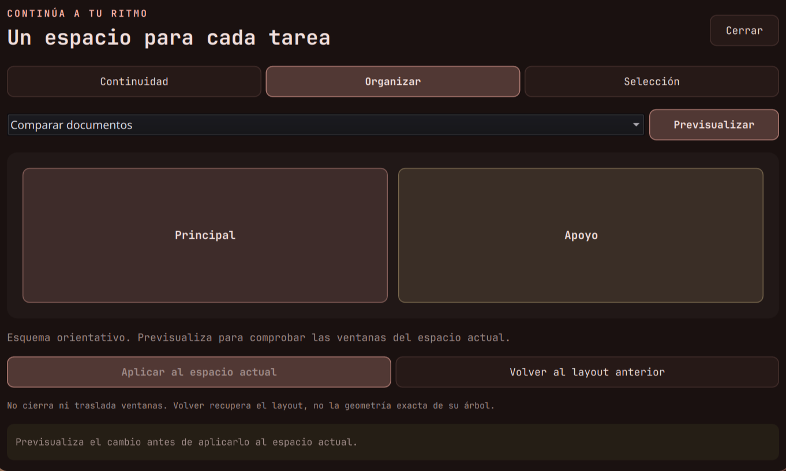

# Continuidad, organización y acciones de selección

Tres herramientas integradas en el escritorio. Se accede desde el lanzador o desde
**Proyectos y acciones** en la mesa de trabajo.

| Atajo | Abre |
|---|---|
| `SUPER+CTRL+Enter` | Proyectos y próxima tarea |
| `SUPER+CTRL+O` | Organizador del espacio actual |
| `SUPER+ALT+C` | Captura de selección y sus acciones |

## Continuar un proyecto



Escribe un nombre y el siguiente paso que quieres recordar. Puedes añadir una carpeta del
proyecto y hasta doce recursos existentes, una ruta absoluta o `~/…` por línea. **Guardar**
recuerda esos datos, el perfil visual actual y las aplicaciones compatibles con sus espacios.

Al volver, incluso después de reiniciar, el proyecto aparece en el panel. El resumen del día
incluye una tarjeta para revisarlo. No se abren aplicaciones automáticamente al iniciar sesión.
La privacidad oculta los detalles del proyecto y deshabilita su edición en pantalla.

**Retomar** aplica el perfil guardado y solicita abrir las aplicaciones que falten. Terminal,
Firefox, Code y Thunar son las aplicaciones compatibles. Las que ya existen en su espacio se
reutilizan; las demás se solicitan en el espacio guardado. Una carpeta se pasa al terminal,
editor o gestor de archivos. Los recursos fijados se abren con `xdg-open` por petición explícita.

Esto no restaura documentos sin guardar, pestañas del navegador ni el estado interno de las apps.
Firefox nuevo comienza con una ventana en blanco; su propia restauración de sesiones es otra
función. Aplicaciones de instancia única pueden decidir dónde mostrar una ventana. No se guardan
comandos de procesos ni se ejecutan comandos arbitrarios leídos del archivo del proyecto.

La captura es **explícita al guardar**: no hay seguimiento de títulos, documentos o historial.
Se conservan aplicación compatible, espacio, perfil y las rutas que escribas. Hasta treinta
proyectos se almacenan en `~/.local/state/mesa-trabajo/proyectos.json`, o bajo `$XDG_STATE_HOME`
si está definido, con escritura atómica y permisos 600. Ese archivo no va a GitHub.
Eliminar un proyecto requiere confirmación; cambiar de proyecto con edición pendiente requiere
guardar o descartar. Guarda antes de cerrar sesión: los campos sin guardar no son un borrador persistente.

## Organizar según la tarea



Elige una intención y pulsa **Previsualizar**. El panel muestra un esquema orientativo y comprueba
el espacio y las ventanas reales antes de habilitar **Aplicar**.

| Intención | Layout |
|---|---|
| Comparar documentos | Master: área principal y apoyo |
| Programar | Master: prefiere el editor como principal |
| Investigar | Scrolling: columnas navegables |
| Concentrarse | Monocle: una ventana ocupa el área disponible |

Se requieren al menos dos ventanas en mosaico, sin pantalla completa, en un espacio normal.
No se cierran ni trasladan ventanas, no se convierten las flotantes y no se cambian ajustes
globales de otros espacios. El esquema no promete una proporción exacta: se respetan las opciones
de los layouts que ya tengas configuradas.

La previsualización vale dos minutos. Si cambian el espacio o las ventanas participantes,
debes previsualizar otra vez. El editor se promociona sin expulsarlo si ya era principal,
usando la variante `ignoremaster` documentada en el
[layout Master](https://wiki.hypr.land/configuring/layouts/master-layout/).

**Volver al layout anterior** recupera el motor de distribución del mismo espacio. No reconstruye
el árbol exacto de divisiones, orden o tamaños. Esta recuperación es independiente del checkpoint
de espacios de la mesa. Los planes y la recuperación solo duran la instancia actual de Hyprland.
El comportamiento de foco de Monocle puede consultarse en su
[documentación](https://wiki.hypr.land/configuring/layouts/monocle-layout/).

## Acciones sobre una selección

Marca texto en una aplicación y pulsa **SUPER+ALT+C**. Se captura primero la selección primaria;
si no contiene texto se usa el portapapeles. Después aparece la vista previa, su origen y su tamaño.
No necesitas copiar si tu aplicación ofrece selección primaria. **Capturar de nuevo** permite
actualizar la entrada de forma explícita.

Acciones disponibles:

- copiar el texto exacto;
- añadirlo a notas o guardarlo como plantilla;
- pasar a mayúsculas, minúsculas o limpiar espacios, copiando el resultado;
- resumir, explicar o traducir mediante el asistente local ya configurado;
- abrir una URL `http`/`https` o una ruta existente cuando se reconoce como recurso.

Las acciones usan la captura revisada, aunque otra app cambie después el portapapeles. El texto
no se evalúa como código. No se admite `javascript:` como recurso. La vista previa muestra hasta
700 caracteres de una captura de hasta 32 000; los caracteres restantes también participan en
la acción. Las plantillas mantienen su propio límite de 16 000 y muestran un error si se supera.

La captura se guarda con permisos 600 en el directorio runtime de la instancia. Se retira al cerrar
el panel y deja de ser válida a los diez minutos. Si el panel se interrumpe antes de limpiar,
una lectura posterior detecta la caducidad y elimina el archivo. No hay lectura automática de
selecciones en segundo plano. La privacidad oculta la vista previa.

La IA utiliza Ollama local a través del panel existente. Abrir una URL sí puede contactar esa web;
guardar notas, convertir texto y crear plantillas no necesitan red. La entrada del asistente se
copia a su archivo runtime existente para que pueda procesarse después de cerrar este panel.
Copiar un resultado puede incorporarlo al historial habitual del portapapeles del escritorio.

## Validación y recuperación

Las regresiones comprueban persistencia y permisos de proyectos, argumentos con Unicode y
metacaracteres, aplicaciones permitidas, recursos inexistentes, ausencia de duplicados y retirada
de proyectos. También prueban caducidad y cambios del plan de organización, recuperación del
layout, selección exacta, tokens antiguos, limpieza y entrega del contexto al asistente local.

Los componentes QML se cargaron en Quickshell y se revisaron visualmente. Los cambios de ventanas,
la apertura de aplicaciones y las acciones de IA/portapapeles se validan con comandos simulados;
no se usaron documentos o selecciones personales como datos de prueba.

```bash
cd ~/dotfiles
python3 -m unittest discover -s tests -v
lua tests/test_politicas.lua
hyprctl configerrors
```

Los archivos anteriores a esta ampliación están en
`~/.local/state/hypr-avanzado/flujo-20261111-190454/`, con su manifiesto. La biblioteca de proyectos
se conserva por separado del código. Consulta también la [mesa de trabajo](mesa-de-trabajo.md).
