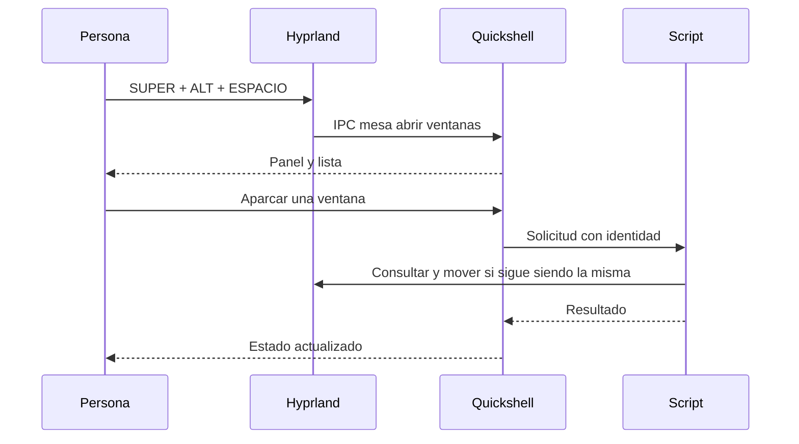

# Guía de estudio · Entender y construir tu escritorio

**Del primer atajo a una integración propia**

[Inicio](../README.md) · [Manual de usuario](manual.md) · [Manual técnico](manual-tecnico.md) · **Aprendizaje**

Esta guía explica cómo encajan las piezas del sistema y propone ejercicios sobre tu propio código.
No necesitas reinstalar el escritorio para aprenderlo: necesitas seguir sus entradas, sus cambios
de estado y sus salidas. Usa el manual de usuario para manejarlo y el técnico para localizar archivos.

## Índice

- [1. El mapa mental del sistema](#1-el-mapa-mental-del-sistema)
- [2. Seguir una acción de principio a fin](#2-seguir-una-acción-de-principio-a-fin)
- [3. Configuración, estado y datos derivados](#3-configuración-estado-y-datos-derivados)
- [4. Lua: eventos, funciones y políticas](#4-lua-eventos-funciones-y-políticas)
- [5. QML: propiedades, señales e interfaz reactiva](#5-qml-propiedades-señales-e-interfaz-reactiva)
- [6. Python y shell: integrar sin perder el control](#6-python-y-shell-integrar-sin-perder-el-control)
- [7. Automatización, búsqueda e IA local](#7-automatización-búsqueda-e-ia-local)
- [8. Recuperación y evidencias](#8-recuperación-y-evidencias)
- [9. Ruta práctica por etapas](#9-ruta-práctica-por-etapas)
  - [Etapa 0 · Establecer una base recuperable — 1 semana](#etapa-0--establecer-una-base-recuperable--1-semana)
  - [Etapa 1 · Dominar lo que ya usas — 1–2 semanas](#etapa-1--dominar-lo-que-ya-usas--12-semanas)
  - [Etapa 2 · Entender Linux, Wayland y el inicio de sesión — 2 semanas](#etapa-2--entender-linux-wayland-y-el-inicio-de-sesión--2-semanas)
  - [Etapa 3 · Lua y configuración mantenible — 2 semanas](#etapa-3--lua-y-configuración-mantenible--2-semanas)
  - [Etapa 4 · Ventanas, reglas, monitores y portales — 2 semanas](#etapa-4--ventanas-reglas-monitores-y-portales--2-semanas)
  - [Etapa 5 · Shell, Python e IPC fiables — 2–3 semanas](#etapa-5--shell-python-e-ipc-fiables--23-semanas)
  - [Etapa 6 · Quickshell y QML reactivo — 2–3 semanas](#etapa-6--quickshell-y-qml-reactivo--23-semanas)
  - [Etapa 7 · Rendimiento y batería con evidencia — 2 semanas](#etapa-7--rendimiento-y-batería-con-evidencia--2-semanas)
  - [Etapa 8 · Recuperación, Btrfs y administración de Arch — 2 semanas](#etapa-8--recuperación-btrfs-y-administración-de-arch--2-semanas)
  - [Etapa 9 · Seguridad práctica de la sesión — 1–2 semanas](#etapa-9--seguridad-práctica-de-la-sesión--12-semanas)
  - [Etapa 10 · Mantener y distribuir tu escritorio — 2 semanas](#etapa-10--mantener-y-distribuir-tu-escritorio--2-semanas)
  - [Etapa 11 · Desarrollo avanzado y contribución — itinerario abierto](#etapa-11--desarrollo-avanzado-y-contribución--itinerario-abierto)
  - [Primeros siete días](#primeros-siete-días)
  - [Seguimiento de dominio](#seguimiento-de-dominio)
- [10. Lectura guiada del código y autoevaluación](#10-lectura-guiada-del-código-y-autoevaluación)

## 1. El mapa mental del sistema

Piensa en cinco responsabilidades conectadas:

| Capa | Pregunta que resuelve | Ejemplo del proyecto |
|---|---|---|
| Sistema operativo | ¿Qué recursos y servicios existen? | Kernel, systemd, red, audio y almacenamiento |
| Sesión gráfica | ¿Dónde y cómo se dibuja cada ventana? | Hyprland, reglas, layouts y monitores |
| Interfaz | ¿Qué ve y pulsa la persona? | Barra, Mesa, Brújula y lanzador de Quickshell |
| Automatización | ¿Cómo se transforma una intención en acciones? | Scripts de captura, proyectos, contexto y actualización |
| Persistencia | ¿Qué se recuerda, dónde y durante cuánto tiempo? | Archivos runtime, bibliotecas, índices, snapshots y restic |

Una avería puede comenzar en una capa y manifestarse en otra. Si desaparece la barra pero puedes
mover ventanas con el teclado, Quickshell es una hipótesis más fuerte que un fallo completo del
compositor. Si la música no suena, no empieces editando la barra: mira primero la salida y los servicios.

**Explícalo con tus palabras:** ¿qué seguiría funcionando si Quickshell se cerrara? ¿Qué dejaría
de verse? Contrasta tu respuesta con `autostart.lua` y `shell.qml`.

## 2. Seguir una acción de principio a fin

### Caso A: abrir la Mesa

1. El teclado produce un evento; Hyprland reconoce SUPER+ALT+ESPACIO.
2. `modulos/escritorio.lua` tiene un `hl.bind` que solicita `qs ipc call mesa abrir ventanas`.
3. El `IpcHandler` de `shell.qml` recibe el objetivo `mesa`, cierra otros paneles y llama a Mesa.
4. `Mesa.qml` presenta ventanas y solicita datos o acciones a `mesa.py`.
5. Para una operación de ventana se consulta su identidad y se solicita la acción a Hyprland.
6. La interfaz muestra el resultado; aparcar mantiene viva la aplicación en un workspace especial.



**Por qué comprobar la identidad:** una dirección antigua no basta si una ventana cerró y otra
ocupó un identificador reutilizado. Dirección, PID y clase reducen ese riesgo. El registro no necesita
almacenar el contenido de documentos para recordar dónde devolver una ventana.

**Práctica:** sigue «Guardar checkpoint» desde el botón hasta el comando externo. Anota argumentos,
archivo escrito y criterio para omitir una ventana. No necesitas mover tus ventanas personales.

### Caso B: cambiar a Lectura

El panel llama al CLI del escritorio; este solicita una función exportada de Lua. El coordinador
cambia el perfil, el motor puro calcula las opciones y Hyprland las aplica. Se publica el estado;
`EstadoEscritorio.qml` lo observa y la interfaz marca el perfil activo. Replay y No molestar se
reconcilian con los motivos restantes.

Cambiar una opción visual aislada no equivale a cambiar todo el perfil. Por eso un coordinador
resulta más mantenible que varios scripts que intentan adivinar el modo mirando una animación.

## 3. Configuración, estado y datos derivados

**Configuración** indica qué debería suceder: `sesiones.lua` o `brujula.json`. **Estado** dice qué
ocurre ahora: reunión activa, perfil o token de selección. **Datos personales** son proyectos,
plantillas y notas. **Datos derivados** se calculan desde otros: índice de documentos o sugerencias.

| Pregunta | Ejemplo que debes localizar |
|---|---|
| ¿Debe sobrevivir al reinicio? | Proyecto guardado frente a checkpoint |
| ¿Debe sobrevivir a recargar? | Perfil de la instancia y cuenta atrás de reunión |
| ¿Cuándo deja de ser válido? | Plan de organización a los 2 min, selección a los 10 min |
| ¿Qué datos podrían revelar actividad? | Títulos de la línea, índice documental e historial |
| ¿Qué puedo reconstruir? | Índice, si conservo las fuentes y sus dependencias |
| ¿Qué no puedo reconstruir solo con Git? | Documento personal nunca añadido o cambio aún sin guardar |

Una escritura **atómica** prepara un archivo temporal y lo reemplaza completo: evita que otro
lector vea medio JSON. No resuelve por sí sola que dos escritores se pisen; para eso también se
necesita coordinación. Los permisos 600 limitan lectura al usuario propietario, pero no aíslan de
cualquier aplicación ejecutada como ese mismo usuario.

**Práctica:** dibuja el ciclo crear → leer → cambiar → caducar → borrar de una selección de Flujo.
Después compáralo con una plantilla. Explica por qué se conservan durante tiempos diferentes.

## 4. Lua: eventos, funciones y políticas

Un módulo puede devolver una tabla con funciones o publicar una referencia global para que una
expresión de `hyprctl` la alcance. `require` conecta esas piezas. Las variables locales separan
responsabilidades; `_G.escritorio` expone deliberadamente un punto de control.

`hl.bind` asocia eventos de entrada con acciones. `hl.on("hyprland.start", …)` asocia el inicio
con acciones una vez por sesión. Un timer ejecuta trabajo después o periódicamente. Pregunta
siempre **cuándo se ejecuta** una función: al cargar el módulo, al pulsar o al vencer el timer.

El motor `politicas.lua` es puro: con la misma entrada produce la misma salida sin mover ventanas.
Eso permite probar combinaciones sin tocar el escritorio. `escritorio.lua` reúne señales del mundo
y aplica el resultado. La separación facilita distinguir un cálculo erróneo de un fallo externo.

Ejemplo conceptual: reunión y concentración piden silencio. Terminar reunión retira su motivo,
pero concentración mantiene No molestar. Un único booleano modificado por dos programas perdería
esa información y podría mostrar avisos antes de tiempo.

**Práctica:** toma cuatro combinaciones de batería, juego y perfil. Predice blur, sombras y replay;
contrasta con las pruebas del motor. Explica por qué perfil Rendimiento y energía performance no
son la misma variable.

## 5. QML: propiedades, señales e interfaz reactiva

Una propiedad enlazada, como `visible: estado.activo`, se recalcula cuando cambia su dependencia.
Una señal comunica un evento; un handler reacciona. Un singleton mantiene una instancia común
para componentes que necesitan compartir datos.

`FileView` observa archivos, `Process` ejecuta programas y `IpcHandler` expone funciones. Deben
representar al menos espera, éxito, ausencia de servicio y error. Un comando lento no debería
bloquear la interacción ni lanzarse de nuevo si la consulta anterior sigue corriendo.

**No todo es una señal:** CPU y algunas herramientas externas se consultan por timers. Pregunta
qué ocurre con un panel cerrado, cuántos procesos se lanzan y si un intervalo es razonable. En
`Actualizaciones.qml`, `if (!lector.running)` evita solapar consultas de ese lector.

**Práctica:** compara el FileView de `EstadoEscritorio.qml` con el Timer de `Pausas.qml` y el
Process de `Actualizaciones.qml`. Explica qué desencadena cada actualización y cómo falla.

## 6. Python y shell: integrar sin perder el control

Un script recibe entradas, consulta el sistema, valida y solicita cambios. Los códigos de salida
forman parte de su contrato: «no hubo copia porque el disco no estaba» debe distinguirse de una
restauración certificada, aunque el timer no deba considerarlo un error fatal.

Estudia argumentos como listas, comillas, plazos, señales, bloqueo de archivos e idempotencia.
Texto seleccionado o una ruta con espacios no debe convertirse accidentalmente en una orden.
No confundas una simulación de comandos con haber abierto una aplicación o probado hardware.

El gestor de replay necesita saber **qué proceso es suyo**; matar cualquier proceso con el mismo
nombre podría detener una grabación distinta. El organizador necesita saber **si el plan sigue
siendo válido** antes de aplicarlo. Ambos son el mismo patrón: comprobar que el mundo sigue
coincidiendo con lo que se preparó.

**Práctica:** busca la validación del token de selección, el bloqueo de replay y el manejo de
una dependencia ausente. Escribe entrada, precondición, efecto y error esperado para cada uno.

## 7. Automatización, búsqueda e IA local

Brújula escucha actividad, evalúa reglas y recuerda valores anteriores. Una regla combina
condiciones; una espera de activación evita reaccionar a cada alt-tab y la gracia mantiene un
contexto durante una consulta breve en otra app. El orden de reglas decide prioridades por efecto.
Lugares es más sencillo: aplica una regla al cambiar de Wi-Fi; no tiene la misma restauración.

El índice FTS5 encuentra palabras en texto extraído. La búsqueda universal agrega fuentes con
un plazo para que una lenta no retrase toda la respuesta. Buscar un título de Firefox no equivale
a descargar y leer el contenido completo de todas sus páginas.

El asistente integrado procesa selección y preguntas con Ollama. Un **modelo generativo** redacta;
un **modelo de embeddings** convierte fragmentos en vectores para comparar significado. `memoria.py` combina esos vectores con FTS5 y `agente.py` usa herramientas desde el
panel de SUPER+O. Las consultas y aperturas son directas; los cambios pasan por propuestas
que la persona debe confirmar. Sigue `Agente.qml` → JSONL del backend → herramienta → resultado.

La privacidad depende de todo el recorrido: fuente, índice, fragmento, modelo, resultado y retención.
Un proceso local puede conservar información sensible sin enviarla a internet. Desactivar títulos
nuevos no borra automáticamente un índice o registro anterior.

**Práctica:** dibuja una búsqueda exacta y una semántica, con las bases que necesitan. Lee
`tests/test_agente.py`: identifica cómo demuestra que una acción no se ejecuta antes de confirmar
y cómo simula embeddings sin un modelo real. Explica qué
parte puede responder sin modelos, qué parte requiere Ollama y cómo mostrarías una fuente al usuario.

## 8. Recuperación y evidencias

Un checkpoint recuerda espacios de ventanas vivas; una sesión solicita abrir apps; un snapshot
recupera archivos en el mismo disco; una copia externa permite recuperar aunque el SSD falle.
Cada herramienta protege de un problema diferente y exige una prueba diferente.

Una captura prueba que una interfaz pudo mostrarse. Una prueba unitaria con procesos simulados
prueba la lógica bajo ese modelo. Una restauración real a otra carpeta prueba lectura y contenido
de ese archivo. Ninguna evidencia aislada certifica «todo el sistema».

Para tus prácticas usa esta ficha:

| Campo | Qué escribir |
|---|---|
| Pregunta | Una conducta concreta que quieres entender |
| Hipótesis | Qué capa y componente crees responsable |
| Cambio | Una variable o una modificación pequeña |
| Evidencia | Comando, prueba o comparación reproducible |
| Resultado | Qué observaste y qué todavía no demostraste |
| Reversión | Cómo volver a la configuración anterior |

**Ejercicio final de lectura:** explica por qué «systemd terminó con success», «restic creó una
copia» y «restauré un archivo y coincide» son afirmaciones distintas.

## 9. Ruta práctica por etapas

La ruta siguiente conserva los ejercicios de la documentación anterior, actualizados para las
correcciones ya presentes. Reserva unas 4–6 h semanales y adapta el ritmo a las entregas. Primero
aprende recuperación y uso; después código, medición y distribución. Las duraciones son orientativas,
no una certificación por tiempo transcurrido.

### Etapa 0 · Establecer una base recuperable — 1 semana

**Objetivo:** saber qué está funcionando y cómo volver a ello.

1. Lee el registro histórico y el estado actual de correcciones del manual técnico; clasifica H1–H9: corregir, investigar o aceptar con un motivo.
2. Distingue cambios pendientes tuyos y cambios del ejercicio con `git status` y `git diff`.
   No uses `git reset --hard` ni publiques un `git add .` sin revisar.
3. Guarda el trabajo y planifica una sesión para comprobar acceso TTY, kernel LTS y respaldo.
4. Revisa la corrección de H1: el IPC de prueba con liberación temporizada fue retirado.
   Comprueba la confirmación de bloqueo y planifica la prueba física de contraseña/TTY por separado.
5. Investiga el hub USB con conexión directa y después restaura un archivo desde restic.

Comprobaciones iniciales de solo lectura:

```bash
cd ~/dotfiles
git status --short
hyprctl version
hyprctl configerrors
systemctl --failed
systemctl --user --failed
systemctl list-timers --all
swapon --show
```

**Entrega:** lista de incidencias priorizada, un archivo recuperado y procedimiento TTY anotado.
**Pasas si:** puedes diferenciar «hay timer», «hubo copia» y «puedo restaurarla», y puedes recuperar
la sesión sin depender de que funcione el panel gráfico. Las pruebas que interrumpen la sesión
se hacen con trabajo guardado, no durante una actividad importante.

### Etapa 1 · Dominar lo que ya usas — 1–2 semanas

**Objetivo:** elegir herramientas del escritorio según la tarea.

Lee las secciones 4–9, 13 y 15–17 del [manual](manual.md). Practica con ventanas desechables:

- Haz una sesión de 30 minutos con foco, movimiento, intercambio y workspaces usando teclado.
- Resuelve la misma tarea con dwindle, master y scrolling; explica cuál te conviene y por qué.
- Crea un grupo, cambia pestañas y separa una ventana. Distingue grupo y workspace especial.
- Usa los scratchpads configurados y los submaps de lanzar/redimensionar; practica salir con Escape.
- Identifica qué hace la capa de teclado del sistema y qué hace Hyprland. keyd está
  desactivado por defecto: no supongas que sus capas opcionales estén aplicadas.
- Revisa los gestos que cierran ventanas y el uso de `SUPER` para evitar acciones accidentales.

Archivos: `modulos/atajos.lua`, `layouts.lua`, `scratchpads.lua`, `submaps.lua`, `entrada.lua`
dentro de [`hypr/.config/hypr`](../hypr/.config/hypr/).

**Entrega:** una chuleta personal de diez acciones y un flujo de trabajo universidad/programación.
**Pasas si:** puedes organizar y recuperar el foco de seis ventanas sin recurrir al ratón y
explicas la diferencia entre mover foco, mover ventana, intercambiar y mover workspace.

### Etapa 2 · Entender Linux, Wayland y el inicio de sesión — 2 semanas

**Objetivo:** localizar la capa responsable de un fallo.

Estudia procesos, señales, descriptores, permisos Unix, variables de entorno, sockets, unidades
y D-Bus. Dibuja esta cadena con tus componentes: firmware → cargador → kernel → systemd → SDDM
→ `start-hyprland` → compositor → shell → aplicaciones.

Prácticas:

1. Explica por qué Hyprland es el compositor y Quickshell construye la interfaz del escritorio.
2. Identifica tres clientes Wayland y alguno XWayland si lo hay, sin publicar sus títulos.
3. Sigue un atajo desde `hl.bind` hasta el script o `IpcHandler` que termina ejecutándolo.
4. Compara servicios de usuario, servicios del sistema y programas lanzados por autostart.
5. Lee la entrada de sesión en `/usr/share/wayland-sessions/` y comprueba el proceso real.
   No migres a UWSM por una receta genérica: primero entiende tu arranque actual y su ciclo de vida.

```bash
systemctl --user status pipewire wireplumber
systemctl --user status xdg-desktop-portal xdg-desktop-portal-hyprland
systemctl status sddm
hyprctl monitors
hyprctl devices
```

**Entrega:** diagrama de arquitectura con responsable, entrada, salida y log para cada componente.
**Pasas si:** ante «no hay audio», «no aparece la barra» y «no comparte pantalla» propones
comprobaciones distintas y justificas cuál harías primero.

### Etapa 3 · Lua y configuración mantenible — 2 semanas

**Objetivo:** modificar la configuración entendiendo su ciclo de vida.

Aprende tablas, funciones, cierres, módulos, `require`, alcance local/global, manejo de errores
y separación entre datos y acciones. Sigue las dependencias de `hyprland.lua`, `programas.lua`,
`utilidades.lua`, `colores.lua`, `autostart.lua` y `sesiones.lua`.

1. Dibuja qué módulos definen `_G` para llamadas externas y cuáles retornan una tabla.
2. Explica por qué `hyprland.start` evita duplicados al recargar y qué pasa con los timers.
3. Añade en una rama una sesión mínima para una aplicación inocua ya instalada; verifica que
   repetirla cuando la app está abierta no duplica ventanas.
4. Detecta los valores dependientes de máquina: monitor interno, rutas absolutas y apps opcionales.
5. Propón un módulo de datos de máquina; implementa solo un caso y verifica un valor de respaldo.

```bash
# Desde la raíz del repositorio; comprobar sintaxis no ejecuta el módulo.
luac -p hypr/.config/hypr/modulos/sesiones.lua
```

Los enlaces de stow apuntan al árbol de trabajo: **cambiar de rama o guardar Lua puede modificar
la sesión activa inmediatamente**. Para experimentar con APIs desconocidas usa un usuario de
pruebas o una VM. Una rama por sí sola no aísla el escritorio.

**Entrega:** módulo pequeño con propósito documentado y un commit que puedas revertir.
**Pasas si:** explicas cuándo se ejecuta el código y validas sintaxis, errores del compositor y
comportamiento. `luac -p` no conoce los objetos `hl` ni valida las APIs de Hyprland.

### Etapa 4 · Ventanas, reglas, monitores y portales — 2 semanas

**Objetivo:** automatizar ventanas sin reglas frágiles.

1. Usa `hyprctl -j clients` localmente para distinguir clase, título, workspace y XWayland.
2. Crea una regla estrecha para una app de prueba; comprueba ventanas normales, diálogos y segunda
   instancia. Evita depender de un título que cambia con el documento.
3. Revisa `reglas.lua`, `monitores.lua` y `presentacion.lua`; explica escala física/lógica,
   posiciones, espejo y extensión. En tu pantalla 1920×1080 con escala 1.5 el área lógica es menor.
4. Con un monitor disponible, ensaya conectar, duplicar, extender y desconectar. Comprueba foco,
   workspaces, bloqueo y presentación. Sin hardware, deja la prueba física como pendiente.
5. Comparte una ventana y una pantalla desde una aplicación de uso habitual; comprueba selección,
   audio cuando corresponda y finalización de captura. Un portal activo no garantiza todo eso.

**Entrega:** matriz de al menos seis casos con resultado y reversión de cada regla nueva.
**Pasas si:** puedes explicar qué parte resuelve el compositor, cuál el portal y cuál la app;
al desconectar un monitor conservas un escritorio utilizable.

### Etapa 5 · Shell, Python e IPC fiables — 2–3 semanas

**Objetivo:** que una automatización falle de forma comprensible.

Estudia códigos de salida, comillas, argumentos como listas, plazos, señales, archivos temporales,
escritura atómica, exclusión mutua e idempotencia. Usa como casos `replay.sh`, `bloquear.sh`,
`desbloqueo-emergencia.sh`, `tema.sh` y `tiempo-pantalla.py`.

1. Estudia la corrección de H4 en un entorno de pruebas: salida 0 al simular sin incidencias, salida no cero al
   fallar una etapa. Comprueba que no se instale ni se reconfigure nada en simulación.
2. Define cómo detectar **tu** proceso de replay y no cualquier grabador del mismo nombre.
3. Añade un plazo a una consulta externa que pueda colgarse y una respuesta útil ante fallo.
4. Construye un pequeño consumidor del socket de eventos de Hyprland que cuente cambios de
   workspace sin guardar títulos. Incluye desconexión y reconexión de la instancia.
5. Define un contrato IPC: argumentos admitidos, estados, errores y quién puede invocarlo.
6. Prueba nombres de archivo con espacios y comillas, ausencia de una dependencia y llamadas
   repetidas. No construyas comandos de shell concatenando texto no validado.

**Entrega:** una automatización mejorada y una prueba de fallo real en aislamiento.
**Pasas si:** funciona dos veces sin duplicar procesos, no bloquea la interfaz y no informa
«éxito» cuando la operación no ocurrió. Introduce ShellCheck cuando trabajes en scripts;
no estaba instalado en la revisión. Consulta `man bash` y `man systemd.service` locales.

### Etapa 6 · Quickshell y QML reactivo — 2–3 semanas

**Objetivo:** crear un componente entendiendo estado y actualizaciones.

Lee [`shell.qml`](../quickshell/.config/quickshell/shell.qml), `Sistema.qml`, `Cargador.qml`,
`Notificaciones.qml` y `Bloqueo.qml`. Estudia propiedades, bindings, señales, modelos, singleton,
`Process`, `FileView`, `IpcHandler` y ciclo de vida en la
[API oficial de tu versión](https://quickshell.org/docs/v0.3.2/types/).

1. Dibuja qué estado pertenece al componente, a un singleton o al sistema externo.
2. Construye un indicador pequeño de salud de sesión que no muestre información privada.
3. Haz que sus procesos tengan plazo, indiquen fallo y no se solapen entre actualizaciones.
4. Actualiza por eventos cuando exista una señal adecuada; justifica los sondeos restantes.
5. Pausa trabajo innecesario de paneles ocultos. Prueba abrir/cerrar y recargar varias veces.
6. Separa el diseño de previsualización del bloqueo real; prueba cada uno sin compartir una
   ruta de liberación automática en producción.

**Entrega:** componente nuevo, captura de la interfaz y medición de actualizaciones/procesos.
**Pasas si:** explicas por qué se recalcula cada binding, qué ocurre al recargar y cómo se
representa un servicio ausente. Usa `qmllint` con imports adecuados; errores de imports ausentes
no equivalen por sí mismos a errores funcionales del QML.

### Etapa 7 · Rendimiento y batería con evidencia — 2 semanas

**Objetivo:** decidir cambios usando mediciones comparables.

Tu Ryzen 7520U/Radeon 610M comparte memoria con la GPU. Ya hay ahorro por batería, efectos y
replay continuo. No necesitas más ajustes hasta medir los existentes.

Diseña cuatro escenarios: reposo normal, reposo sin replay, reposo sin efectos y tu carga real.
Mantén brillo, apps, red y perfil de energía; espera estabilización y mide al menos tres veces
cada escenario durante cinco minutos. Cambia una variable por comparación.

| Medida | Herramienta o fuente | Qué registrar |
|---|---|---|
| CPU / RAM | btop, `ps`, `free -h` | Intervalo y procesos; separar caché y memoria disponible |
| GPU | radeontop, si ya está instalado | Carga en reposo y con replay |
| Perfil | `powerprofilesctl get` | Perfil y cargador conectado/desconectado |
| Energía | UPower o sysfs de la batería | Tasa de descarga si está disponible; condiciones |
| Interacción | Tarea repetible de ventanas/vídeo | Tirones observados y forma de reproducirlos |

No prometas una autonomía exacta con cinco minutos ni uses porcentajes acumulados de `ps` como
medida instantánea. Conserva la configuración anterior para comparar.

**Entrega:** tabla de muestras, mediana y decisión justificada sobre replay/efectos/sondeo.
**Pasas si:** puedes demostrar una mejora reproducible o concluir que el cambio no aporta.

### Etapa 8 · Recuperación, Btrfs y administración de Arch — 2 semanas

**Objetivo:** sobrevivir una actualización o un error humano.

1. Explica subvolúmenes, snapshots, exclusión del swapfile y retención. Distingue raíz y home.
2. Recupera un archivo de prueba desde un snapshot y otro desde restic a destinos nuevos.
   Comprueba contenido; nunca ensayes restaurar toda la raíz sobre la sesión activa.
3. Verifica arranque de LTS y retorno al kernel habitual. Anota cómo acceder al menú oculto.
4. Con trabajo guardado, prueba suspensión y después hibernación; comprueba recuperación de apps,
   bloqueo, red y audio. No concluyas que hibernación funciona solo por tener swap.
5. Revisa mantenimiento de paquetes y AUR: lee cambios y PKGBUILD antes de actualizar. Evita
   actualizaciones parciales y comprende qué paquetes puedes recuperar de caché o snapshots.
6. Registra el plan si falla SSD: copia externa, clave recuperable y medio de instalación.

Para restic, usa la [guía oficial de restauración](https://restic.readthedocs.io/en/stable/050_restore.html)
y el wrapper del proyecto: `respaldo estado`, `respaldo lista`, `respaldo comprobar`.
Estas operaciones requieren acceso al disco y, en el wrapper actual, privilegios.

**Entrega:** procedimiento de recuperación con tiempos medidos y pruebas marcadas pendientes.
**Pasas si:** recuperas un archivo sin sobrescribir el original y explicas qué perderías si
desaparece el SSD. Consulta también `man snapper`, `man btrfs` y `man systemd-sleep` instalados.

### Etapa 9 · Seguridad práctica de la sesión — 1–2 semanas

**Objetivo:** conocer los límites de confianza del escritorio.

1. Define amenazas concretas: acceso físico al portátil, app del mismo usuario, red no confiable
   y publicación accidental. No atribuyas al bloqueo protección frente a un disco sin cifrar.
2. Revisa PAM y prueba bloqueo normal, antes de suspensión, fallo de shell y recuperación por TTY.
   Prueba ambos monitores cuando estén disponibles; éxito requiere bloqueo confirmado.
3. Inventaría IPC del compositor y de Quickshell, capturadores y herramientas que escriben texto.
4. Revisa UFW con privilegios y contrasta reglas con sockets escuchando. Comprueba las excepciones
   de KDE Connect, Syncthing y Tailscale según las redes donde realmente los necesitas.
5. Revisa retención del portapapeles, capturas y replay. Usa datos sintéticos al probar secretos.
6. Estudia permisos de Hyprland antes de activarlos; comprueba que capturas y portales siguen
   funcionando. Los permisos no aíslan sus sockets IPC por sí solos, según la
   [documentación oficial](https://wiki.hypr.land/configuring/core/advanced-configuration/permissions/).

**Entrega:** mapa de permisos y pruebas con resultados, sin publicar reglas que revelen tu red.
**Pasas si:** explicas qué protege cada capa y puedes explicar la retirada de la liberación temporizada del bloqueo
de producción y la evidencia de su regresión. No subas credenciales, claves restic, historiales ni configuración privada.

### Etapa 10 · Mantener y distribuir tu escritorio — 2 semanas

**Objetivo:** convertir los dotfiles en un proyecto reproducible.

1. Separa datos por máquina de configuración compartida: usuario, monitor, rutas y apps opcionales.
2. Haz que los modos juego/batería/presentación/concentración tengan estado explícito y un único
   cálculo de efectos y «No molestar». Prueba entrar/salir en distintos órdenes y recargar.
3. Mantén la referencia central del manual alineada con keyd, rotación de fondos y funciones opcionales realmente activas.
4. Define checks de sintaxis y enlaces documentales en CI. Añade regresiones para fallos reales:
   salida de simulación, procesos duplicados y composición de modos.
5. Instala en VM con usuario diferente. Primero simula; luego verifica instalación y segunda
   ejecución. Una VM no certifica batería, USB, GPU ni suspensión de tu portátil.
6. Publica una versión con dependencias, limitaciones, capturas y procedimiento de desinstalación
   o reversión. Revisa el diff y añade únicamente archivos previstos en cada commit.

**Entrega:** instalación repetible en entorno limpio y una versión etiquetada con pruebas.
**Pasas si:** otra persona puede reproducir el entorno sin usar tus rutas ni copiar secretos.

### Etapa 11 · Desarrollo avanzado y contribución — itinerario abierto

**Objetivo:** pasar de configurar Hyprland a extenderlo con una contribución mantenible.

Prerrequisitos: etapas anteriores, Git cómodo, lectura de documentación técnica y fundamentos
de C++ antes de modificar el compositor. Empieza por un cambio pequeño y verificable.

Elige un proyecto:

| Proyecto | Qué aprendes | Criterio de cierre |
|---|---|---|
| Coordinador de modos | Máquinas de estados, precedencias, IPC | Combinaciones y recargas mantienen estado correcto |
| Monitor de salud de sesión | IPC, D-Bus, procesos y observabilidad | Detecta un fallo inducido sin sondeo excesivo |
| Layout propio en Lua | Geometría y ciclo de ventanas | Abrir, cerrar, mover, fullscreen y multimonitor comprobados |
| Corrección upstream | Código del compositor, compilación y revisión | Reproductor mínimo, parche y validación según el proyecto |

Para el último: usa el código y las instrucciones de contribución de
[hyprwm/Hyprland](https://github.com/hyprwm/Hyprland) correspondientes a tu versión.
Compila en aislamiento; no sustituyas el compositor de la sesión de trabajo para experimentar.
Aprende a preparar un reproductor mínimo, leer backtraces y diferenciar fallo de app, shell,
compositor y controlador. Si desarrollas un plugin, estudia ABI y recompilación por versión.
Un plugin o un layout no es requisito para tener un buen escritorio: elige un problema real.

**Entrega:** proyecto con explicación de arquitectura, validación reproducible y limitaciones;
si corresponde, issue o PR upstream revisado según las normas del proyecto.
**Pasas si:** otra persona puede reproducir el problema y verificar tu solución sin tus dotfiles
completos. No necesitas que un mantenedor acepte el PR para demostrar ese aprendizaje.

### Primeros siete días

| Día | Trabajo | Resultado esperado |
|---|---|---|
| 1 | Leer arquitectura y estado de correcciones | Prioridades y dudas concretas |
| 2 | Revisar la corrección de H1 y sus regresiones | Bloqueo sin liberación temporizada de producción |
| 3 | Investigar USB directo/cable/hub | Comparación con horas y errores observados |
| 4 | Conectar respaldo y recuperar un archivo | Evidencia de restauración |
| 5 | Practicar teclado, layouts y grupos | Flujo diario elegido conscientemente |
| 6 | Seguir un atajo de Lua a IPC/QML | Explicación de extremo a extremo |
| 7 | Revisar entregas y planificar | Etapa de inicio y siguiente cambio pequeño |

No marques una tarea como terminada solo porque está documentada en esta ruta.

### Seguimiento de dominio

- [ ] Puedo recuperar la sesión desde TTY.
- [ ] Entiendo la corrección del bloqueo y validé su comportamiento de producción.
- [ ] Investigué los errores USB con una comparación controlada.
- [ ] Restauré un archivo desde una copia externa.
- [ ] Manejo ventanas y layouts con intención.
- [ ] Puedo explicar inicio de sesión, servicios y portales.
- [ ] Puedo escribir y depurar un módulo Lua pequeño.
- [ ] Puedo diseñar una regla sin depender de títulos frágiles.
- [ ] Mi automatización maneja fallos, plazos y llamadas repetidas.
- [ ] Mi componente QML maneja estado, recarga y servicio ausente.
- [ ] Medí rendimiento y energía con condiciones comparables.
- [ ] Probé recuperación con LTS y documenté suspensión/hibernación.
- [ ] Revisé permisos, sockets y privacidad de los datos generados.
- [ ] Instalé el escritorio en un entorno limpio con otro usuario.
- [ ] Puedo entregar una integración o corrección reproducible a otra persona.

Para cada casilla guarda fecha y evidencia. Esta lista describe habilidades por demostrar,
no certifica que las correcciones ya estén aplicadas.


## 10. Lectura guiada del código y autoevaluación

| Orden | Lee | Debes poder explicar |
|---|---|---|
| 1 | `hyprland.lua`, `programas.lua`, `autostart.lua` | Quién arranca y cuándo; qué se repite al recargar |
| 2 | `atajos.lua`, `layouts.lua`, `scratchpads.lua` | Diferencia entre entrada, distribución y espacio especial |
| 3 | `politicas.lua`, `escritorio.lua` y su prueba Lua | Estado, precedencias y efectos externos |
| 4 | `shell.qml`, `EstadoEscritorio.qml`, `CentroEscritorio.qml` | IPC, propiedades y estado compartido |
| 5 | `mesa.py`, `Mesa.qml`, `Reunion.qml` | Persistencia, identidad, tiempo y supervisión |
| 6 | `flujo.py`, `Flujo.qml`, `Continuidad.qml` | Validación, caducidad y recuperación parcial |
| 7 | `brujula.py`, `brujula.json`, `buscar.py`, `indice.py` | Eventos, reglas, fuentes y búsqueda |
| 8 | `Agente.qml`, `agente.py`, `memoria.py`, `test_agente.py` | Tools, propuestas, fuentes, fragmentos y separación entre lógica y modelo |
| 9 | `instalar.sh`, `sistema-base.sh`, `respaldo.sh` | Privilegios, idempotencia y recuperación |

Al terminar, responde sin mirar el código y luego verifica:

1. ¿Por qué reiniciar Quickshell no equivale a reiniciar Hyprland?
2. ¿Por qué una rama Git no aísla una configuración enlazada con Stow?
3. ¿Qué motivos pueden mantener No molestar después de terminar una reunión?
4. ¿Cuándo deja de servir un checkpoint y qué herramienta usarías al día siguiente?
5. ¿Qué conserva la biblioteca de proyectos y qué no puede recuperar?
6. ¿Qué historial puede seguir existiendo después de activar privacidad?
7. ¿Qué diferencia hay entre «está instalado», «está activo» y «lo probé funcionando»?
8. ¿Qué información necesitarías para instalarlo en otro usuario sin rutas de Oscar?

Para respuestas y rutas consulta el [manual técnico](manual-tecnico.md). Para practicar flujos
completos sigue los capítulos 23–27 del [manual de usuario](manual.md#23-centro-del-escritorio).
