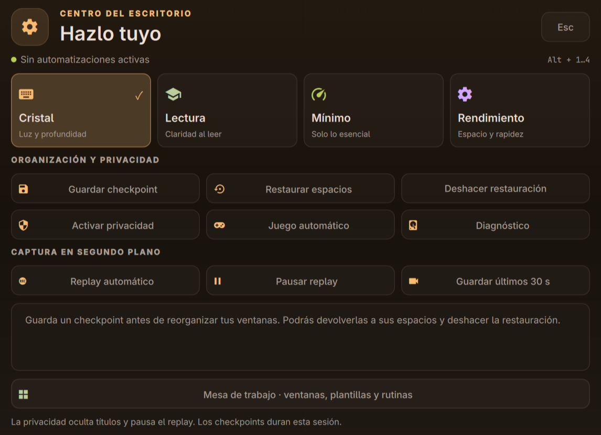
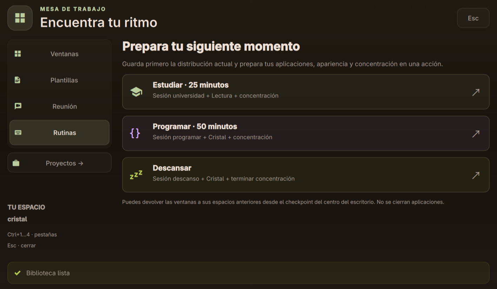
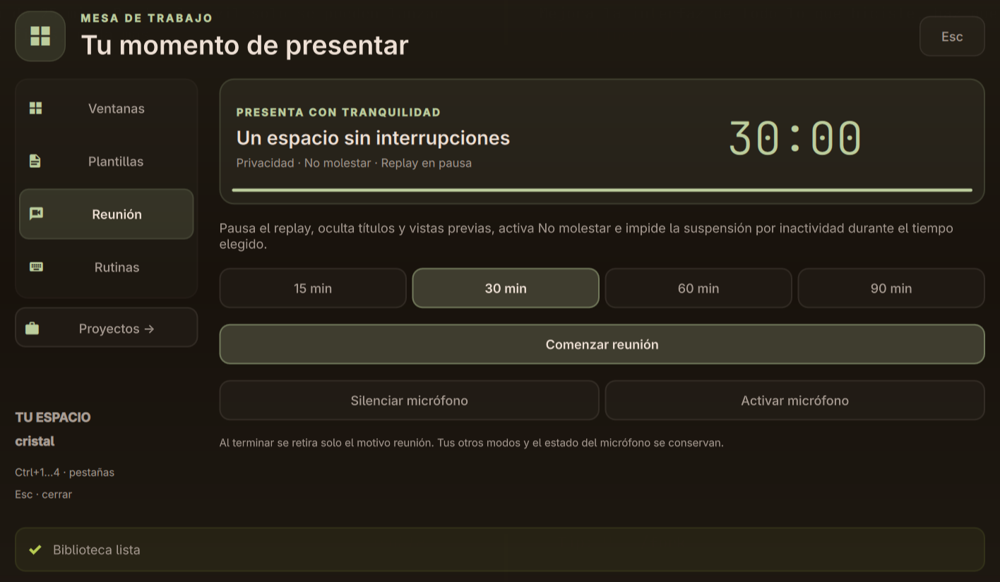
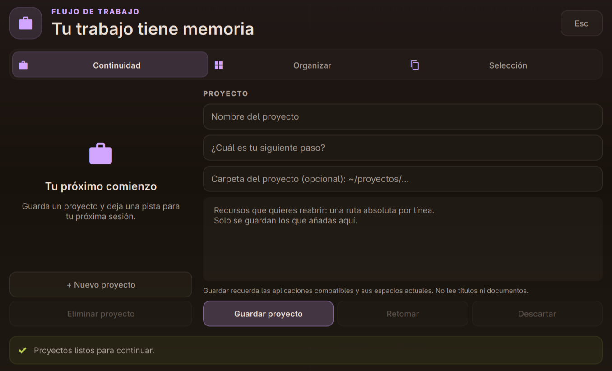
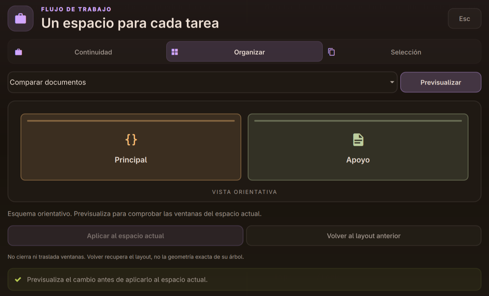

# Una interfaz más cuidada

El centro de control, Mesa, Flujo y el resumen del día comparten ahora tipografía,
espaciado y estados visuales. La paleta sigue viniendo del tema activo.

## Qué cambia

- **Centro del escritorio:** cuatro perfiles en tarjetas con icono, descripción y
  marca de selección; acciones separadas por propósito y resultados legibles.
- **Mesa:** navegación lateral con indicador deslizante, búsqueda con foco visible,
  ventanas con selección y respuesta al puntero, rutinas con iconos y acentos propios.
- **Reuniones:** tarjeta con contador, duración seleccionada y barra de tiempo restante
  cuando hay una reunión activa.
- **Flujo:** pestañas con iconos, bienvenida para una biblioteca vacía, campos con
  espaciado consistente y una vista orientativa de la organización por tarea.
- **Selección:** vista previa con margen interior, acciones de IA identificadas y
  controles desactivados claramente diferenciados.
- **Resumen diario:** cabecera más legible y tarjeta para continuar el último proyecto
  con respuesta al puntero y al foco del teclado.

Las transiciones de apertura y pestañas duran como máximo 220 ms; los cambios de
color y pulsación, 140 ms. Se desactivan con batería, juego activo y los perfiles
Mínimo o Rendimiento. No se añaden animaciones decorativas continuas.

Los paneles respetan la altura disponible. Cuando el contenido excede esa altura,
puede desplazarse; al avanzar con Tab se mantiene visible el control enfocado.
Esc y el clic fuera siguen cerrando los paneles.

## Capturas de la sesión real

Las capturas muestran paneles en reposo, sin títulos de ventanas, documentos ni
contenido del portapapeles.

## Componentes y mantenimiento

En `quickshell/.config/quickshell/`:

| Componente | Responsabilidad |
| --- | --- |
| `EstiloPanel.qml` | Tipografía, superficies, texto secundario y política de movimiento |
| `BotonPanel.qml` | Iconos, selección, foco, pulsación y texto completo en ayuda |
| `CampoPanel.qml` | Entrada de texto, selección y foco |
| `EncabezadoPanel.qml` | Cabecera, icono y cierre |
| `NavegacionPanel.qml` | Navegación horizontal o vertical con indicador animado |
| `EstadoPanel.qml` | Resultado, actividad o error, con símbolo además de color |
| `Superpuesta.qml` | Apertura, velo, límites de altura y desplazamiento |

`panelCuidado: true` activa el fondo degradado y el margen amplio en una
`Superpuesta`; `acentoPanel` elige su color. Las demás superpuestas conservan su
apariencia básica y aprovechan los límites de altura y la política de movimiento.
Se usa Adwaita Sans para la interfaz y la Nerd Font existente para los iconos.

Al añadir tipos QML nuevos, Quickshell puede necesitar reiniciarse si la recarga
en caliente conserva tipos anteriores. Este diseño ya quedó cargado en la sesión.

Referencias de Qt: [personalización de controles](https://doc.qt.io/qt-6/qml-qtquick-controls-control.html)
y [animaciones de propiedades](https://doc.qt.io/qt-6/qml-qtquick-behavior.html).

## Validación

- Ocho vistas abiertas por IPC en una instancia de vista previa independiente:
  cuatro de Mesa, tres de Flujo y el centro de control.
- Dieciséis combinaciones de perfil, batería y juego verificadas para el movimiento.
- Revisión visual en pantalla de 1920 × 1080 con escala 1,5 y capturas de la sesión real.
- Análisis de sintaxis QML y carga completa de la configuración en Quickshell.
- Suite de regresión de escritorio, Mesa y Flujo; 768 combinaciones del motor Lua.
- `./instalar.sh --simular` finalizó correctamente; `hyprctl configerrors` quedó vacío.

La revisión visual se hizo con el tema activo de esta sesión. Las operaciones que
abren aplicaciones, reorganizan ventanas o procesan texto conservan sus pruebas
anteriores; para esta revisión se abrieron vistas sin ejecutar esas acciones.

Guías: [centro de control](escritorio-avanzado.md), [Mesa](mesa-de-trabajo.md),
[Flujo](flujo-de-trabajo.md) y [ruta de aprendizaje](ruta-hyprland.md).
