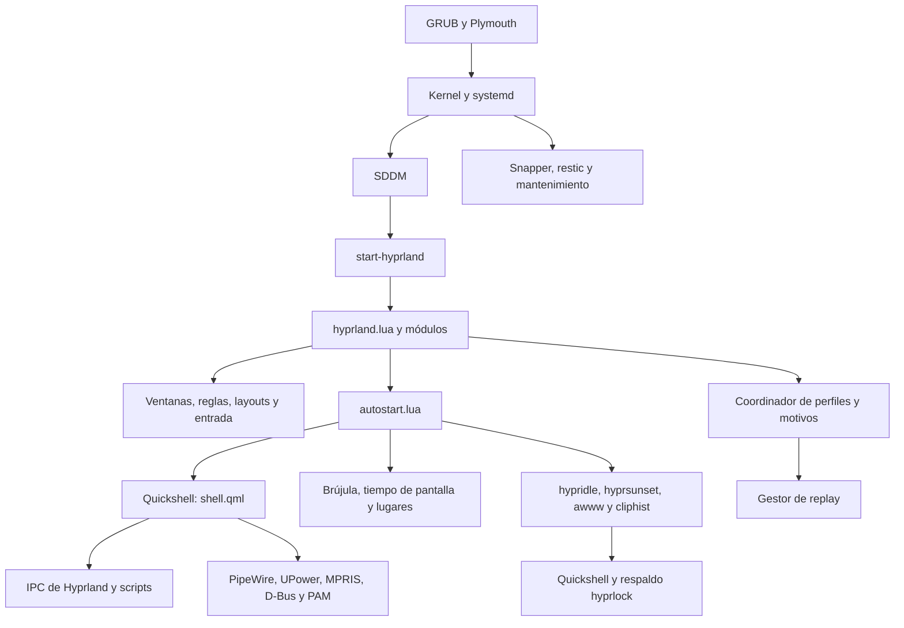
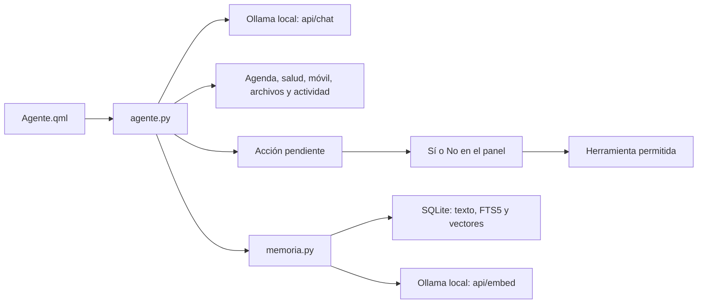
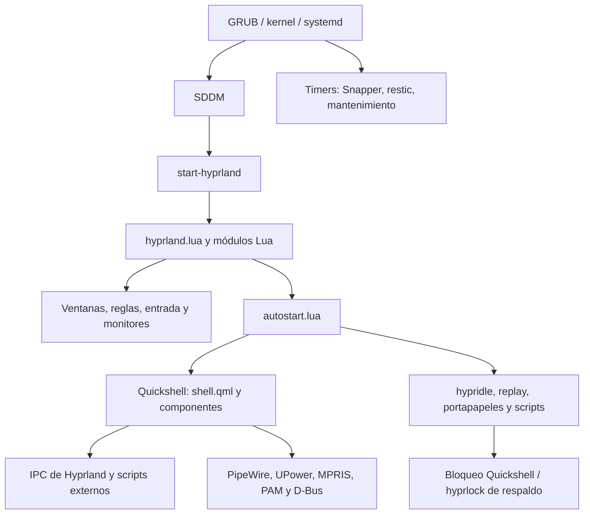

# Manual técnico · Arquitectura y mantenimiento

**Arch Linux · Hyprland en Lua · Quickshell/QML · GNU Stow**

[Inicio](../README.md) · [Manual de usuario](manual.md) · **Referencia técnica** · [Guía de estudio](guia-estudio.md)

Este documento reúne la estructura del repositorio, los contratos entre componentes, la instalación,
las herramientas de diagnóstico y el registro histórico. Describe el código inspeccionado; que una
función esté configurada no certifica su funcionamiento físico en cualquier equipo.

## Índice

- [1. Alcance y fuentes de verdad](#1-alcance-y-fuentes-de-verdad)
- [2. Arquitectura de extremo a extremo](#2-arquitectura-de-extremo-a-extremo)
- [3. Instalación y portabilidad](#3-instalación-y-portabilidad)
- [4. Mapa del repositorio](#4-mapa-del-repositorio)
- [5. Módulos de Hyprland](#5-módulos-de-hyprland)
- [6. Coordinación de modos, captura y bloqueo](#6-coordinación-de-modos-captura-y-bloqueo)
- [7. Interfaz y componentes QML](#7-interfaz-y-componentes-qml)
- [8. Automatizaciones, búsquedas e integraciones](#8-automatizaciones-búsquedas-e-integraciones)
- [9. Datos, persistencia y privacidad](#9-datos-persistencia-y-privacidad)
- [10. Referencia de comandos](#10-referencia-de-comandos)
- [11. Respaldo, snapshots y actualizaciones](#11-respaldo-snapshots-y-actualizaciones)
- [12. Diagnóstico y recuperación](#12-diagnóstico-y-recuperación)
- [13. Desarrollo y validación](#13-desarrollo-y-validación)
- [Apéndice B. Revisión histórica del 11 de noviembre de 2026](#apéndice-b-revisión-histórica-del-11-de-noviembre-de-2026)

## 1. Alcance y fuentes de verdad

La revisión documental se contrastó con `hyprland.lua`, sus módulos Lua, `shell.qml`, los componentes
QML, los scripts, la configuración de las aplicaciones, las pruebas y los instaladores.
El objetivo del proyecto es un equipo Arch personal; todavía existen supuestos de máquina y usuario.

| Información | Fuente principal |
|---|---|
| Comportamiento de ventanas y teclas | `hypr/.config/hypr/modulos/` |
| Interfaz e IPC | `quickshell/.config/quickshell/` |
| Automatización y CLI | `hypr/.config/hypr/scripts/` |
| Paquetes y configuración del sistema | `instalar.sh`, `instalar/` |
| Copias externas | `respaldo/` |
| Referencia documental de atajos | [Apéndice A del manual](manual.md#apéndice-a-todos-los-atajos) |
| Evidencia de regresiones | `tests/`, `.github/workflows/validar.yml` |

Las versiones de la revisión histórica son **Hyprland 0.57.2, Quickshell 0.3.2 y Neovim 0.12**
para la configuración del editor. Son contexto de compatibilidad, no versiones fijadas por un lockfile
para todo Arch. Consulta `hyprctl version`, `qs --version` y `nvim --version` en el destino.

## 2. Arquitectura de extremo a extremo



**Hyprland** compone ventanas, administra entrada, monitores, workspaces y efectos. **Quickshell**
construye la barra, los paneles y la interfaz de servicios. Los scripts realizan trabajo externo;
los singletons QML comparten estado. PipeWire/WirePlumber atienden audio; los portales median
operaciones como compartir pantalla. Que un portal esté activo no prueba una videollamada completa.

### Inicio y recarga

`hyprland.lua` carga módulos con `require`. `autostart.lua` usa `hyprland.start`: sus programas
se lanzan al iniciar, no en cada `hyprctl reload`. Abre Kitty y Firefox e inicia Quickshell,
awww, tiempo de pantalla, Brújula, hyprsunset, hypridle, portapapeles de texto e imagen,
hyprpolkitagent, systembus-notify, KDE Connect, sonido, lugares, udiskie y reconciliación de replay.

Los timers de los módulos se vuelven a configurar al recargar. La rotación de fondos usa
**17,5 minutos** en `tema.lua`. El tema horario está apagado por defecto; al habilitarlo cambia
a claro a las 6:30 y a oscuro a las 18:00, respetando cambios manuales hasta el siguiente cruce.

`shell.qml` instancia paneles, crea una barra y widgets por pantalla mediante `Variants` y fuerza
el uso de singletons que deben arrancar (Cargador, Recordatorios, Audifonos, Actualizaciones,
Pausas, Clima y Eventos). Guardar QML puede recargar la interfaz; añadir un tipo nuevo puede
requerir reiniciar Quickshell. Una rama Git no aísla los archivos que Stow enlaza a la sesión.

## 3. Instalación y portabilidad

### Requisitos y simulación

El instalador principal exige usuario sin root, `pacman`, internet para descargas y sudo para las
etapas de sistema. Clona en `~/dotfiles` si falta el repositorio. Arch con Btrfs, GRUB y el portátil
Lenovo son supuestos de varias etapas; revisa esos pasos antes de usarlos en otro equipo.

```bash
cd ~/dotfiles
./instalar.sh --simular
./instalar.sh --simular --sin-sistema
./instalar.sh --simular --solo dotfiles
```

Tras revisar la salida, las mismas opciones sin `--simular` aplican cambios. `--sin-sistema`
omite repositorios, listas de paquetes, sistema base y arranque, pero mantiene configuración,
tema, Buds y temas de aplicaciones, cuyos pasos pueden invocar instalaciones:
no significa «sin sudo» ni «solo enlaces». `--solo PASO` limita la ejecución a una etapa.
La simulación describe comandos, no instala ni certifica el equipo destino; puede consultar el
sistema y en alguna ruta auxiliar crear un directorio temporal.

### Etapas del instalador principal

| Etapa | Responsabilidad |
|---|---|
| `repos` | Activar multilib cuando falta y actualizar el sistema |
| `paquetes` | Instalar listas oficiales con pacman |
| `aur` | Preparar yay e instalar la lista AUR |
| `flatpak` | Configurar Flathub e instalar las apps listadas |
| `dotfiles` | Enlazar configuración con Stow y adaptar el perfil de Firefox |
| `tema` | Preparar fondos y aplicar la paleta |
| `buds` | Clonar/configurar Buds Manager desde su repositorio propio |
| `sistema` | Servicios y ajustes del escritorio |
| `base` | Ejecutar `instalar/sistema-base.sh` |
| `arranque` | Temas e integración de arranque |
| `apps` | Temas de Vesktop y Spotify mediante los scripts correspondientes |

Los conflictos de Stow se apartan a `~/.respaldo-dotfiles-FECHA/`; el registro de instalación
real va a `~/instalar-FECHA.log`. Repetir la instalación busca reutilizar lo existente, pero
se deben revisar avisos y diferencias. Pasos desconocidos se rechazan; una simulación sin avisos
tiene salida 0. El respaldo externo tiene instalador separado:

```bash
~/dotfiles/respaldo/instalar.sh [UUID] [carpeta]
```

### Qué instala el sistema base

| Área | Configuración prevista |
|---|---|
| Archivos y medios | USB/MTP, miniaturas, comprimidos; imv, zathura y mpv por defecto |
| Memoria | Zram con zstd y prioridad alta; parámetros de VM; earlyoom con preferencias de procesos |
| Snapshots | Configuraciones Snapper root/home, timeline/cleanup, snap-pac y grub-btrfs |
| Red | UFW, systemd-resolved y DNS-over-TLS; reglas para KDE Connect y Syncthing en rangos privados |
| Red privada | tailscaled y regla sobre tailscale0; el usuario aún debe autenticarse |
| Sincronización | Servicio de usuario Syncthing; carpetas y dispositivos se configuran aparte |
| Hardware | Regla udev para hub USB concreto; conservación de batería Lenovo |
| Mantenimiento | paccache, smartd, fwupd-refresh y reflector |
| Arranque | Menú GRUB oculto, espera de 1 s |
| IA | Ollama y modelo configurado; descarga inicial requiere red |
| Hibernación | Swapfile de 16 GiB en subvolumen propio y suspend-then-hibernate a las 2 h |
| Teclado | Bloque de keyd comentado: no se habilita por defecto |

Las excepciones de rangos privados del firewall no son una comprobación de que una red sea confiable.
El DNS cifrado protege consultas en tránsito; no proporciona anonimato de navegación.
Los snapshots del mismo SSD no reemplazan una copia externa.

### Trasladar a otra máquina

Revisa `monitores.lua` y las referencias a `eDP-1`, rutas de Flatpak en `entorno.lua`, el include
de Kitty en `/home/oscar/.local/state/tema/kitty.conf`, la ruta de Packet Tracer en `sesiones.lua`,
el perfil de Firefox, ciudad del clima, dispositivo SMART, conservación Lenovo, UUID de respaldo
y subvolúmenes Btrfs. Estos valores no deben copiarse como si fueran universales.

Regenera las listas conscientemente con `instalar/actualizar-listas.sh`: captura el equipo actual,
no solo las dependencias mínimas del escritorio. El instalador no restaura credenciales ni archivos
personales. Una VM sirve para validar instalación; no demuestra batería, GPU, USB ni suspensión física.

## 4. Mapa del repositorio

| Paquete (stow) | Qué configura |
|---|---|
| `hypr` | Hyprland en Lua, partido en módulos (`modulos/`), scripts, filtros de pantalla (`shaders/`), hyprlock, hypridle y los temas de arranque (`temas-arranque/`: SDDM, GRUB y Plymouth) |
| `tema` | Paletas Ayu (oscura y clara) y plantillas de matugen. `SUPER+SHIFT+T` cambia entre Ayu y los colores del wallpaper; `SUPER+CTRL+T` entre claro y oscuro (oscuro siempre, salvo que actives el horario con `tema.sh auto on`) |
| `swaync` · `swayosd` · `fuzzel` | De respaldo: Quickshell ya hace sus funciones (los scripts vuelven a fuzzel si Quickshell no responde) |
| `waybar` | La barra anterior, de respaldo (ya no arranca; ver `modulos/autostart.lua`) |
| `quickshell` | Todo el escritorio propio en QML: **barra** (workspaces, ventana, reloj, visualizador de audio, grabación, móvil, bandeja, Buds, volumen, red, brillo, batería, energía, CPU, RAM, modo juego, notificaciones), **dashboard** SUPER+D (reloj, clima, calendario con Google Calendar, sistema, tiempo de pantalla semanal, música con letra), **lanzador** SUPER+R (apps, cálculos, web, emojis, archivos, recordatorios), **chuleta** SUPER+H, **vista general** SUPER+ESPACIO, **OSD**, **notificaciones** y centro de control SUPER+N, **Wi-Fi/Bluetooth** SUPER+K, **pantalla de bloqueo**, selectores de **wallpapers**, **portapapeles** y menús, **widgets de escritorio** (reloj, clima, frase del día y lo próximo, solo con el workspace vacío), **asistente de IA local** SUPER+ALT+A, **agente con memoria** SUPER+O, **nota rápida** SUPER+SHIFT+O, **resumen del día** y aviso de **actualizaciones** en la barra |
| `kitty` · `zsh` | Terminal, prompt starship, plugins de zsh, fzf, zoxide, atuin (historial) y fastfetch |
| `yazi` | Gestor de archivos en la terminal (SUPER+SHIFT+E o `y`), con el acento de la paleta |
| `lugares` | Reglas por lugar: qué cambia al conectarte a cada Wi-Fi (`~/.config/lugares.conf`) |
| `satty` | Editor de capturas (flechas, texto, difuminar) con la paleta Ayu |
| `easyeffects` | Perfiles de sonido para las bocinas del portátil (música y voz) |
| `keyd/` | Capas de teclado: Bloq Mayús = Esc / Ctrl / flechas en HJKL (va a `/etc/keyd`, no es de stow). **Desactivado** desde el 10-11-2026: para usarlo, descomenta el paso 15 de `instalar/sistema-base.sh` |
| `udiskie` | Monta solos los USB y discos externos, con aviso |
| `gtk` | adw-gtk3 con colores Ayu e iconos Papirus-Ayu |
| `btop` · `nvim` · `vscode` · `firefox` · `vesktop` · `spicetify` | Apps con el tema Ayu |
| `wallpapers` | Mis fondos, en `~/Imágenes/wallpapers` |
| `instalar/` | Listas de paquetes y scripts de instalación (no es un paquete de stow) |
| `respaldo/` | Copias de seguridad automáticas al disco externo (restic; se instala con su `instalar.sh`) |

Además: `grub/` contiene un tema y utilidades históricas; la integración de arranque activa se
coordina desde `hypr/.config/hypr/temas-arranque/`. `tests/` contiene regresiones Python y Lua.
`docs/` contiene únicamente los tres documentos y sus capturas. Los temas de apps conservan
sus configuraciones propias: no todas siguen automáticamente el modo claro.

## 5. Módulos de Hyprland

Todos se encuentran en `hypr/.config/hypr/modulos/`.

| Archivo | Responsabilidad |
|---|---|
| `programas.lua` | Comandos base y modificador principal |
| `utilidades.lua` | Enfocar o abrir y construcción de atajos |
| `colores.lua` | Lectura de paleta y conversión de colores |
| `monitores.lua`, `entorno.lua` | Pantallas y variables de entorno |
| `autostart.lua` | Procesos del inicio de sesión |
| `apariencia.lua`, `animaciones.lua` | Geometría visual, opacidad, efectos y transiciones |
| `entrada.lua` | Teclado, touchpad, cursor y gestos |
| `sistema.lua` | Opciones generales, swallow y configuración del compositor |
| `reglas.lua` | Reglas de ventanas, capas y asignación de espacios |
| `atajos.lua`, `submaps.lua` | Acciones normales y modos lanzar/redimensionar |
| `layouts.lua` | Ciclo dwindle/master/scrolling/monocle y atajos dependientes del layout |
| `scratchpads.lua` | Terminal, música, notas, Yazi y espacio especial |
| `politicas.lua` | Motor puro: perfiles y combinación de motivos |
| `escritorio.lua` | Estado de instancia y aplicación del resultado de políticas |
| `modo_juego.lua` | Preferencia sí/no/automático y detección de Sober |
| `presentacion.lua` | Pantallas externas y motivo presentación |
| `bateria.lua` | Motivo batería del coordinador |
| `concentracion.lua` | Apartar/restaurar ventanas de apps distractoras |
| `sesiones.lua` | Sesiones universidad, programar y descanso |
| `shaders.lua` | Elección y persistencia del filtro GLSL |
| `tema.lua` | Teclas del tema, horario opcional y rotación de fondos |

Las sesiones reutilizan aplicaciones encontradas por clase; no restauran documentos ni aplican
una nueva URL si el navegador ya estaba abierto. Sus comandos viven en la configuración de confianza,
a diferencia de los proyectos persistentes, que solo permiten solicitudes de apps compatibles.

## 6. Coordinación de modos, captura y bloqueo

### Perfiles y motivos

`politicas.lua` calcula un resultado a partir del perfil visual y de batería, juego, presentación,
concentración, privacidad y reunión. `escritorio.lua` aplica opciones con `hl.config`, publica
estado y reconcilia notificaciones y replay. El motor Lua prueba **768 combinaciones**.

Los perfiles son Cristal, Lectura, Mínimo y Rendimiento. **No equivalen al perfil energético**
de `powerprofilesctl`. Juego tiene preferencia explícita `si`, `no` o `automatico`; el estado
no se deduce simplemente de si están activadas las animaciones. Los motivos de No molestar se
combinan para que terminar una reunión no apague el silencio de concentración o el manual.
Brújula y lugares aportan motivos propios de notificación.

Perfil, preferencia de juego y privacidad se recuperan de un archivo runtime dentro de la misma
instancia de Hyprland. Una nueva sesión vuelve a Cristal y juego automático; los motivos detectables
se consultan de nuevo. Reunión se guarda con caducidad y supervisor de systemd del usuario.

### Replay y grabación explícita

`replay.sh` delega en `replay.py`. Automático permite captura con cargador, salvo condiciones de
pausa; el encendido manual puede superar el ahorro por batería. Privacidad y reunión impiden
replay incluso si se pidió manualmente. Apagar o salir de un motivo respeta la preferencia previa.

El gestor usa bloqueo de archivo y verifica usuario, ejecutable, destino y tiempo de inicio para
no matar grabadores ajenos. `replay.log` queda en el runtime de la instancia. Guardar solicita el
buffer de hasta 30 s disponible; si acaba de arrancar no implica que ya haya 30 s grabados.
`grabar.sh` es el flujo separado de región/pantalla/audio/GIF y muestra estado en la barra.

### Bloqueo y autenticación

`hypridle.conf` solicita bloqueo con `bloquear.sh`. Este consulta Quickshell, espera confirmación
`secure` y diferencia `libre`, `bloqueando` y `bloqueado`. Usa hyprlock cuando no hay bloqueo
pendiente; no lanza dos bloqueadores simultáneos si el primero está pendiente sin confirmar.
El IPC antiguo `probar()` con liberación a los 12 s fue retirado del bloqueo de producción.

PAM verifica la contraseña. El envío automático se basa en la longitud aprendida, también usada
por la función `sudo` de Zsh; no guarda la contraseña. La recuperación TTY está en
`desbloqueo-emergencia.sh`, con restauración de bloqueo permitida por la configuración.
No se debe usar una captura o una prueba simulada como evidencia de bloqueo físico correcto.

## 7. Interfaz y componentes QML

| Familia | Componentes principales |
|---|---|
| Entrada y ventanas | `shell.qml`, `Lanzador.qml`, `Chuleta.qml`, `Vista.qml` |
| Barra | `Barra.qml`, `BarraEspacios.qml`, `BarraDerecha.qml`, `Modulo.qml` |
| Dashboard | `Dashboard.qml`, `Calendario.qml`, `Tiempo.qml`, `Musica.qml`, `Sistema.qml` |
| Servicios comunes | `Notificaciones.qml`, `Eventos.qml`, `Recordatorios.qml`, `Clima.qml` |
| Control y hardware | `CentroControl.qml`, `Conexiones.qml`, `Cargador.qml`, `Audifonos.qml`, `Movil.qml` |
| Productividad | `Mesa.qml`, `Reunion.qml`, `Flujo.qml`, `Continuidad.qml`, `Brujula.qml`, `Concentracion.qml` |
| Estado y perfiles | `EstadoEscritorio.qml`, `CentroEscritorio.qml` |
| Texto y resumen | `IA.qml`, `Agente.qml`, `NotaRapida.qml`, `Resumen.qml`, `Pausas.qml`, `Actualizaciones.qml` |
| Seguridad | `Bloqueo.qml`, `PantallaBloqueo.qml` |
| Selectores y avisos | `Portapapeles.qml`, `Wallpapers.qml`, `Menu.qml`, `OSD.qml`, `Emergentes.qml`, `NotiTarjeta.qml` |
| Fondo y diseño | `Escritorio.qml`, `Paleta.qml`, `Superpuesta.qml` y componentes de panel |

`Superpuesta.qml` limita la altura y permite desplazamiento; mantiene visible el control enfocado.
`EstiloPanel.qml` define tipografía y superficies; `BotonPanel`, `CampoPanel`, `EncabezadoPanel`,
`NavegacionPanel` y `EstadoPanel` comparten foco, estados y navegación. `panelCuidado: true` y
`acentoPanel` activan el estilo del panel. La interfaz usa Adwaita Sans e iconos de la Nerd Font.

El aspecto de cristal es común: `FondoPanel.qml` (sombra, degradado, luces radiales del acento y
filo de luz) es el fondo de `Superpuesta`, el dashboard, el lanzador, el centro de control, el OSD
y las notificaciones emergentes. `FondoBoton.qml` es el fondo de todos los botones,
`TarjetaPanel.qml` agrupa secciones dentro de un panel e `Interruptor.qml` es el conmutador sí/no.
La barra superior es transparente (42 px) con tres islas `IslaBarra.qml`: espacios y perfil (más
la ventana activa si cabe), reloj y estado. `DivisorBarra.qml` separa los grupos de módulos.
Las tarjetas son algo translúcidas (opacidad ≤ 0,86): la regla `quickshell-blur` de
`hypr/modulos/reglas.lua` difumina lo que hay detrás. El velo queda por debajo de 0,3 de opacidad
para que el blur actúe solo bajo la tarjeta. `EstiloPanel.efectos` quita sombras y luces en los
mismos casos que las animaciones.

Aperturas y cambios de pestaña duran hasta 220 ms; color y pulsación, 140 ms. Se desactivan por
batería, juego, Mínimo y Rendimiento. `EstadoEscritorio.qml` observa un archivo con FileView:
no requiere sondeo periódico. Otros datos de sistema sí usan timers o procesos externos.

Las capturas conservadas en [el manual de usuario](manual.md) muestran el centro, Mesa, reunión,
continuidad y organización. Proceden de la sesión anterior; esta consolidación documental no
certifica una nueva prueba visual ni altera el diseño de los paneles.

## 8. Automatizaciones, búsquedas e integraciones

### Catálogo de scripts por responsabilidad

Todos viven en `hypr/.config/hypr/scripts/` salvo donde se indique otra ruta.

| Grupo | Scripts | Papel |
|---|---|---|
| Mesa y continuidad | `mesa.py`, `flujo.py`, `escritorio.py` | Bibliotecas, ventanas, reuniones, proyectos, planes y checkpoints |
| Brújula | `brujula.py`, `sugerencias.py`, `salud.py` | Eventos, contexto, sesión, agenda y diagnóstico |
| Búsqueda | `buscar.py`, `indice.py` | Fuentes del lanzador y base documental FTS5 |
| IA y texto | `agente.py`, `memoria.py`, `ia.sh`, `ia.py`, `nota.sh`, `claves.sh`, `traducir.sh` | Asistente local, notas, contraseñas y traducción dedicada |
| Voz y OCR | `dictado.sh`, `dictado.py`, `ocr.sh` | Grabación/transcripción local y reconocimiento de imágenes |
| Captura | `capturas.sh`, `grabar.sh`, `replay.sh`, `replay.py`, `selector-color.sh` | Capturas, edición, vídeo y color |
| Apariencia | `tema.sh`, `wallpaper.sh`, `sonido.sh`, `luz-nocturna.sh` | Paletas, fondos, efectos de audio y temperatura de color |
| Hardware y red | `modo-energia.sh`, `conmutadores.sh`, `dns-cifrado.sh`, `lugar.sh` | Energía, radios, conservación y reglas por Wi-Fi |
| Móvil | `movil.sh`, `movil.py` | KDE Connect, avisos, respuestas y acciones explícitas |
| Sesión | `bloquear.sh`, `desbloqueo-emergencia.sh`, `inspector.sh`, `menu.sh` | Bloqueo, inspección y menús de acciones |
| Tiempo y calendario | `tiempo-pantalla.py`, `eventos.py` | Uso por app, límites y lectura iCal |
| Actualizar | `actualizaciones.sh`, `actualizar.py` | Consulta de pendientes y flujo interactivo de actualización |
| Compatibilidad | `modo-juego-waybar.sh`, `calendario.sh` | Integraciones de la barra anterior |

### Brújula y búsqueda universal

`brujula.py vigilar` consume eventos de Hyprland, mantiene contexto y sesión y revisa tareas
periódicas. `brujula.json` se relee aproximadamente cada 2 s. Las reglas combinan condiciones con
AND, esperan 4 s para activarse y priorizan el orden del archivo por efecto. Al retirarse intentan
restaurar el valor anterior sin pisar un cambio manual posterior.

La línea registra bloques de foco de más de 4 s y puede incluir títulos. Privacidad/reunión retiran
los títulos nuevos y ocultan la línea; bloquear interrumpe el registro. Eso **no borra datos anteriores**.
La exclusión de navegación privada depende de que pueda reconocerse: no es un aislamiento garantizado.
La configuración original conserva 30 días; las capturas periódicas están apagadas por defecto.
Si se habilitan, se cifran con OpenSSL y clave de anillo; sin anillo disponible se omiten. La vista
las descifra en runtime para mostrarlas y las elimina al cerrar.

La sesión se captura cada minuto y tras cambios de ventanas con retardo; usa Flatpak, `.desktop`
o terminal con directorio. Recuerda espacios y geometría compatible. La pila de ventanas cerradas
conserva 15 solicitudes reconocidas. Ni esto ni los proyectos recuperan documentos sin guardar.

`indice.py` extrae texto de PDF, docx, odt, pptx, odp, ods y archivos de texto en Documents, Desktop,
Downloads y sus equivalentes en español; indexa incrementalmente con SQLite FTS5. El vigilante lo
programa cada 30 min con prioridad baja. `buscar.py` combina fuentes en paralelo, con plazo de
1,5 s por fuente; tres letras sin prefijo activan la búsqueda universal.

### Agente y memoria integrados

`Agente.qml` está instanciado en `shell.qml`; el IPC `agente` admite `toggle`, `preguntar(texto)`
y `estado`. `escritorio.lua` asigna SUPER+O y el lanzador incluye su acción. El scratchpad de notas
usa SUPER+CTRL+SHIFT+O para evitar el conflicto con ese acceso.



**Protocolo:** `agente.py turno`, `confirmar si|no`, `nueva` y `precalentar` emiten eventos JSONL
`herramienta`, `texto`, `fuentes`, `confirmar`, `error` y `fin`. El historial usa `historial`,
`actual`, `abrir ID` (lo vuelve actual) y `borrar ID`, que imprimen un único JSON. El panel muestra respuesta progresiva,
fuentes pulsables y propuestas. El backend limita el bucle a seis pasos y conserva hasta 24 mensajes;
recorta texto de usuario a 4 000 y resultados de herramientas a 6 000 caracteres.

El modelo configurado en `~/.config/ia/agente` es `qwen3:4b-instruct`; necesita soporte de tools.
Usa contexto de 8 192, temperatura 0,3 y keep_alive de 20 min. Las instrucciones son estables para
aprovechar caché; fecha/hora acompañan cada mensaje. El panel prepara el modelo y conserva una
petición pendiente mientras calienta; no es una certificación de que el modelo esté disponible.
Los resultados reales se verifican mediante respuesta del servicio y comportamiento observado.

**Herramientas:** agenda, estado del equipo, línea, archivos, avisos del móvil, memoria y aperturas
se consultan sin confirmación. Concentración, sesión, ajuste, recordatorio, respuesta/envío móvil y
acciones de sistema pasan por propuesta. Se guarda nombre, argumentos y descripción; al confirmar
se prepara de nuevo la operación. Escribir otra petición cancela la propuesta anterior. Los wrappers
de algunas acciones no verifican exhaustivamente su resultado: «Hecho» indica una solicitud enviada,
no evidencia suficiente de entrega de un mensaje, suspensión o aplicación del ajuste.

`dictado.sh texto` implementa la entrada de voz: al terminar devuelve la transcripción a stdout;
no la escribe ni la copia como el flujo general. Comparte el mecanismo de grabación con el dictado
normal; su comportamiento se debe probar antes de mezclar ambos flujos simultáneamente.

**Memoria:** `memoria.py` usa NumPy, SQLite FTS5 y Ollama `/api/embed`. Divide en fragmentos de unos
900 caracteres con solape de 150, guarda embeddings float32 y combina ranking por significado y
palabras. Consulta documentos del índice, hasta 60 días de línea disponible y hasta 90 días de
historial Firefox. El código actual lee `~/.config/mozilla/firefox/*/places.sqlite`; otros lugares de
perfil no se descubren por esa función. No descarga el contenido de las webs ni indexa cliphist.

`brujula.py vigilar` solicita primero `indice.py` y, si termina correctamente, `memoria.py indexar`,
cada 30 min, con `nice 19` e `ionice` idle. La memoria usa un cerrojo para evitar indexaciones
simultáneas. Es incremental por firma de fuente y retira fuentes desaparecidas en una pasada completa
satisfactoria. Sin Ollama puede buscar por palabras en fragmentos ya existentes; no puede crear
embeddings nuevos. El filtro de URLs de acceso/pago es heurístico, no garantía de saneamiento.

### Dependencias y preparación del agente

El paquete `python-numpy` está instalado en el equipo inspeccionado, pero **no figura en la lista
actual de paquetes del instalador**. Para reproducir esta función en otro Arch, instala la dependencia
y descarga los dos modelos adicionales, además de preparar Ollama:

```bash
sudo pacman -S --needed python-numpy
sudo systemctl enable --now ollama
ollama pull qwen3:4b-instruct
ollama pull embeddinggemma
ollama list
~/.config/hypr/scripts/memoria.py estado
~/.config/hypr/scripts/memoria.py indexar
qs ipc call agente preguntar "¿Qué tengo mañana?"
```

Descargar modelos necesita internet y espacio; no se descarga automáticamente `embeddinggemma`
solo por existir `memoria.py`. Para cambiarlo, escribe su nombre en `~/.config/ia/embeddings` y
reconstruye el índice: firmas existentes no incluyen el modelo ni garantizan compatibilidad de
vectores de dimensiones diferentes.

### Datos y limpieza de memoria

La base reside en `$XDG_CACHE_HOME/brujula/memoria.db` (o `~/.cache/brujula/memoria.db`), con tablas
`fuentes`, `trozos` y `trozos_fts`, modo WAL y directorio privado. Conserva texto, títulos, referencias,
fechas y vectores: **no está cifrada por esta función**. No debe publicarse. Las conversaciones están en
`~/.local/state/brujula/agente/conversaciones/ID.json` (directorio 700, archivos 600, sin cifrar).
Cada una guarda `vista` (lo que pintó el panel, hasta 400 entradas), los últimos 24 mensajes del
modelo, la propuesta pendiente, el título (primera pregunta) y fechas. `actual` apunta a la que está
en curso. Se conservan las 100 más recientes.

`agente.py nueva` empieza otra conversación sin borrar la anterior; `borrar ID` la elimina. Ninguno
toca la base. Privacidad oculta la línea directa, pero no
revoca por sí sola las consultas a memoria ni borra material anterior. El índice elimina fuentes
que dejan de enumerarse al completar la actualización; no equivale a borrado seguro del SQLite.

Para reconstruir o retirar el índice, detén primero la indexación en ejecución y evita el siguiente
lanzamiento del vigilante mientras lo haces. Identifica la ruta según XDG; retira `memoria.db` y sus
archivos `memoria.db-wal` y `memoria.db-shm` solo cuando no haya procesos usándolos. Al volver a
indexar se recrean desde las fuentes. Eliminar el índice no elimina originales y estos lo repoblarán.
Si necesitas dejar de recopilar una fuente, modifica su enumerador o el lanzamiento periódico;
esta versión no ofrece un interruptor gráfico por fuente para la memoria.

### Integraciones de red y servicios

Clima consulta Open-Meteo; letras usa lrclib.net; calendario usa URLs iCal privadas. El dictado
transcribe con Whisper; la traducción dedicada usa red, mientras la traducción del asistente usa
Ollama local. Los modelos deben descargarse previamente. KDE Connect expone acciones explícitas:
responder mensajes necesita una acción compatible en la notificación del móvil y permisos de Android.
No se envían respuestas simplemente por abrir el panel.

Lugares escucha cambios de NetworkManager; al iniciar solo apunta la red. Aplica energía, volumen
si detecta bocinas y motivo de silencio; no implementa una restauración general al salir de la red.
Pausas usa inactividad de 180 s y aviso tras 50 min; Actualizaciones consulta al minuto del arranque
y cada 3 h. El resumen diario empieza desde las 5:00 y las sugerencias de Brújula desde las 6:00.

## 9. Datos, persistencia y privacidad

| Ruta o grupo | Datos y ciclo de vida |
|---|---|
| `$XDG_STATE_HOME/mesa-trabajo/` o `~/.local/state/mesa-trabajo/` | Proyectos y plantillas persistentes; JSON atómico y permisos 600 |
| `~/.local/state/brujula/` | Línea, sesión, reglas activas, cierres y registro de actualizaciones; directorio privado |
| `$XDG_CACHE_HOME/brujula/memoria.db` o `~/.cache/brujula/memoria.db` | Fragmentos, fuentes y vectores de la memoria semántica; persistentes, sin cifrado propio |
| `~/.local/state/brujula/agente/` | Historial del agente: conversaciones, propuesta pendiente y la actual; `agente.py borrar ID` quita una |
| `~/.config/ia/agente`, `~/.config/ia/embeddings` | Modelo del agente y override opcional de embeddings |
| `~/.cache/brujula/documentos.db` | Texto documental derivado en SQLite FTS5 |
| `$XDG_RUNTIME_DIR/hypr-escritorio-<instancia>.state` | Perfil, juego y motivos; sobrevive a reload, no a nuevo login |
| `$XDG_RUNTIME_DIR/hypr-checkpoints-<instancia>/` | Ventanas y espacios de checkpoint/deshacer |
| `$XDG_RUNTIME_DIR/hypr-replay-<instancia>/` | Estado del proceso y registro del replay |
| `$XDG_RUNTIME_DIR/hypr-reunion-<instancia>.json` | Cuenta atrás de reunión por instancia |
| Runtime de Flujo | Selección temporal, token y planes; selección caduca a los 10 min, plan a los 2 min |
| `~/.local/state/tema/` | Variante, paleta y configuración generada de aplicaciones |
| `~/.local/state/bloqueo/longitud` | Longitud aprendida; no contraseña |
| `~/.config/calendario/url` | URL iCal secreta, una por línea; no publicar |
| `~/.config/ia/modelo`, `~/.config/dictado/modelo` | Modelo local del asistente y del dictado |
| `~/.config/tiempo-pantalla/limites.json` | Minutos diarios por clase de app |
| `~/Documents/notas.md` | Notas escritas explícitamente por el usuario |
| cliphist, Atuin y datos de apps | Historial personal persistente; no son archivos de configuración para publicar |
| `~/Imágenes/screenshots`, `~/Videos/Replays`, `~/Videos/Grabaciones` | Capturas y grabaciones guardadas explícitamente |
| `/etc/respaldo/` | Configuración, exclusiones y clave de restic |
| `/var/lib/respaldo/` | Marca de última copia, metadatos y errores |

El soporte XDG depende de cada componente: no todos los scripts sustituyen rutas fijas por variables.
Privacidad oculta títulos y vistas previas, aporta silencio y detiene replay, pero no convierte
las aplicaciones compartidas directamente en contenido oculto. Copiar una plantilla o respuesta
puede incorporarla a cliphist. No usar plantillas como gestor de contraseñas.

Límites relevantes: 30 proyectos, hasta 12 recursos por proyecto; 200 plantillas, nombre de 100 y
contenido de 16 000 caracteres; selección de 32 000 con vista previa de 700. Los proyectos solo
solicitan apps permitidas y rutas revisadas; no ejecutan comandos guardados en su JSON.

## 10. Referencia de comandos

Las rutas abreviadas de scripts de las tablas siguientes se ejecutan bajo `~/.config/hypr/scripts/`.
Consulta `qs ipc show` para obtener los objetivos realmente cargados en tu sesión.

### Quickshell desde la terminal (`qs ipc call …`)

Sirven para atajos, scripts o pruebas. Lista en vivo: `qs ipc show`.

| Comando | Qué hace |
|---|---|
| `qs ipc call dashboard toggle` · `abrir` · `cerrar` | Dashboard |
| `qs ipc call dashboard irA 3` | Ir al workspace 3 |
| `qs ipc call ia abrir <accion> "pregunta"` · `estado` | Panel del asistente (lo normal es usar `ia.sh`) |
| `qs ipc call nota abrir` · `resumen mostrar` | Nota rápida / resumen del día |
| `qs ipc call actualizaciones refrescar` · `estado` · `pausas estado` | Volver a comprobar actualizaciones / minutos seguidos de uso |
| `qs ipc call escritorio toggle` · `estado` | Esconder / mostrar los widgets de escritorio |
| `qs ipc call menu shaders` · `sonido <perfil>` | Menús de filtro de pantalla y de sonido |
| `qs ipc call lanzador toggle` | Lanzador de apps |
| `qs ipc call lanzador buscar fire` | Abrir el lanzador con un texto ya escrito |
| `qs ipc call lanzador lanzar btop` | Abrir directamente el primer resultado |
| `qs ipc call wallpapers toggle` | Selector de wallpapers |
| `qs ipc call portapapeles toggle` | Historial del portapapeles |
| `qs ipc call portapapeles copiarId 204` | Copiar la entrada 204 de cliphist |
| `qs ipc call conexiones toggle` / `wifi` / `bluetooth` | Panel de Wi-Fi y Bluetooth (en esa pestaña) |
| `qs ipc call cargador estado` | ¿Con batería o cargador? (y el perfil que se restaurará) |
| `qs ipc call cargador simular bat` · `ac` | Probar el cambio sin desenchufar |
| `qs ipc call chuleta toggle` · `buscar captura` | Chuleta de atajos (con una búsqueda ya escrita) |
| `qs ipc call vista toggle` | Vista general |
| `qs ipc call recordatorios agregar "20m beber agua"` · `lista` · `borrar ID` | Recordatorios |
| `qs ipc call menu grabar` · `pantalla HDMI-A-1` | Menú de grabar / de pantalla externa |
| `qs ipc call conexiones estado` | Resumen: tarjeta Wi-Fi, redes vistas, Bluetooth, dispositivos |
| `qs ipc call menu capturas` · `concentracion` · `cerrar` | Menús |
| `qs ipc call notificaciones toggle` | Centro de control |
| `qs ipc call notificaciones noMolestar` · `noMolestarSi` · `noMolestarNo` | No molestar manual: alternar / activar / desactivar; no cancela motivos automáticos |
| `qs ipc call notificaciones borrar` | Borrar todas las notificaciones |
| `qs ipc call concentracion empezar 25` | Empezar una sesión de 25 min |
| `qs ipc call concentracion sumar 10` · `terminar` · `estado` | Añadir tiempo / terminar / ver lo que queda |
| `qs ipc call bloqueo bloquear` | Bloquear con la pantalla de Quickshell |
| `qs ipc call bloqueo estado` | `libre`, `bloqueando` o `bloqueado` |
| `qs ipc call osd brillo` · `bloqMayus` · `media` | Mostrar en el OSD el brillo / Bloq Mayús / la canción |
| `qs ipc call osd mensaje "Hola" f04fe` | Aviso libre en el OSD (icono = código Nerd Font en hex) |
| `qs ipc call barra refrescar buds` | Refrescar un módulo de la barra: `buds`, `modo-juego`, `red`, `brillo`, `grabacion` o `todo` |

### Hyprland desde la terminal

| Comando | Qué hace |
|---|---|
| `hyprctl dispatch 'hl.dsp.focus({ workspace = 3 })'` | Cualquier acción de Hyprland (con config Lua se escribe en Lua) |
| `hyprctl dispatch 'modo_juego.alternar() or hl.dsp.no_op()'` | Alternar el modo juego |
| `hyprctl dispatch 'concentracion.empezar() or hl.dsp.no_op()'` · `terminar()` | Esconder / devolver las apps que distraen (sin temporizador) |
| `hyprctl dispatch 'hl.dsp.submap("reset")'` | Salir de un modo (submap) si te quedas atrapado |
| `hyprctl clients` · `activewindow -j` · `monitors` · `layers` · `binds -j` · `devices` | Inspeccionar ventanas, monitores, capas, atajos, teclados |
| `hyprctl configerrors` · `hyprctl reload` | Ver errores de la config / recargarla |

### Scripts (`~/.config/hypr/scripts/`)

| Comando | Qué hace |
|---|---|
| `tema.sh ayu` · `wallpaper` · `alternar` · `estado` | Colores fijos Ayu / del wallpaper / cambiar / ver modo, variante y si es automático |
| `tema.sh claro` · `oscuro` · `variante` | Tema claro / oscuro / cambiar |
| `tema.sh auto on` · `off` · `estado` | Claro de día y oscuro de noche, sí/no |
| `ia.sh` · `resumir` · `corregir` · `mejorar` · `explicar` · `traducir` · `preguntar [texto]` | Asistente local sobre la selección. Modelo en `~/.config/ia/modelo` |
| `nota.sh "texto"` · `seleccion` | Apuntar una línea / la selección en `notas.md` |
| `claves.sh configurar` | Guía para dejar listo el gestor de contraseñas (Bitwarden con `rbw`, o `pass`) |
| `lugar.sh estado` · `aplicar` | Red y lugar actuales / aplicar su regla ahora |
| `actualizaciones.sh` · `instalar` | Pendientes en JSON / actualizar en una terminal |
| `movil.sh menu` · `portapapeles` · `elegir` · `navegar` | Menú del móvil / enviar lo copiado / enviar archivo / ver sus archivos |
| `menu.sh "Título" '[…json…]'` | Abrir el menú de Quickshell con tus propias opciones |
| `buscar.py <tipo> <texto>` | El buscador del lanzador (ventanas, notas, portapapeles, pestanas, claves) |
| `sonido.sh Portatil` · `Voz` · `off` · `menu` · `estado` | Perfil de sonido de las bocinas (EasyEffects) |
| `tema.sh aplicar [imagen]` | Regenerar la paleta en el modo actual |
| `wallpaper.sh` · `aleatorio` · `poner <ruta>` | Selector / uno al azar / poner ese |
| `capturas.sh` · `region` · `pantalla` · `ventana` · `temporizador` · `anotar` | Menú / captura directa / región al editor |
| `capturas.sh editar <archivo>` | Abrir una captura ya hecha en el editor (satty) |
| `replay.sh auto` · `start` · `stop` · `save` · `toggle` · `estado` | Replay: automático / encendido manual / apagado manual / guardar 30 s / alternar / consultar |
| `conmutadores.sh todos` | Estado de Wi-Fi, Bluetooth, replay y rendimiento |
| `conmutadores.sh wifi on` · `off` · `estado` | Igual para `bluetooth`, `replay`, `rendimiento`, `conservacion` (batería hasta ~80 %), `luz` |
| `dns-cifrado.sh on` · `off` · `estado` | DNS cifrado (alias `dns-cifrado` en zsh) |
| `modo-energia.sh` | Siguiente modo de energía |
| `inspector.sh` | Datos de la ventana activa (lo que hace `SUPER+I`) |
| `bloquear.sh` | Bloquear (Quickshell; si no responde, hyprlock) |
| `desbloqueo-emergencia.sh` | Recuperar la sesión desde una TTY (ver más arriba) |
| `tiempo-pantalla.py --hoy` · `--semana` | Tiempo de pantalla de hoy por app / últimos 7 días (JSON) |
| `ocr.sh [idioma]` | Texto de una zona de la pantalla al portapapeles (por defecto `spa+eng`) |
| `dictado.sh` · `cancelar` | Empezar/terminar el dictado. Modelo en `~/.config/dictado/modelo` (`small` preciso · `base` rápido) |
| `traducir.sh [idioma]` | Traducir la selección (forzar destino: `en`, `fr`…) |
| `grabar.sh` · `region` · `pantalla` · `region-audio` · `pantalla-audio` · `gif` · `parar` · `estado` | Grabar pantalla |
| `eventos.py --lista` | Tus próximos eventos de Google Calendar (dirección en `~/.config/calendario/url`, privada) |
| `movil.sh estado` · `sonar` · `enviar archivo` · `app` | Móvil por KDE Connect |
| `tiempo-pantalla.py` | El demonio que lo mide (arranca solo) |
| `modo-juego-waybar.sh` · `calendario.sh` | Restos de waybar (se usan si vuelves a ella) |

### Instalación y mantenimiento

| Comando | Qué hace |
|---|---|
| `~/dotfiles/instalar.sh` | Instalar o completar (ver sección 3) |
| `~/dotfiles/instalar.sh --simular` · `--sin-sistema` · `--solo PASO` | Simular / omitir etapas de sistema / un paso |
| `~/dotfiles/instalar/actualizar-listas.sh` | Regenerar las listas de paquetes desde este sistema |
| `~/dotfiles/instalar/apps-ayu.sh` | Instalar Vesktop y spicetify con el tema Ayu |
| `~/dotfiles/instalar/sistema-base.sh [--simular]` | Snapshots (snapper + GRUB), zram, firewall, USB/celular, visores, llavero, caché, hub USB, earlyoom, vigilancia del SSD, firmware, GRUB rápido, botón de conservación de batería y DNS cifrado |
| `sudo ~/.config/hypr/temas-arranque/instalar.sh` | Temas de SDDM y GRUB |
| `sudo ~/.config/hypr/temas-arranque/instalar-plymouth-osd.sh` | Plymouth (pantalla de arranque) |
| `systemctl --user unmask swaync` | Volver a swaync (y cerrar Quickshell) |


### Escritorio, Mesa, Flujo y Brújula

```bash
~/.config/hypr/scripts/escritorio.py menu
~/.config/hypr/scripts/escritorio.py perfil lectura
~/.config/hypr/scripts/escritorio.py privacidad
~/.config/hypr/scripts/escritorio.py juego automatico
~/.config/hypr/scripts/escritorio.py checkpoint guardar
~/.config/hypr/scripts/escritorio.py checkpoint restaurar
~/.config/hypr/scripts/escritorio.py checkpoint deshacer
~/.config/hypr/scripts/escritorio.py diagnostico
qs ipc call agente toggle
qs ipc call agente preguntar "¿Qué tengo mañana?"
qs ipc call agente estado
~/.config/hypr/scripts/memoria.py estado
~/.config/hypr/scripts/memoria.py buscar "apuntes de redes"
~/.config/hypr/scripts/agente.py nueva
~/.config/hypr/scripts/agente.py historial
qs ipc call centroEscritorio estado
qs ipc call mesa abrir ventanas
qs ipc call mesa abrir plantillas
qs ipc call mesa abrir reunion
qs ipc call mesa abrir rutinas
qs ipc call flujo abrir continuidad
qs ipc call flujo abrir organizar
~/.config/hypr/scripts/flujo.py abrir seleccion
~/.config/hypr/scripts/mesa.py reunion iniciar --minutos 30
~/.config/hypr/scripts/mesa.py reunion terminar
~/.config/hypr/scripts/mesa.py plantilla lista
~/.config/hypr/scripts/brujula.py estado
~/.config/hypr/scripts/brujula.py pausar
~/.config/hypr/scripts/brujula.py reanudar
~/.config/hypr/scripts/brujula.py linea --dia 2026-11-10
~/.config/hypr/scripts/brujula.py sesion restaurar
~/.config/hypr/scripts/brujula.py programar --inicio 09:00 --minutos 90
~/.config/hypr/scripts/brujula.py programados
~/.config/hypr/scripts/brujula.py cancelar ID
~/.config/hypr/scripts/brujula.py jornada cerrar
~/.config/hypr/scripts/brujula.py jornada reabrir
~/.config/hypr/scripts/sugerencias.py
~/.config/hypr/scripts/indice.py --buscar "método simplex"
~/.config/hypr/scripts/salud.py
~/.config/hypr/scripts/actualizar.py historial
```

Los comandos que cambian modos, ventanas o sesión son acciones reales. Para capturar una selección
usa el atajo o el CLI de Flujo: abrir solo la pestaña por IPC no debe confundirse con capturar texto.
Para opciones adicionales, revisa el parser del script correspondiente; no todas las CLI implementan
`--help` de la misma manera.

### Buds Manager: integración externa

`SUPER+B` abre la GUI; `SUPER+SHIFT+B` cambia modo. La barra ofrece modo, batería y acceso al gestor.
Las funciones dependen del modelo y de la versión del proyecto independiente. Referencia disponible:

| Comando | Función |
|---|---|
| `buds status` | Todo el estado |
| `buds battery` | Batería |
| `buds mode off\|anc\|transparency\|next\|toggle\|flip` | Modo de cancelación de ruido |
| `buds strength` | Intensidad del ANC o de la transparencia |
| `buds adaptive-anc` / `personalized-anc` / `adaptive-sound` | Opciones de ANC y sonido |
| `buds eq <preset>` | Ecualizador: `standard`, `voice`, `bass`, `treble`, `volume`, `custom`, `balanced` |
| `buds eq-band 62 +4` | Ajustar una banda |
| `buds eq-curve 4 3 2 0 0 0 1 2 2 1` | Las 10 bandas de una vez |
| `buds spatial on\|head\|off\|dolby\|xiaomi` | Audio espacial |
| `buds commute off\|airplane\|transit\|train` | Viaje inmersivo |
| `buds gesture` / `cycle` | Acciones de los gestos / modos de la pulsación larga |
| `buds atajos [tecla] [acción \| cmd:<comando>]` | Qué hace la PC con cada gesto |
| `buds auto [salida\|pausa\|reanudar\|bateria\|estuche\|ruido] [on\|off]` | Automatizaciones |
| `buds dormir 30` / `buds dormir off` | Temporizador para dormir |
| `buds mic calls\|any\|never` | Cuándo usar el micrófono de los audífonos |
| `buds hold on\|off\|status` | Mantener el control en esta PC |
| `buds exposicion` | Dosis de sonido de la semana |
| `buds find` | Hacer sonar los audífonos |
| `buds backup` / `restore` | Guardar / restaurar la configuración |
| `buds auto-answer` / `multipoint` / `ear-detection` | Opciones generales |
| `buds-manager` | App gráfica |
| `buds-tray` | Icono en la bandeja |

Usa `buds --help` y `buds <subcomando> --help` para comprobar opciones instaladas. Esta documentación
no sustituye el manual del proyecto de audífonos.

## 11. Respaldo, snapshots y actualizaciones

### Tres mecanismos diferentes

Git conserva versiones que se hayan registrado; Snapper conserva snapshots de Btrfs en el mismo
SSD; restic conserva copias cifradas en un dispositivo externo. Syncthing sincroniza archivos y
puede propagar borrados: no sustituye por sí solo esas copias.

`respaldo/respaldo.sh` se instala en `/usr/local/bin/respaldo` y escala a sudo. Su configuración
selecciona UUID, carpeta y usuario. En este equipo se usa TOSHIBA EXT y `OSCAR/hyprland`.
Automático omite la copia si falta el disco o la última tiene menos de 20 h. Un retorno 0 del timer
sin disco significa «nada que hacer», no «se creó una copia». Revisa marca y snapshots reales.

Copia Documents, Projects, proyectos, Imágenes, Pictures, `.config`, `.local/share`, SSH/GPG,
dotfiles, `/etc`, `/usr/local` y el inventario de paquetes/servicios si existen, con exclusiones.
No incluye automáticamente cualquier proyecto creado en otra carpeta de home. La retención de
copias con tag auto es 7 diarias, 4 semanales y 12 mensuales. Código 3 de restic indica archivos
no leídos: el wrapper registra la copia y deja advertencia; consulta `errores.log`.

```bash
respaldo estado
respaldo lista
respaldo ahora
respaldo montar
respaldo comprobar
```

Para ensayar recuperación, monta y copia un archivo sintético de una copia existente a **otro
destino**; verifica contenido o hash. `Ctrl+C` cierra el montaje. Guarda la clave fuera del
portátil mediante tu procedimiento privado: no la incluyas en capturas ni documentación pública.

### Actualización guiada

La barra y Salud abren `actualizar.py` mediante `actualizaciones.sh instalar`. Consulta batería
(advierte por debajo del 40 % sin cargador), exige 5 GiB libres, muestra noticias con informant,
advierte sobre paquetes delicados y revisa snap-pac. Ejecuta `yay -Syu` y resume snapshots,
`.pacnew`, unidades fallidas y necesidad de reiniciar. El alias Zsh `actualizar` ejecuta directamente
`yay -Syu`, por lo que no ofrece todas esas comprobaciones de la guía.

`actualizar.py deshacer` pide `DESHACER` y privilegios para `snapper undochange` del par elegido.
Puede haber varios pares en una actualización: no se debe presentar como una restauración completa
atómica de todos sus pasos. No restaura home, RAM ni documentos abiertos. Revisa el historial y
el alcance antes de ejecutarlo; para fallo de arranque consulta las entradas de GRUB disponibles.

## 12. Diagnóstico y recuperación

### Identificar la capa antes de cambiarla

```bash
cd ~/dotfiles
git status --short
hyprctl version
hyprctl configerrors
systemctl --failed
systemctl --user --failed
systemctl --user status pipewire wireplumber
systemctl --user status xdg-desktop-portal xdg-desktop-portal-hyprland
qs ipc show
~/.config/hypr/scripts/escritorio.py diagnostico
```

El diagnóstico del centro resume configuración, unidades, energía, pantallas, replay y bloqueo sin
volcar títulos, SSID, IP ni registros completos. No certifica restauración, red ni salud física.
`salud.py` agrega señales con umbrales: disco libre 85/95 %, temperatura 80/92 °C, capacidad de
batería 80/60 %, memoria disponible 15/5 %; además copia, snapshots, scrub, servicios, `.pacnew`,
USB y escritorio. Un semáforo no sustituye investigar el error concreto.

### Recuperación de interfaz o configuración

- **Submap atrapado:** Esc o `hyprctl dispatch 'hl.dsp.submap("reset")'`.
- **Quickshell ausente:** revisa si queda un proceso antes de lanzar `qs -d`. Si un reinicio es
  necesario, guarda el trabajo y considera el estado del bloqueo antes de terminar la instancia.
  Ejecutar `qs` en una terminal permite observar sus errores; evita duplicar instancias.
- **Error de Lua:** usa `hyprctl configerrors`, identifica el archivo y revisa su diff.
- **Bloqueo pendiente:** Ctrl+Alt+F3, autentícate, ejecuta
  `~/.config/hypr/scripts/desbloqueo-emergencia.sh`; vuelve a la VT gráfica habitual
  (Ctrl+Alt+F1 en este equipo) y desbloquea con hyprlock.
- **Problema de archivos personales:** recupera a un destino nuevo desde Snapper home o restic.
- **Wi-Fi con portal:** `dns-cifrado off`, completa el acceso y vuelve a `dns-cifrado on`.

Para revertir una edición, guarda primero cualquier cambio que quieras conservar. Desde la raíz:

```bash
git diff -- ruta/al/archivo
# Solo si decides descartar TODOS los cambios locales de ese archivo:
git restore --source=HEAD -- ruta/al/archivo
hyprctl reload
hyprctl configerrors
```

Un diff vacío no demuestra que un archivo sin seguimiento esté guardado. No uses un reset de todo
el repositorio para arreglar una sola opción. Eliminar enlaces con `stow -D -t "$HOME" paquete`
solo desenlaza ese paquete: no revierte paquetes, servicios ni modificaciones de `/etc`.

### Pruebas físicas pendientes y registro de cambios anterior

USB `-71`, restauración externa, LTS, contraseña/TTY, monitores, portales, suspensión e hibernación
requieren pruebas en el equipo. El registro histórico siguiente conserva lo observado antes de
las ampliaciones. H1, H4 y H5 se abordaron en código (bloqueo, salida del instalador y coordinador);
H6 tiene política de replay, pero todavía requiere mediciones. No declares cerrados los demás
hallazgos solo porque exista configuración o una prueba con comandos simulados.

Los respaldos locales de ampliaciones anteriores quedaron registrados en
`~/.local/state/hypr-avanzado/`: `respaldo-20261111-154302`, `mesa-20261111-160229` y
`flujo-20261111-190454`, con manifiestos. Son referencias históricas: comprueba su existencia
antes de usarlos. Restaurar su código no restaura bibliotecas personales ni archivos sin guardar.

## 13. Desarrollo y validación

```bash
cd ~/dotfiles
python3 -m unittest discover -s tests -v
lua tests/test_politicas.lua
lua tests/test_sesiones.lua
./instalar.sh --simular
hyprctl configerrors
```

La CI ejecuta políticas, regresiones y sintaxis Lua/shell/Python. `luac -p` comprueba sintaxis,
no APIs del objeto `hl`. `bash -n` no ejecuta los scripts; `ast.parse` no comprueba dependencias.
Qmllint necesita imports de Qt y Quickshell apropiados; sus advertencias no sustituyen una carga
funcional. Las pruebas de ventanas, procesos y acciones externas usan simulación cuando corresponde.

| Suite | Responsabilidad principal |
|---|---|
| `test_politicas.lua` | Combinación de perfiles y motivos |
| `test_sesiones.lua` | Apps elegidas en Mesa frente a las de serie de cada sesión |
| `test_escritorio.py` | Checkpoints, replay, identidad y confirmación de bloqueo |
| `test_mesa.py` | Plantillas, aparcado, reuniones, supervisor, rutinas y apps de cada sesión |
| `test_flujo.py` | Proyectos, planes, selecciones y límites |
| `test_brujula.py` | Contexto, línea, sesión, índice, sugerencias, cifrado y bloques programados |
| `test_salud.py` | Señales de salud y actualización |
| `test_agente.py` | Consultas, confirmación/rechazo, búsqueda obligatoria de memoria, historial de conversaciones, fechas, caché e indexación híbrida con modelo simulado |
| `test_movil.py` | Operaciones de integración móvil |

Para cambiar un atajo: modifica el módulo responsable y el apéndice A del manual de usuario.
`Chuleta.qml` lee solo la región de atajos de ese manual; `buscar.py` usa el mismo archivo.
No existe ya el generador que copiaba tablas desde README. Conserva los encabezados
`### Atajos de teclado` y `### Comportamiento automático`: delimitan el bloque leído por la chuleta.

Para actualizar documentación: explica el acceso real, requisitos, datos guardados, resultado y
límites. Usa imágenes recortadas sin información personal. Mantén la revisión histórica fechada:
las observaciones de un día no son estado vigente permanente.

### Comprobación de esta consolidación

- 86 pruebas Python correctas, incluido agente y memoria con modelos/vectores simulados.
- 768 combinaciones correctas del motor Lua y sintaxis del scratchpad/dictado comprobada.
- 101 enlaces locales revisados entre README, los tres documentos y sus recursos.
- Parser real de la chuleta ejecutado sin abrir paneles: 15 grupos y 155 filas, con agente y notas.
- Búsqueda real de atajos comprobada para agente, scratchpads y captura.

No se ejecutaron acciones del agente sobre datos personales ni se descargaron modelos en esta
consolidación. La conexión local a Ollama no pudo comprobarse desde este entorno por su restricción
de sockets; las pruebas de modelo fueron simuladas. Los resultados históricos siguientes conservan
su fecha y alcance originales.

## Apéndice B. Revisión histórica del 11 de noviembre de 2026

> **Registro anterior a las ampliaciones.** Los valores, cantidades de archivos y hallazgos de
> este informe describen aquella revisión. No son una nueva medición ni anulan el estado de
> correcciones explicado en las secciones 6 y 12. Se conserva para mantener la evidencia y el
> contexto de la guía de estudio.

<details>
<summary>Consultar el informe original: inventario, hallazgos H1–H9 y pruebas pendientes</summary>

### Alcance y conclusión

El escritorio tiene una arquitectura avanzada: configuración Lua modular, shell propia en QML,
automatizaciones, integración de energía y herramientas de recuperación. El siguiente salto consiste
en poder explicar, medir, probar y reconstruir ese conjunto. La complejidad instalada no demuestra
por sí sola el nivel de conocimientos del usuario: la ruta incluye ejercicios para comprobarlo.

Esta fue una revisión de solo lectura del sistema en ejecución y del repositorio: distribución,
kernel, hardware, almacenamiento, paquetes relevantes, servicios, temporizadores, registros del
arranque, configuración de Hyprland, integraciones de Quickshell, instaladores y respaldo.
Se inspeccionaron módulos y scripts clave y se validó sintaxis de todos los Lua, shell y Python del
repositorio. No equivale a una auditoría exhaustiva de cada paquete, cada línea QML o cada archivo
privado del equipo.

No se ejecutaron suspensión, hibernación, reinicios, bloqueo, restauraciones, cambios de firewall ni
instalación real. Tampoco se validaron SMART con privilegios, reglas efectivas del firewall,
Secure Boot, cobertura total del respaldo o comportamiento con monitor externo. Se publica un
resumen; no volcados de registros, títulos de ventanas, direcciones de red, UUID ni credenciales.

### Inventario observado

| Área | Evidencia local |
|---|---|
| Sistema | Arch Linux, x86_64; kernel en ejecución `7.2.14-arch1-1` |
| Kernel alternativo | `linux-lts 6.18.60-1` instalado; arranque alternativo sin probar |
| CPU / GPU | Ryzen 5 7520U, 8 CPU lógicas; Radeon 610M, Mesa `26.2.6` |
| Memoria | Aproximadamente 14 GiB utilizables; 5.5 GiB disponibles en la muestra |
| Swap | zram de 7.5 GiB, prioridad 100; archivo de 16 GiB, prioridad 1 |
| Almacenamiento | SSD de unos 477 GiB; Btrfs; raíz al 11 %; compresión zstd:3 |
| Pantalla activa | `eDP-1`, 1920×1080 a unos 60 Hz, escala 1.5; VRR inactivo |
| Compositor | Hyprland `0.57.2-1`; Aquamarine `0.16.0-1` |
| Shell | Quickshell `0.3.2-1`; 44 archivos QML incluyendo el tema SDDM |
| Configuración | `hyprland.lua`, 22 módulos; enlaces de Hyprland y Quickshell al repositorio |
| Audio | PipeWire `1.6.10`, WirePlumber `0.5.18`; servicios activos |
| Portales | xdg-desktop-portal, backend Hyprland y GTK instalados y activos |
| Acceso gráfico | SDDM habilitado; entrada Hyprland instalada ejecuta `start-hyprland` |
| Red | NetworkManager y systemd-resolved activos; resolv.conf usa el stub de resolved |
| Mantenimiento | UFW, earlyoom, smartd, power-profiles-daemon activos |
| Recuperación | Snapper con configuraciones `root` y `home`; restic instalado |

Los valores de consumo, capacidad libre y servicios representan una muestra, no un presupuesto de
rendimiento. `hyprctl version` indica Hyprcursor compilado contra 0.1.13 y sistema con 0.1.14:
es una diferencia observada, no evidencia de incompatibilidad o fallo.

### Mapa de la arquitectura



`autostart.lua` utiliza el evento `hyprland.start`: evita relanzar sus programas en cada recarga.
`shell.qml` concentra paneles e IPC; los componentes usan servicios QML y procesos externos.
Los modos y temas también pueden recargar Hyprland y modificar opciones compartidas.
La configuración actual está en Lua; la ubicación y carga por módulos coinciden con el
[núcleo documentado de Hyprland](https://wiki.hypr.land/configuring/core/).

### Qué está bien comprobado

- `hyprctl configerrors`: salida vacía en la sesión actual.
- `systemctl --failed` y `systemctl --user --failed`: cero unidades fallidas.
- Snapper timeline/cleanup, respaldo, fstrim, paccache, reflector y firmware tienen timers activos.
  El timer de scrub Btrfs aparece programado; el estado del servicio consultado es `success`.
  Ese estado aislado no demuestra una comprobación completa del disco.
- PipeWire y los portales están activos; falta la prueba funcional de compartir pantalla y audio.
- El bloqueo usa `WlSessionLock`, autenticación PAM y hyprlock como respaldo; hay procedimiento TTY.
  La revisión de código no sustituye una prueba de recuperación del bloqueo.
- Zram tiene prioridad mayor que la swap en disco; ambas aparecen activas.
- El script de respaldo instalado coincide byte a byte con `respaldo/respaldo.sh`.
- Sintaxis correcta en **28 Lua** (`luac -p`), **36 shell** (`bash -n`) y **8 Python** (`ast.parse`).
  No se ejecutaron esos programas ni se certificaron las APIs de Hyprland con `luac`.

### Hallazgos y prioridades

#### H1 · Alta: modo de prueba que libera el bloqueo

En [`Bloqueo.qml`](../quickshell/.config/quickshell/Bloqueo.qml), el IPC `probar()` llama al bloqueo
y arranca un temporizador que ejecuta `desbloquear()` a los 12 segundos sin autenticación.
La función también puede invocarse cuando `bloquear()` retorna porque ya está bloqueado.
Es una ruta de liberación accesible a procesos que puedan usar el IPC de esa sesión; no se ha
demostrado acceso remoto ni desde otro usuario. No se invocó durante la revisión.

Acción: separar la previsualización del bloqueo de producción y eliminar de éste la liberación
temporizada. Probar contraseña válida/incorrecta, ausencia de shell y recuperación TTY.
Además, `bloquear.sh` acepta tanto `bloqueado` como `bloqueando`: conviene esperar la confirmación
`secure`, con plazo y respaldo claros. El protocolo diferencia solicitar bloqueo y tenerlo
efectivamente adquirido; consultar el tipo en la
[API de Quickshell 0.3.2](https://quickshell.org/docs/v0.3.2/types/).

#### H2 · Alta: errores USB reales y repetidos

El registro del kernel de este arranque contiene **95 líneas USB con `-71`**: lectura de
descriptor, dirección y resets fallidos. Ya hay una regla contra autosuspensión del hub en
`instalar/sistema-base.sh`, pero los errores siguen presentes en este arranque.

Acción: correlacionar hora y dispositivo; probar conexión directa, otro cable, puerto y hub,
una variable cada vez. Comparar kernel normal y LTS si persiste. No atribuirlo a Hyprland ni dar
por resuelto un problema físico por tener una regla udev. Cierre: uso real de teclado/ratón y
reconexiones sin reproducir los errores durante una ventana de observación anotada.

#### H3 · Alta: respaldo programado no significa restauración comprobada

`respaldo.service` terminó con `success`, pero el script devuelve 0 también si falta el disco.
La marca local de última copia es del **9 de noviembre de 2026, 10:15**, anterior al último intento
del servicio, del día 11. En la muestra de discos no apareció el disco externo. Esto no prueba
fallo de restic: muestra que el éxito de systemd no garantiza una copia nueva.

Acción: conectar el disco, consultar estado y snapshots, ejecutar `respaldo comprobar` y recuperar
un archivo de prueba a una carpeta nueva. Comparar contenido o hash y anotar duración. La
[guía de restauración de restic](https://restic.readthedocs.io/en/stable/050_restore.html)
explica selección e inclusión de archivos. Conservar la clave fuera del portátil sin publicarla.
Revisar las rutas incluidas: la lista explícita del script no garantiza cubrir todos los
directorios personales. Los snapshots en el mismo SSD no sustituyen una copia externa.

#### H4 · Media: simulación del instalador termina con código 1

`./instalar.sh --simular` recorrió las etapas y mostró «Todo en orden», pero devolvió **1**.
La última expresión es `[ "$SIMULAR" = 0 ] && ...`; al simular resulta falsa y queda como estado
de salida. Además, varias etapas registran avisos y continúan, de modo que el código final no
representa necesariamente el resultado acumulado.

Acción: definir salida explícita según errores acumulados; verificar simulación satisfactoria,
fallo de una etapa y argumentos inválidos en un entorno aislado. La simulación no instala paquetes,
no prueba una máquina nueva y no valida por sí sola los scripts anidados que solo muestra.

#### H5 · Media: modos que comparten estado sin un coordinador

`modo_juego.lua` deduce si está activo a partir de `animations.enabled`; apagar animaciones por
otro motivo puede confundirse con modo juego. Juego, presentación y concentración escriben el
mismo «No molestar»; salir de uno puede desactivar el estado que otro todavía necesita.
Batería y tema también interactúan con recargas y efectos.

Acción: estado explícito por motivo y cálculo único del resultado efectivo. Ensayar combinaciones:
juego + batería, concentración + presentación, cambio de tema y recarga. Es una conclusión de
lectura de código; no se alteraron los modos en la sesión.

#### H6 · Media: medir replay y sondeo antes de optimizar

`autostart.lua` inicia replay continuo de 30 segundos a 60 FPS en RAM. El grabador y su servidor
KMS estaban activos. Hay transparencia/blur y sondeos de sistema cada 2 segundos en QML.
Son costes potenciales en una GPU integrada; no se midió su impacto en autonomía.

Acción: comparar reposo con/sin replay y con/sin efectos, manteniendo brillo, apps y perfil de
energía. Usar muestras repetidas; distinguir CPU de GPU y consumo energético. No diagnosticar
una fuga con una captura de `ps`: una muestra mostró un `qs` breve al 100 %, y la posterior
solo la instancia persistente, alrededor de 3.2 % de CPU acumulada.

#### H7 · Media: seguridad e integraciones por verificar

UFW está activo y `ENABLED=yes`; no se leyeron reglas efectivas con privilegios. Se observaron
servicios escuchando fuera de loopback para sincronización, móvil, juegos y red privada; eso
no demuestra que sean alcanzables desde Internet. Ollama y la interfaz web de sincronización
observadas escuchaban en loopback.

`ecosystem.enforce_permissions` devuelve `false`. Activarlo requiere inventario y pruebas, no
solo descomentar ejemplos: los permisos del compositor no aíslan por sí mismos sus sockets IPC,
como advierte la [documentación de permisos](https://wiki.hypr.land/configuring/core/advanced-configuration/permissions/).
Revisar también el historial persistente de cliphist, el replay y las capturas según el uso.
No se extrajeron historiales ni secretos para esta revisión.

#### H8 · Media: recuperación e hibernación aún sin ensayo

Hay kernel LTS, Snapper y swapfile de 16 GiB. `mkinitcpio.conf` usa el hook `systemd`.
No hay `resume=` en el arranque actual y `/sys/power/resume` muestra `0:0`, pero esos datos
antes de hibernar no bastan para declarar avería: el instalador contempla detección mediante
systemd/EFI. Falta probar el ciclo completo con trabajo guardado y verificar el arranque de LTS.
La vista de dispositivos no muestra una capa LUKS; no se certificó el cifrado ni Secure Boot.

#### H9 · Baja: documentación y portabilidad

Hay cambios locales previos: perfiles EasyEffects, tema/wallpaper, frases del escritorio,
instalador y tres fondos nuevos. Se conservaron fuera del commit documental de esta revisión.
El instalador local tiene desactivada la configuración de keyd; `systemctl is-active keyd`
respondió `inactive`, aunque el README todavía lo presenta como función del escritorio.
El temporizador de fondos usa 17.5 minutos y su comentario habla de 15.
`entorno.lua` contiene una ruta absoluta del usuario para Flatpak.

Acción: distinguir preferencias personales, datos de máquina y valores compartidos. Documentar
el comportamiento vigente y comprobar restauración en otro usuario o una VM.

### Señales del arranque que necesitan contexto

También se observaron avisos ACPI por un nombre duplicado, certificado X.509, gnome-keyring/PAM
y limitaciones multicast de Wi-Fi. Sin síntomas correlacionados no justifican cambiar firmware,
PAM o controladores. Priorizar los resets USB reproducidos; investigar los demás si afectan
conectividad, llavero, suspensión o arranque. Cero unidades fallidas no significa cero errores
en el registro del kernel.

### Validación y trabajo pendiente

| Comprobación | Resultado |
|---|---|
| Configuración de sesión | Sin errores reportados por `hyprctl configerrors` |
| Unidades fallidas | Cero en sistema y usuario |
| Sintaxis Lua / shell / Python | 28 / 36 / 8 archivos correctos |
| Simulación de instalación | Recorrido completo; salida 1, hallazgo H4 |
| QML | Inspección de componentes clave; sin validación estática o funcional completa |
| Respaldo | Script instalado coincide; marca local consultada; restauración pendiente |
| Monitor externo / portales / audio | Componentes presentes; pruebas de uso pendientes |
| Suspensión / hibernación / TTY / LTS | Pendientes para una sesión de pruebas con trabajo guardado |

Las correcciones descritas son tareas propuestas, no cambios ya aplicados al sistema. Para
llevarlas a cabo con evidencias y criterios de cierre, seguir la [ruta](guia-estudio.md).

</details>
