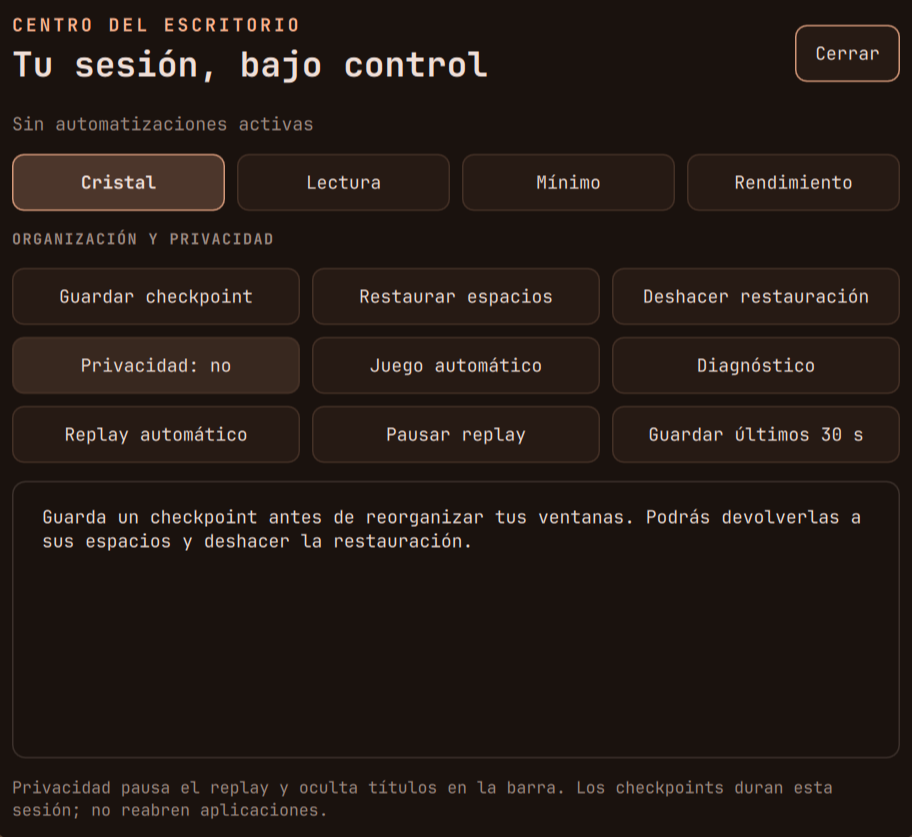
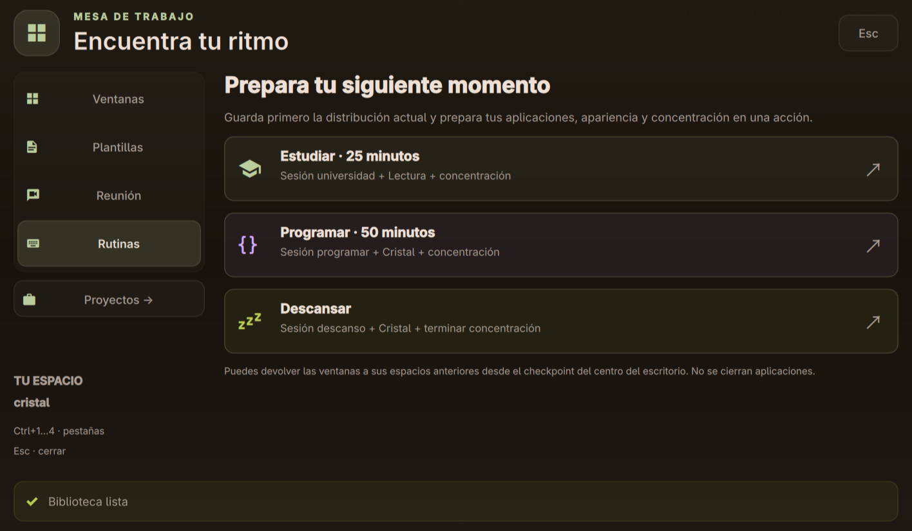
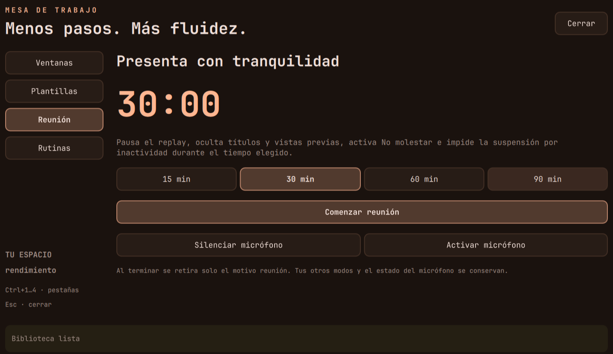
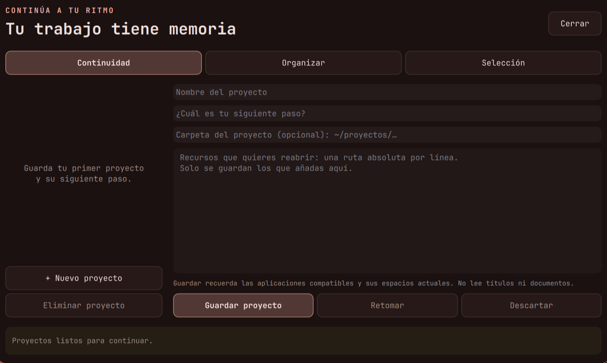
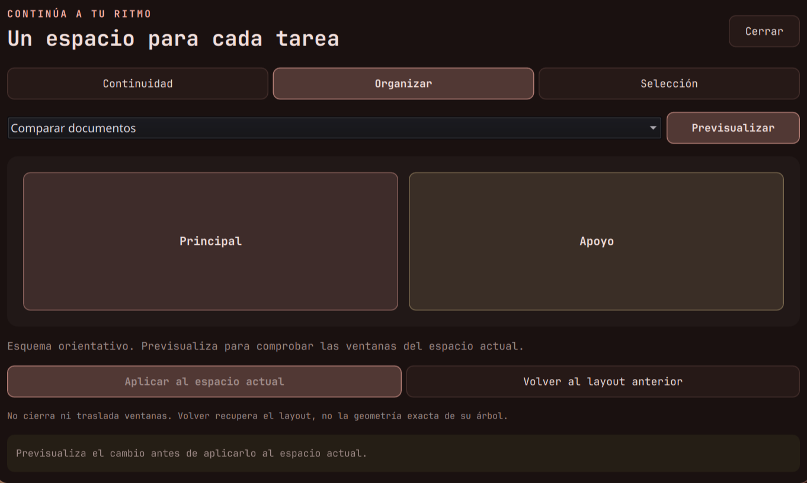

# Manual de usuario · Tu escritorio, de principio a fin

**Arch Linux · Hyprland · Quickshell · Ayu**

[Inicio](../README.md) · **Uso diario** · [Manual técnico](manual-tecnico.md) · [Guía de estudio](guia-estudio.md)

Un escritorio para estudiar, programar, comunicarte y retomar lo que estabas haciendo.
Aquí encontrarás cómo usar cada herramienta, qué guarda y cómo salir de un problema.
`SUPER` es la tecla Windows; `Return` y `Enter` se refieren a la tecla Intro.



## Tu primera sesión en cinco minutos

1. Abre una terminal con **SUPER+Q** y el navegador desde **SUPER+R**, escribiendo `firefox`.
2. Usa **SUPER+1** y **SUPER+2** para cambiar de espacio; **SUPER+ESPACIO** muestra las ventanas.
3. Abre **SUPER+N** para ajustar sonido y brillo; **SUPER+K** conecta Wi-Fi o Bluetooth.
4. Busca cualquier función en **SUPER+R**. Si olvidas una tecla, consulta **SUPER+H**.
5. Explora **SUPER+ALT+ESPACIO** para preparar una rutina y **SUPER+CTRL+B** para consultar tu día.
6. Al alejarte, **SUPER+L** bloquea. Guarda tu trabajo antes de cerrar sesión.

> **Para empezar:** aprende seis teclas: Q, R, E, N, H y L con SUPER.
> Las funciones de móvil, calendario, IA, respaldo externo y conservación de batería necesitan
> configuración o hardware compatible. keyd está desactivado; las apps de respaldo no arrancan
> junto a Quickshell. El agente requiere Ollama y sus modelos; su configuración se explica en el capítulo 28.

## Encuentra lo que necesitas

- [Tu primera sesión en cinco minutos](#tu-primera-sesión-en-cinco-minutos)
- [1. Ideas básicas](#1-ideas-básicas)
- [2. Chuleta: los atajos que más se usan](#2-chuleta-los-atajos-que-más-se-usan)
- [3. Abrir apps](#3-abrir-apps)
- [4. Manejar ventanas](#4-manejar-ventanas)
- [5. Workspaces y navegación](#5-workspaces-y-navegación)
- [6. Layouts: cómo se reparten las ventanas](#6-layouts-cómo-se-reparten-las-ventanas)
- [7. Grupos: ventanas en pestañas](#7-grupos-ventanas-en-pestañas)
- [8. Scratchpads: apps que aparecen y desaparecen](#8-scratchpads-apps-que-aparecen-y-desaparecen)
- [9. Gestos del touchpad](#9-gestos-del-touchpad)
- [10. Barra, dashboard y notificaciones](#10-barra-dashboard-y-notificaciones)
- [11. Portapapeles, wallpapers y colores](#11-portapapeles-wallpapers-y-colores)
- [12. Capturas y grabación](#12-capturas-y-grabación)
- [13. Modos: juego, concentración, energía y No molestar](#13-modos-juego-concentración-energía-y-no-molestar)
- [14. Sonido, brillo y audífonos](#14-sonido-brillo-y-audífonos)
- [15. Bloqueo, inactividad y apagado](#15-bloqueo-inactividad-y-apagado)
- [16. Cambiar la configuración](#16-cambiar-la-configuración)
- [17. Si algo falla](#17-si-algo-falla)
- [18. Copias de seguridad, memoria y salud del equipo](#18-copias-de-seguridad-memoria-y-salud-del-equipo)
- [19. Texto, voz, recordatorios y tiempo de pantalla](#19-texto-voz-recordatorios-y-tiempo-de-pantalla)
- [20. El móvil (KDE Connect)](#20-el-móvil-kde-connect)
- [21. Teclado con capas, tema claro, filtros, sonido y escritorio](#21-teclado-con-capas-tema-claro-filtros-sonido-y-escritorio)
- [22. Asistente, sesiones, notas, buscador y automatizaciones](#22-asistente-sesiones-notas-buscador-y-automatizaciones)
- [Tres recorridos para el día a día](#tres-recorridos-para-el-día-a-día)
- [23. Centro del escritorio](#23-centro-del-escritorio)
- [24. Mesa de trabajo](#24-mesa-de-trabajo)
- [25. Proyectos, organización y selecciones](#25-proyectos-organización-y-selecciones)
- [26. Brújula](#26-brújula)
- [27. Herramientas y automatismos que conviene conocer](#27-herramientas-y-automatismos-que-conviene-conocer)
- [28. Agente y memoria: hablarle al escritorio](#28-agente-y-memoria-hablarle-al-escritorio)
- [Apéndice A. Todos los atajos](#apéndice-a-todos-los-atajos)

---

## 1. Ideas básicas

| Concepto | Qué es |
|---|---|
| **Mosaico (tiling)** | Las ventanas no se superponen: se reparten la pantalla solas. Abrir una ventana parte el hueco de la que tiene el foco. |
| **Flotante** | Una ventana libre, encima de las demás, como en Windows. `SUPER+V` alterna entre flotante y mosaico. |
| **Workspace** | Un escritorio virtual. Hay 10 (`SUPER+1` … `SUPER+0`). Solo existen mientras tienen ventanas. |
| **Layout** | La regla para repartir las ventanas de un workspace: dwindle, master, scrolling o monocle (sección 6). |
| **Grupo** | Varias ventanas en un mismo hueco, con pestañas arriba (sección 7). |
| **Scratchpad** | Un workspace especial que aparece *encima* del actual y se esconde con la misma tecla (sección 8). |
| **Foco** | La ventana que recibe el teclado. Sigue al ratón y lleva el borde de color. |

Regla para recordar los atajos de ventanas:

| Modificador | Con flechas significa |
|---|---|
| `SUPER` | mover el **foco** |
| `SUPER+SHIFT` | mover la **ventana** |
| `SUPER+ALT` | **intercambiar** la ventana con la vecina |
| `SUPER+CTRL` | cosas de **monitores** |

## 2. Chuleta: los atajos que más se usan

`SUPER+H` abre en pantalla **todos** los atajos, con buscador. La lista completa también está al final de este
manual (apéndice A).

| Atajo | Acción |
|---|---|
| `SUPER+Q` | Terminal |
| `SUPER+R` | Lanzador (apps, cálculos, web, emojis, archivos, recordatorios) |
| `SUPER+H` | Todos los atajos |
| `SUPER+ESPACIO` | Vista general de las ventanas |
| `SUPER+E` | Archivos |
| `SUPER+C` | Cerrar ventana |
| `SUPER+V` | Flotante ↔ mosaico |
| `SUPER+F` | Pantalla completa |
| `SUPER+flechas` | Mover el foco |
| `SUPER+SHIFT+flechas` | Mover la ventana |
| `SUPER+ALT+flechas` | Intercambiar con la vecina |
| `SUPER+1…0` | Ir a un workspace (el mismo otra vez = volver) |
| `SUPER+SHIFT+1…0` | Mandar la ventana a un workspace |
| `SUPER+\|` | Volver a la última ventana |
| `ALT+TAB` | Siguiente ventana del workspace |
| `SUPER+TAB` | Cambiar de layout |
| `SUPER+T` | Grupo (pestañas) |
| `SUPER+.` / `SUPER+,` | Pestaña siguiente / anterior |
| `SUPER+Return` | Terminal flotante |
| `SUPER+Y` | Música |
| `SUPER+O` | Agente: preguntas, memoria y acciones del escritorio |
| `SUPER+CTRL+SHIFT+O` | Notas en un scratchpad |
| `SUPER+SHIFT+E` | Archivos (yazi) |
| `SUPER+D` | Dashboard |
| `SUPER+N` | Centro de control |
| `SUPER+SHIFT+V` | Portapapeles |
| `SUPER+K` | Wi-Fi y Bluetooth |
| `PRINT` | Captura de una región |
| `SUPER+SHIFT+X` | Copiar texto de la pantalla (OCR) |
| `SUPER+ALT+R` | Grabar la pantalla |
| `SUPER+ALT+D` | Dictar con la voz |
| `SUPER+ALT+T` | Traducir lo seleccionado |
| `SUPER+L` | Bloquear |
| `ALT+F4` | Menú de apagado |

## 3. Abrir apps

- **Lanzador** (`SUPER+R`): escribe parte del nombre, `↑↓` para elegir, `Enter` para abrir, `Esc` para cerrar.
  Sirve para mucho más que apps; lo escrito decide qué busca:

  | Escribe | Qué hace |
  |---|---|
  | `firefox`, `ffx` | Apps. También acciones: `blo` (bloquear), `apa` (apagar), `ocr`, `dictar`, `grabar`, `atajos`… |
  | `2*(3+4)` · `5 km a mi` · `30 °C a °F` · `100 USD a COP` | Calcula / convierte; `Enter` copia el resultado |
  | `g método simplex` · `yt …` · `w …` · `gh …` | Busca en Google / YouTube / Wikipedia / GitHub |
  | `:fuego` · `:corazon` · `:sigma` · `:≤` | Emojis y símbolos matemáticos: `Enter` los escribe donde estabas |
  | `/apuntes` (solo `/`: los recientes) | Busca archivos en tu carpeta personal y los abre |
  | `recordar 20m beber agua` · `recordar mañana 7:00 examen` | Recordatorio (ver sección 19) |
- **Atajos directos**: `SUPER+Q` terminal, `SUPER+E` archivos, `SUPER+W` WhatsApp, `SUPER+B` Buds Manager,
  `SUPER+G` Roblox.
- **Modo lanzar** (`SUPER+A` y luego una letra): `F` Firefox, `T` terminal, `E` archivos, `W` WhatsApp,
  `G` Roblox, `S` Spotify. Cualquier otra tecla cancela.
- **«Enfocar o abrir»**: WhatsApp, Buds Manager, Firefox y Spotify no se abren dos veces. Si ya están abiertos,
  el atajo te lleva a su ventana.
- **Cada app en su sitio**: Firefox siempre abre en el workspace 2 y WhatsApp/Discord en el 9, y te llevan ahí.

## 4. Manejar ventanas

**Con el teclado** (lo más rápido):

| Quiero… | Atajo |
|---|---|
| Ir a la ventana de la izquierda/derecha/arriba/abajo | `SUPER+flechas` |
| Llevar la ventana hacia un lado (cambia la forma del reparto) | `SUPER+SHIFT+flechas` |
| Cambiar dos ventanas de sitio sin tocar el resto | `SUPER+ALT+flechas` |
| Hacerla más grande o más pequeña | `SUPER++` / `SUPER+-` |
| Ajustar el tamaño con precisión | `SUPER+SHIFT+R`, flechas (mantener = repetir), `Esc` para salir |
| Flotante ↔ mosaico | `SUPER+V` |
| Pantalla completa | `SUPER+F` |
| Cerrar | `SUPER+C` |

**Mover** frente a **intercambiar**: mover (`SHIFT`) saca la ventana de su rama y puede cambiar los tamaños de
todas; intercambiar (`ALT`) solo cambia dos ventanas de sitio. Si no sabes cuál usar, prueba intercambiar.

**Con el ratón**: `SUPER+arrastrar con clic izquierdo` mueve la ventana; `SUPER+arrastrar con clic derecho` la
redimensiona.

**Detalles automáticos**:
- Si una ventana está sola en su workspace, ocupa toda la pantalla, sin huecos ni borde (*smart gaps*).
- Si abres una app gráfica desde kitty (por ejemplo `mpv video.mp4`), ocupa el sitio de la terminal y, al
  cerrarla, la terminal vuelve (*swallow*).
- El cursor se esconde al escribir y tras 5 segundos quieto.

## 5. Workspaces y navegación

- `SUPER+número` va a ese workspace. Pulsar el número del workspace en el que ya estás **vuelve al anterior**:
  así se salta entre dos workspaces con una sola tecla.
- `SUPER+SHIFT+número` manda la ventana a ese workspace (tú te quedas donde estás).
- `SUPER+|` (la tecla a la izquierda del 1) salta a **la última ventana** que usaste, aunque esté en otro
  workspace. Ideal para ir y volver entre el navegador y la terminal.
- `ALT+TAB` / `ALT+SHIFT+TAB` recorren las ventanas del workspace y traen la elegida al frente (útil con
  flotantes).
- `SUPER+rueda del ratón` o 3 dedos en horizontal: workspace siguiente / anterior.
- En la barra, clic en un número de workspace para ir a él.

Organización sugerida: **1** terminal · **2** navegador · **3-8** lo que estés haciendo · **9** chats.

**Con un monitor externo**: se coloca a la derecha del portátil. `SUPER+CTRL+←/→` cambia el foco de monitor,
`SUPER+CTRL+SHIFT+←/→` manda la ventana y `SUPER+CTRL+ALT+←/→` manda el workspace entero.

## 6. Layouts: cómo se reparten las ventanas

`SUPER+TAB` cambia el layout **del workspace actual** (cada workspace recuerda el suyo hasta recargar la config).
Sale un aviso con el nombre.

| Layout | Cómo reparte | Bueno para |
|---|---|---|
| **dwindle** (por defecto) | Cada ventana nueva parte en dos el hueco de la enfocada | Uso general |
| **master** | Una ventana grande (principal) y las demás apiladas al lado | Programar: editor grande + terminales |
| **scrolling** | Columnas en una cinta infinita que se desplaza | Muchas ventanas sin que se hagan diminutas |
| **monocle** | Una ventana a la vez, a pantalla completa | Concentrarse en una cosa |

Las mismas teclas hacen «lo equivalente» en cada layout:

| Tecla | dwindle | master | scrolling |
|---|---|---|---|
| `SUPER++` / `SUPER+-` | División más grande / pequeña | Principal más ancha / fina | Columna más ancha / estrecha |
| `SUPER+Z` | Llevar la ventana a la raíz | Cambiarla con la principal | Centrar la columna |
| `SUPER+X` | Invertir la división | Girar la orientación | Meter / sacar de la columna anterior |
| `SUPER+SHIFT++` / `-` | — | Una principal más / menos | — |

En dwindle, `SUPER+J` cambia la división entre horizontal y vertical.

## 7. Grupos: ventanas en pestañas

Un grupo mete varias ventanas en un solo hueco, con una barra de pestañas arriba (como un navegador).

1. Enfoca una ventana y pulsa `SUPER+T`: se convierte en grupo.
2. Las ventanas que abras mientras el grupo tiene el foco entran solas en él.
3. Para meter una ventana que ya existe: llévala hacia el grupo con `SUPER+SHIFT+flechas`.
   Para sacarla, lo mismo hacia fuera.
4. `SUPER+.` / `SUPER+,` cambian de pestaña; `SUPER+SHIFT+.` / `,` reordenan.
5. `SUPER+T` otra vez deshace el grupo.

Con el ratón: clic en una pestaña para ir a ella, clic central para cerrarla, arrastrar una ventana sobre la
barra para meterla. Una ventana agrupada tiene el borde amarillo → naranja.

## 8. Scratchpads: apps que aparecen y desaparecen

| Tecla | Qué aparece |
|---|---|
| `SUPER+Return` | Una terminal flotante, centrada |
| `SUPER+Y` | Spotify |
| `SUPER+CTRL+SHIFT+O` | Notas: nvim con `~/Documents/notas.md` |
| `SUPER+SHIFT+E` | Archivos: yazi (gestor de archivos de teclado) |
| `SUPER+S` | El scratchpad libre «magic»: manda cualquier ventana con `SUPER+SHIFT+S` |

- La misma tecla lo muestra y lo esconde. Lo de debajo no se mueve.
- La primera vez la app se abre sola. Después sigue viva escondida: lo que tenías en la terminal o en las notas
  sigue ahí.
- Si Spotify ya estaba abierto en otro workspace, `SUPER+Y` lo trae en vez de abrir otro.
- En las notas, `Espacio w` guarda y `Espacio q` sale.

**Archivos con yazi** (`SUPER+SHIFT+E`, o `y` en la terminal). Tres columnas: carpeta de arriba · actual ·
vista previa (imágenes, PDF, videos y comprimidos se ven ahí mismo).

| Tecla | Qué hace |
|---|---|
| `↑↓` o `j` `k` | Moverse |
| `→` / `Enter` · `←` | Entrar / abrir con su app · subir |
| `Espacio` | Marcar (para copiar o mover varios) |
| `y` · `x` · `p` | Copiar · cortar · pegar |
| `d` · `a` · `r` | A la papelera · crear (termina en `/` para carpeta) · renombrar |
| `/` · `z` | Buscar en la carpeta · saltar a una carpeta (zoxide) |
| `.` | Mostrar / ocultar archivos ocultos |
| `q` · `F1` | Salir · ayuda con todas las teclas |

Con `y` en la terminal, al salir con `q` te quedas en la carpeta donde estabas en yazi.

**USB y discos externos**: se montan solos al conectarlos (en `/run/media/<usuario>/<nombre>`) y sale un aviso con
un botón para abrirlos en Thunar. Para expulsar: el icono que aparece en la bandeja mientras hay algo conectado,
o `udiskie-umount -a` en la terminal. Espera a que desaparezca antes de sacarlo.

## 9. Gestos del touchpad

Regla: **3 dedos = navegar · 4 dedos = mover la ventana · con SUPER = lo delicado**.

| Gesto | Acción |
|---|---|
| 3 dedos ← → | Cambiar de workspace |
| 3 dedos ↑ | Scratchpad «magic» |
| 3 dedos ↓ | Dashboard |
| Abrir 3 dedos | Pantalla completa (otra vez = salir) |
| Juntar 3 dedos | Flotante ↔ mosaico |
| 4 dedos | Mover la ventana |
| `SUPER` + 4 dedos | Redimensionar |
| `SUPER` + 3 dedos ↓ | Cerrar la ventana |
| `SUPER` + pellizco | Lupa alrededor del cursor |

Los gestos siguen a los dedos: si sueltas a medias, se cancelan.

**Clics del touchpad**: tocar = clic. Al hundirlo, cuenta el número de dedos: 1 = clic, 2 = clic derecho,
3 = clic central. Mientras escribes, el touchpad se ignora.

## 10. Barra, dashboard y notificaciones

**Barra** (arriba). Casi todo se puede pulsar:

| Zona | Clic | Otros |
|---|---|---|
| Números de workspace | Ir | Rueda = siguiente / anterior |
| Reloj | Dashboard | Al pasar el ratón: la fecha |
| Volumen | Silenciar | Rueda = volumen |
| Brillo | — | Rueda = brillo |
| Red | Panel Wi-Fi/Bluetooth | Derecho = nmtui |
| Energía | Cambiar modo | |
| CPU / RAM | Abre btop | |
| Buds | Cambiar modo | Derecho = ANC / apagado · central = Buds Manager |
| Mando | Modo juego | |
| Campana | Centro de control | Derecho = No molestar |

**Dashboard** (`SUPER+D` o 3 dedos hacia abajo): reloj, **clima de Bogotá** (y la probabilidad de lluvia de las
próximas horas), workspaces, calendario, estado del sistema, tiempo de pantalla y la música que suena.
- **Calendario**: flechas o rueda cambian de mes y un clic en el título vuelve a hoy. Un **puntito** bajo un día =
  tienes algo en tu Google Calendar. Debajo, **«Próximo»**: tus eventos y recordatorios (clic en un recordatorio =
  borrarlo). 10 minutos antes de cada evento sale un aviso.
- **Tiempo de pantalla**: hoy por app y, debajo, **los últimos 7 días** (pasa el ratón por una barra).
- **Música**: con la **letra sincronizada** de la canción a la derecha (si lrclib.net la tiene).

**Barra**, además: unas **barras de colores** que bailan con la música (clic = dashboard), un **punto rojo con el
tiempo** mientras grabas la pantalla (clic = parar), un **micrófono rojo** mientras dictas, y la **batería del
móvil** cuando está conectado por KDE Connect.

**Centro de control** (`SUPER+N`): botones rápidos (Wi-Fi, Bluetooth…), volumen, brillo, música y el historial
de notificaciones. Clic derecho en Wi-Fi o Bluetooth abre su lista.

**Wi-Fi y Bluetooth** (`SUPER+K`): dos pestañas (`Tab` cambia). Mientras está abierto busca redes y dispositivos.
- `Enter` o clic: conectar / desconectar. Si la red tiene candado y no está guardada, pide la contraseña en la
  misma fila (el ojo la muestra). Si falla, lo dice en rojo ("Contraseña incorrecta"…).
- Bluetooth: clic en un dispositivo **nuevo** lo empareja, lo marca de confianza y lo conecta.
- `Supr`, clic derecho o la papelera: olvidar la red / el dispositivo. `Espacio`: encender / apagar la radio.

**Notificaciones**: clic = acción principal; `×` = cerrar; con el ratón encima no desaparecen.
`SUPER+SHIFT+N` activa No molestar.

**Tiempo de pantalla**: `~/.config/hypr/scripts/tiempo-pantalla.py --hoy` en la terminal muestra cuánto has
usado cada app hoy.

## 11. Portapapeles, wallpapers y colores

- **Portapapeles** (`SUPER+SHIFT+V`): historial de lo copiado, con imágenes. `Enter` copia la entrada elegida,
  `Supr` la borra.
- **Wallpapers**: `SUPER+SHIFT+W` abre el selector con miniaturas; `SUPER+CTRL+W` pone uno al azar.
  Los fondos están en `~/Imágenes/wallpapers`; la rotación automática cambia el fondo cada
  **17,5 minutos** y su temporizador vuelve a empezar al recargar Hyprland.
- **Colores**: `SUPER+SHIFT+T` cambia entre la paleta Ayu fija y los colores sacados del wallpaper. Se aplican
  a todo: bordes, barra, pestañas de grupos, terminal, btop…

## 12. Capturas y grabación

| Atajo | Acción |
|---|---|
| `PRINT` | Elegir una región |
| `SUPER+PRINT` | Toda la pantalla |
| `SHIFT+PRINT` | Menú: región, pantalla, ventana activa o con 5 s de espera |
| `SUPER+SHIFT+PRINT` | Guardar los **últimos 30 s** de pantalla y audio |
| `SUPER+ALT+PRINT` | Encender / apagar esa grabación continua (replay) |

Las capturas van a `~/Imágenes/screenshots` y además al portapapeles (se pueden pegar directamente).
Los replays van a `~/Videos/Replays`. El modo automático pausa con batería, privacidad o perfil Mínimo.
El centro del escritorio permite volver a automático después de alternarlo manualmente.

**Grabar la pantalla** (`SUPER+ALT+R`): menú con *Región*, *Pantalla completa*, *con audio* (lo que suena en el
equipo) y *Región como GIF*. Mientras graba hay un **punto rojo con el tiempo** en la barra; para terminar,
`SUPER+ALT+R` otra vez o clic en el punto. Se guarda en `~/Videos/Grabaciones` y la ruta queda copiada.

**Copiar texto de la pantalla (OCR)** (`SUPER+SHIFT+X`, o *Copiar texto* en el menú de capturas): selecciona una
zona (borde azul) y su texto queda en el portapapeles. Sirve para PDFs escaneados, vídeos, fotos de la pizarra…
Funciona sin internet, en español e inglés.

## 13. Modos: juego, concentración, energía y No molestar

| Modo | Atajo | Qué hace |
|---|---|---|
| **Juego** | `SUPER+SHIFT+G` (o solo al abrir Roblox) | Quita animaciones y efectos y silencia notificaciones, para ganar rendimiento |
| **Concentración** | `SUPER+SHIFT+F` | Temporizador de 25, 50 o 90 min con No molestar; WhatsApp, Discord, Roblox y Steam se esconden y vuelven al terminar. Cuenta atrás en la barra (clic = +10 min o terminar) |
| **Energía** | `SUPER+SHIFT+P` | Ahorro → equilibrado → rendimiento |
| **Presentación** | Solo, al conectar un proyector/TV · `SUPER+ALT+P` | Menú: duplicar, extender, solo la externa o solo el portátil. Activa No molestar; al desconectar, todo vuelve |
| **Batería** | Solo, al desenchufar | Pasa a «ahorro» y quita blur y sombras. Al enchufar vuelve tu modo anterior y la apariencia normal. Si con batería eliges otro modo a mano, se respeta |
| **No molestar** | `SUPER+SHIFT+N` | Silencia avisos ordinarios; las notificaciones críticas mantienen su política habitual |
| **Luz nocturna** | `SUPER+ALT+N` | Pantalla cálida (menos luz azul). Se enciende sola a las 20:30 y se apaga a las 7:00 (horario en `~/.config/hypr/hyprsunset.conf`); el atajo la cambia a mano hasta el siguiente cambio de horario |

**Selector de color**: `SUPER+SHIFT+C` congela la pantalla con una lupa; haz clic en cualquier píxel y su color en hex (p. ej. `#f29718`) queda copiado. `Esc` cancela.

## 14. Sonido, brillo y audífonos

- Las teclas de volumen, micrófono, brillo y música funcionan siempre, incluso con la pantalla bloqueada, y
  muestran un aviso (OSD) en pantalla.
- El OSD también avisa cuando activas o desactivas Bloq Mayús.
- En el centro de control (`SUPER+N`): volumen general y de cada app, **micrófono** (clic en su icono lo
  silencia o activa) y, si hay más de una salida (altavoces, Buds, HDMI), un botón por cada una: clic = el
  sonido va por ahí.
- **Batería**: el botón **Conservar** del centro de control (encendido por defecto) hace que la batería pare
  de cargar en ~80 %: dura muchos más años. Apágalo solo cuando necesites el 100 % (un viaje) y vuelve a
  encenderlo después. El tooltip de la batería en la barra dice en qué modo está.
- **Luz noche** en el centro de control hace lo mismo que `SUPER+ALT+N`.
- **Audífonos**: Buds Manager pausa la música al quitarte un audífono y la reanuda al ponértelo (sensor de oreja).
  Si se **desconectan** solos (sin batería, te alejaste) mientras suena algo, la música se pausa para que no salga
  de golpe por los altavoces.
- **Redmi Buds**: `SUPER+SHIFT+B` cambia de modo (ANC → transparencia → apagado); `SUPER+B` abre Buds Manager.
  En la terminal, `buds status`, `buds battery`, etc. (`buds <comando> --help` para más).

## 15. Bloqueo, inactividad y apagado

- `SUPER+L` bloquea. Se desbloquea con tu contraseña.
- La contraseña se comprueba sola al escribir el último carácter, sin Enter. La pantalla aprende la longitud
  en cada desbloqueo correcto (la primera vez, o tras cambiar de contraseña, usa Enter). Si la nueva es más
  larga, fallará una vez a la longitud vieja: escríbela entera + Enter y ya queda aprendida.
  `sudo` en la terminal hace lo mismo y comparte la longitud aprendida (función en `~/.zshrc`).
- `ALT+F4` abre el menú de apagar / reiniciar / cerrar sesión.
- `SUPER+M` sale de Hyprland **sin preguntar**: cuidado.
- Si no tocas el equipo: a los 29,5 min baja el brillo, a los 30 se bloquea, a los 30,5 se apaga la pantalla y a
  la hora se suspende.

## 16. Cambiar la configuración

Todo está en `~/dotfiles` (enlazado con stow, así que editar `~/.config/hypr/…` es editar el repo).

| Quiero cambiar… | Archivo (`~/.config/hypr/modulos/`) |
|---|---|
| Atajos | `atajos.lua` (los de scratchpads en `scratchpads.lua`; los de layouts en `layouts.lua`) |
| Terminal, lanzador, tecla principal | `programas.lua` |
| Bordes, huecos, transparencia, blur, pestañas de grupos | `apariencia.lua` |
| Animaciones | `animaciones.lua` |
| Teclado, touchpad, gestos, cursor | `entrada.lua` |
| Qué app va a qué workspace, ventanas flotantes | `reglas.lua` |
| Pantallas | `monitores.lua` |
| Programas al iniciar | `autostart.lua` |
| Apps de los scratchpads | `scratchpads.lua` |
| Ciudad del clima | `~/.config/quickshell/Clima.qml` (lat, lon, lugar) |
| Calendarios de Google | `~/.config/calendario/url` (una dirección iCal secreta por línea; **no va al repo**) |
| Límites de tiempo por app | `~/.config/tiempo-pantalla/limites.json` |
| Modelo del dictado | `~/.config/dictado/modelo` (`small` o `base`) |
| Qué se apaga con batería | `bateria.lua` (y el perfil, en `~/.config/quickshell/Cargador.qml`) |
| Colores | No a mano: `SUPER+SHIFT+T` o `~/.config/hypr/scripts/tema.sh` |

**Si cambias o añades un atajo**: actualiza el apéndice A de este manual. La chuleta
`SUPER+H` y la búsqueda de atajos del lanzador leen esa misma fuente; no hay que generar otra copia.

**Cómo probar un cambio**:

1. Revisa `git status --short` y `git diff` en `~/dotfiles`; guarda una copia de los cambios
   pendientes antes de experimentar. Los enlaces de Stow apuntan al repositorio: guardar un archivo
   puede cambiar la sesión activa. Git solo recupera contenido que hayas guardado en su historial.
2. Guarda el archivo y recarga con `hyprctl reload` para Lua; Quickshell recarga QML al guardar.
3. Consulta `hyprctl configerrors`. Una salida vacía confirma que no reporta errores de configuración;
   comprueba también la función que cambiaste.
4. Revisa el diff antes de hacer un commit. Consulta el manual técnico para validación y reversión.

**Herramientas útiles**:
- `SUPER+I`: datos de la ventana activa (class, título…) y copia su class. Es lo que necesitas para escribir una
  regla de ventana.
- `hyprctl getoption input:repeat_rate`: valor actual de una opción (con `:` en lugar de `.`).
- `hyprctl binds`: todos los atajos cargados.
- Nombres de funciones Lua de Hyprland: `/usr/share/hypr/stubs/hl.meta.lua`; argumentos, en la wiki
  (<https://wiki.hypr.land>).

## 17. Si algo falla

| Problema | Solución |
|---|---|
| Los atajos no responden: estás atrapado en un modo (submap) | `Esc`; si no, en una terminal: `hyprctl dispatch 'hl.dsp.submap("reset")'` |
| Sale un aviso rojo arriba tras editar la config | `hyprctl configerrors` dice el archivo y la línea; revisa el diff y recupera solo el cambio que causó el error (manual técnico, sección 12) |
| La pantalla de bloqueo se cuelga | `Ctrl+Alt+F3`, entra con tu usuario, ejecuta `~/.config/hypr/scripts/desbloqueo-emergencia.sh`, vuelve con `Ctrl+Alt+F1` y desbloquea |
| La barra, el lanzador o las notificaciones desaparecieron | Quickshell se cerró: en una terminal, `qs -d` lo vuelve a arrancar (los scripts usan fuzzel mientras tanto) |
| Todo en mayúsculas aunque Bloq Mayús parece apagado | Tienes dos teclados y uno quedó con Bloq Mayús activo: púlsalo en el otro teclado (el OSD avisa) |
| Una app abre en un workspace que no quieres | Mira su class con `SUPER+I` y ajusta o borra su regla en `reglas.lua` |
| Una ventana nueva tapa la terminal desde la que la abriste | Es el *swallow*: al cerrar la app vuelve la terminal. Para desactivarlo: `enable_swallow = false` en `sistema.lua` |
| Prefieres huecos aunque haya una sola ventana | Comenta las 4 líneas de *smart gaps* en `apariencia.lua` |
| Un gesto se siente lento o brusco | Añade `scale = 1.5` (o lo que te guste) a ese gesto en `entrada.lua` |
| Necesito el menú de arranque (otro sistema, volver a un snapshot) | Mantén **Esc** (o Shift) justo al encender: GRUB está oculto y espera solo 1 s |
| La Wi-Fi de un hotel/aeropuerto no abre su página de acceso | `dns-cifrado off`, entra, y luego `dns-cifrado on` |
| Aviso «⚠ Disco» | El SSD empieza a fallar: `respaldo ahora` con el disco TOSHIBA conectado, y piensa en cambiarlo |
| La barra/atajos de Quickshell no responden (`qs ipc call …` dice «Not ready to accept queries yet») | Pasa tras muchas recargas en caliente: `pkill -x qs; qs &` (o cerrar sesión y entrar). Si vuelve a pasar justo al arrancar, revisa que ningún archivo que lea un singleton falte |
| El dictado no escribe nada | ¿Micrófono correcto? Prueba `dictado.sh` dos veces y mira la notificación. La primera vez tarda más (carga el modelo) |
| El móvil no aparece en KDE Connect | Mismo Wi-Fi, app KDE Connect abierta en el móvil y el firewall abierto (sección 20) |
| No salen eventos en el dashboard | `~/.config/hypr/scripts/eventos.py --lista`: si no lista nada, revisa la dirección de `~/.config/calendario/url` |
| Reinstalar todo en otro equipo | `bash <(curl -fsSL https://raw.githubusercontent.com/EchoStrokes08/dotfiles/main/instalar.sh)` |

## 18. Copias de seguridad, memoria y salud del equipo

**Copias de seguridad.** Van al disco externo **TOSHIBA EXT**, carpeta `OSCAR/hyprland`, **cifradas** (en Windows
solo se ven archivos ilegibles: no los toques ni los borres). Lo demás del disco no se toca.

- **Son automáticas**: conecta el disco y, si la última copia tiene más de 20 h, empieza sola. Sale un aviso
  «Copiando… no desconectes» y otro «Copia de seguridad hecha» al terminar. Solo copia lo que cambió (segundos).
- Si pasan **7 días** sin copia, un aviso te lo recuerda una vez al día.
- Se guardan 7 copias diarias, 4 semanales y 12 mensuales; las más viejas se borran solas.
- **Qué se copia**: Documents, Projects, proyectos, Imágenes, Pictures, `~/.config`, `~/.local/share`
  (sin Steam ni cachés), llaves SSH/GPG, dotfiles y del sistema: `/etc` entero (incluye las contraseñas Wi-Fi),
  `/usr/local` y las listas de paquetes y servicios. Qué se excluye: `/etc/respaldo/excluir`.
- **La contraseña** está en `/etc/respaldo/clave`. Guárdala de forma segura **fuera** del
  portátil: si se pierde el portátil, sin ella el disco no sirve de nada.

| Comando | Qué hace |
|---|---|
| `respaldo estado` | Cuándo fue la última copia, cuántas hay y espacio libre |
| `respaldo ahora` | Copiar ya (aunque haya una reciente) |
| `respaldo lista` | Todas las copias con su fecha |
| `respaldo montar` | Abre las copias como carpetas en `/mnt/respaldo/snapshots/<fecha>/…`: copia de ahí lo que necesites; `Ctrl+C` cierra |
| `respaldo comprobar` | Lee todas las copias para asegurar que no hay nada dañado (tarda; una vez al mes) |

**Recuperar un archivo**: `respaldo montar` en una terminal, y en otra (o en Thunar) ve a
`/mnt/respaldo/snapshots/latest/home/oscar/…` y cópialo. Para algo de hace poco (horas) es más rápido snapper:
`snapper -c home list` y `/home/.snapshots/N/snapshot/oscar/…`.

**En otro equipo** (portátil nuevo, perdido o roto): instala `restic`, conecta el disco y
`restic -r "/ruta/al/disco/OSCAR/hyprland" mount /mnt` (te pide la contraseña). Para dejarlo todo como antes:
primero `instalar.sh` de los dotfiles, luego copiar de vuelta las carpetas.

**Si el disco no se monta:** consulta `lsblk -f` y el error de montaje. Si es NTFS y quedó
pendiente una sesión de Windows, expúlsalo correctamente desde Windows y revisa su Inicio rápido.
No ejecutes reparaciones sobre un dispositivo elegido por suposición; identifica antes el volumen.

**Memoria llena.** Si la RAM y la swap se acaban, en vez de congelarse el equipo, **earlyoom** cierra UNA app y
avisa. Elige primero pestañas del navegador y apps web (WhatsApp, Discord, VS Code); intenta evitar Hyprland, la barra,
kitty y el audio según sus reglas de preferencia. Si te cierra algo, es que tenías demasiado abierto. Configuración: `/etc/default/earlyoom`
(gestionado desde `instalar/sistema-base.sh`).

**Salud del SSD.** `smartd` lo vigila: si aparecen errores, se gasta la reserva o pasa de 75 °C, sale un aviso
«⚠ Disco». Verlo a mano: `sudo smartctl -a /dev/nvme0n1` (lo importante: *Percentage Used* = desgaste,
*Media and Data Integrity Errors* = 0). Los valores actuales se consultan en el equipo; no son constantes del proyecto.

**Firmware** (BIOS, SSD…): se comprueba solo cada semana. `fwupdmgr get-updates` para ver si hay y
`fwupdmgr update` para instalar (con el cargador puesto).

**DNS cifrado.** Las consultas DNS usan DNS-over-TLS con Quad9 y Cloudflare de respaldo. Esto protege el transporte de las consultas; no oculta por sí solo todo el tráfico ni la identidad de los sitios visitados.
`dns-cifrado estado` dice si está activo. En una Wi-Fi con página de acceso (hotel, aeropuerto) que no carga:
`dns-cifrado off`, entra, y `dns-cifrado on`.

**Arranque:** GRUB usa un menú oculto con espera de 1 s. Mantén Esc o Shift al encender
para elegir otra entrada o consultar los snapshots disponibles.

**Hibernación:** el instalador prepara un swapfile de 16 GiB para `systemctl hibernate` y un plazo
de 2 h para `systemctl suspend-then-hibernate`. Guarda tu trabajo antes de probarlo: la configuración
no demuestra que la recuperación funcione en cada máquina. La suspensión normal sigue independiente.

## 19. Texto, voz, recordatorios y tiempo de pantalla

**Dictar** (`SUPER+ALT+D`): pulsa, habla, vuelve a pulsar. El texto se escribe donde esté el cursor (y queda
copiado). Mientras escucha hay un micrófono rojo en la barra. Usa Whisper **en tu equipo**: la voz no sale a
internet. Tarda unos segundos por frase (modelo `small`, preciso); con `echo base > ~/.config/dictado/modelo` va
más rápido pero se equivoca más. Si el micrófono estaba silenciado, lo activa solo mientras grabas. Si te olvidas,
se para solo a los 2 minutos.

**Traducir** (`SUPER+ALT+T`): selecciona un texto con el ratón (en cualquier app) y pulsa. La traducción sale en una
notificación y queda copiada. Otro idioma → español; si ya está en español → inglés. Necesita internet.

**Recordatorios**: en el lanzador (`SUPER+R`) escribe `recordar` (o `rec`) + cuándo + qué:

| Ejemplo | Cuándo avisa |
|---|---|
| `recordar 20m beber agua` | En 20 minutos (también `1h`, `1h30`, `45 minutos`, `90s`) |
| `recordar 18:30 llamar a mamá` · `recordar 6pm …` | Hoy a esa hora (si ya pasó, mañana) |
| `recordar mañana 7:00 examen` | Mañana a esa hora |

Avisa con notificación y sonido. Se guardan en disco: si el equipo estaba apagado a esa hora, avisa al encender.
Los próximos se ven en el dashboard (clic en uno = borrarlo).

**Tiempo de pantalla**: el dashboard muestra hoy y los últimos 7 días. Para ponerte **límites**, edita
`~/.config/tiempo-pantalla/limites.json` (minutos al día por *class* de la ventana; `SUPER+I` te dice la class):

```
{
  "org.vinegarhq.Sober": 60,
  "vesktop": 60
}
```

Al llegar al límite sale un aviso, y otro cada 30 min de más. Mientras la pantalla está bloqueada no cuenta.

## 20. El móvil (KDE Connect)

Con KDE Connect el móvil Android y el portátil se hablan por el Wi-Fi: notificaciones del móvil en el escritorio,
portapapeles compartido, enviar archivos en los dos sentidos, batería del móvil en la barra, usar el móvil como
mando o ratón, y hacerlo sonar cuando no lo encuentras.

**Emparejar (una vez):**

1. Abre los puertos de KDE Connect en el firewall, **solo para la red local** (una vez, en una terminal):
   ```
   for r in 192.168.0.0/16 10.0.0.0/8 172.16.0.0/12; do for p in tcp udp; do sudo ufw allow from $r to any port 1714:1764 proto $p comment 'KDE Connect'; done; done
   ```
2. Instala **KDE Connect** en el móvil (Play Store o F-Droid) y conéctalo al mismo Wi-Fi.
3. En el portátil, abre KDE Connect (lanzador: `kde` → *KDE Connect*, o el icono del móvil en la bandeja),
   elige tu móvil y pulsa *Solicitar emparejamiento*; acepta en el móvil.
4. En el móvil, dale los permisos que pide cada función (notificaciones, archivos…).

**Uso**: la batería del móvil sale en la barra (clic = panel del móvil, clic derecho = hacerlo sonar).

### PC + móvil como uno solo (`SUPER+ALT+M`)

El panel del móvil (`Movil.qml`, datos de `scripts/movil.py`) junta todo en un sitio:

- **Avisos del móvil** con su app. Los de WhatsApp, Telegram o SMS se **contestan desde el PC**:
  *Responder*, escribes y Enter. La respuesta sale desde el móvil. *✕* lo quita también del móvil.
- **Responder desde la notificación:** las notificaciones del móvil traen el botón *Responder* (también
  en el centro de control), que abre el panel con el mensaje y el cursor listo.
- **Acciones:**
  - *Sonar*: para encontrarlo.
  - *Abrir lo copiado*: un enlace copiado en el PC se abre en el navegador del móvil; un texto llega a
    su portapapeles.
  - *Enviar archivo*.
  - *Captura al móvil*: hace la captura y la manda.
  - *Sus archivos*: los abre en Thunar.
  - *Mensajes (SMS)*.
- **Suena en el móvil:** lo que reproduce el móvil, con anterior, pausa y siguiente desde el PC.
- **Uno solo:** interruptores para el portapapeles compartido, los avisos en los dos sentidos, pausar
  la música del PC cuando entra una llamada, los mandos y la música del móvil.
- **Mandos del PC en el móvil:** *Instalar mandos* añade en el móvil (KDE Connect → *Ejecutar orden*):
  - diapositiva siguiente y anterior (sirve de mando de presentación);
  - pausar la música del PC y silenciarlo;
  - bloquear y suspender el PC;
  - concentración de 25 min;
  - captura del PC al móvil y traer lo copiado en el PC.

  Solo son acciones fijas: desde el móvil no se puede ejecutar nada más. Tus propias órdenes se conservan.

Si no llegan avisos del móvil: en la app del móvil, entra en este PC → *Sincronizar notificaciones* y
concede el acceso a notificaciones en Android. Para contestar, la app tiene que ofrecer respuesta en sus
notificaciones (WhatsApp, Telegram y Mensajes la ofrecen).

## 21. Teclado con capas, tema claro, filtros, sonido y escritorio

### Bloq Mayús reconvertida (keyd)

> **Desactivado** desde el 10-11-2026 (no se instala). Para volver a usarlo, descomenta el paso 15 de `instalar/sistema-base.sh`.

La tecla Bloq Mayús está en el mejor sitio del teclado y casi no se usa. Si decides activarla, hace tres cosas:

- **Un toque** = `Esc` (cerrar menús, salir de modos en nvim).
- **Mantenida** = `Ctrl`: `Bloq Mayús+C` copia, `+T` abre pestaña, `+W` la cierra.
- **Mantenida + `H` `J` `K` `L`** = flechas ← ↓ ↑ →, y **`Y` `U` `I` `O`** = Inicio, Av Pág, Re Pág, Fin.
  Con Shift además selecciona texto. Sirve en cualquier app, sin mover la mano a las flechas.

Las mayúsculas fijas siguen existiendo: `Shift+Bloq Mayús`.

keyd trabaja por debajo de Hyprland (también en la TTY y el login) y junta los dos teclados en uno,
así que el Bloq Mayús ya no puede quedar activado en un teclado y no en el otro.

- Cambiar las capas: edita `~/dotfiles/keyd/default.conf`, cópialo con
  `sudo install -m644 ~/dotfiles/keyd/default.conf /etc/keyd/default.conf` y `sudo keyd reload`.
- Si el teclado hace algo raro: **Retroceso + Esc + Enter** a la vez apaga keyd.
- Quitarlo del todo: `sudo systemctl disable --now keyd`.

### Tema claro y oscuro

`SUPER+CTRL+T` cambia entre claro y oscuro. Es independiente de `SUPER+SHIFT+T` (Ayu o colores del
wallpaper): las cuatro combinaciones funcionan.

El escritorio es **siempre oscuro** salvo que lo cambies tú. Si algún día quieres que cambie solo
(claro a las 6:30, oscuro a las 18:00), `tema.sh auto on`; las horas están al principio de
`modulos/tema.lua`.

Cambian con el tema: Hyprland, toda la interfaz de Quickshell, kitty, btop, las apps GTK y lo que
pregunta al sistema (Firefox y las webs con modo oscuro automático). No cambian solos: nvim, VS Code,
Discord y Spotify, que tienen su tema Ayu oscuro fijo.

### Filtros de pantalla

`SUPER+ALT+S` abre el menú: **grises** (leer sin distracciones), **papel** (sepia de poco contraste,
lectura larga), **colores vivos** (juegos y vídeo) e **invertido** (un PDF blanco pasa a oscuro sin
cambiar los tonos). El filtro elegido se mantiene hasta que eliges «Ninguno», también tras reiniciar.
No aparecen en capturas ni grabaciones. Los filtros son archivos GLSL en `~/.config/hypr/shaders/`.

### Sonido de las bocinas

`SUPER+ALT+E`: **Música** (más cuerpo, menos sonido «a caja», más brillo y graves realzados), **Voz**
(clases, vídeos y llamadas: se entiende mejor y a volumen parejo) o **Sin efectos** (cierra
EasyEffects). Con audífonos los efectos se saltan solos. Para afinar un perfil de oído, abre
«Easy Effects» desde el lanzador, ajusta y guarda el perfil con el mismo nombre.

### Wallpapers con transición y widgets de escritorio

Los fondos cambian con una transición (awww): al elegir uno, el nuevo crece desde donde está el
cursor; la rotación automática entra con un barrido; con batería es un fundido corto.

En un workspace vacío aparecen sobre el fondo el reloj, la fecha, el clima, una frase del día y, a la
derecha, tus próximos eventos y recordatorios. Al abrir una ventana se desvanecen.
`qs ipc call escritorio toggle` los esconde.

### Anotar capturas

`SUPER+SHIFT+A` captura una región y abre el editor (satty). También puedes pulsar **Anotar** en el
aviso de cualquier captura. Dentro: flecha, línea, recuadro, texto, números (para pasos 1-2-3),
resaltador, difuminar y recortar. `Enter` copia, guarda (`…_anotada.png`) y sale; `Ctrl+Z` deshace.

### Historial de la terminal (atuin)

`Ctrl+R` abre el buscador: escribe cualquier parte del comando. Muestra cuándo lo corriste, cuánto
tardó y si falló. `Ctrl+R` otra vez cambia el filtro: todo el historial → esta sesión → esta carpeta.
`Enter` lo ejecuta, `Tab` lo deja en la línea para editarlo. Todo queda en este equipo.

---

## 22. Asistente, sesiones, notas, buscador y automatizaciones

### Asistente local (IA)

Funciona con Ollama local y el modelo indicado en `~/.config/ia/modelo` (en este repositorio,
`gemma3:4b`). El modelo debe estar descargado antes de usarlo sin internet. La velocidad y el
consumo dependen del equipo, del modelo y de la longitud del texto.
Lee hasta 32 000 caracteres de texto (unas 10 páginas) con un contexto de 16 384 tokens; un texto
largo puede tardar considerablemente en empezar a responder. Ambos límites
están al principio de `ia.py`.

- **Sobre un texto**: selecciónalo (o cópialo) y pulsa `SUPER+ALT+A`. Elige resumir, corregir
  ortografía, redactar mejor, explicar (sirve para errores de terminal) o traducir.
- **Pregunta suelta**: `SUPER+R` y escribe `ia cómo se calcula una máscara de subred`.
- En el panel: escribe otra pregunta sobre el mismo texto y `Enter`; con el campo vacío, `Enter` copia
  la respuesta y cierra; `Ctrl+Enter` la escribe donde estabas (útil tras «corregir»).

Es un modelo pequeño: redacta y resume bien, pero se equivoca con datos y cálculos. Compruébalo.
Otro modelo: `ollama pull qwen3:4b` y escribe su nombre en `~/.config/ia/modelo`.

### Sesiones de trabajo

`SUPER+ALT+Enter` abre el menú: **Universidad**, **Programar** y **Descanso**. Cada una abre sus apps
en su workspace; lo que ya estaba abierto no se duplica. Las sesiones de ejemplo son una suposición:
cámbialas en `~/.config/hypr/modulos/sesiones.lua` (qué apps, qué direcciones abre Firefox, en qué
workspace). La «clase» de una ventana se ve con `SUPER+I`.

### Notas rápidas

`SUPER+SHIFT+O`, escribe y `Enter`: se añade una línea con fecha y hora al final de
`~/Documents/notas.md` (el mismo archivo de `SUPER+CTRL+SHIFT+O`). `SUPER+ALT+O` guarda lo que tengas
seleccionado. En el lanzador: `nota comprar cable`.

### Buscador universal

En el lanzador (`SUPER+R`), una letra y un espacio cambian dónde se busca: `v` ventanas, `n` dentro de
tus notas, `c` portapapeles, `t` pestañas de Firefox y `p` contraseñas.

Las contraseñas necesitan un gestor. La primera vez, `p algo` + `Enter` abre la guía: Bitwarden
(recomendado; también en el móvil) o `pass` (todo local). Después, `p gmail` + `Enter` escribe la
contraseña donde esté el cursor, sin pasar por el portapapeles.

### Móvil, Syncthing y Tailscale

- **Móvil** (`SUPER+ALT+M`, o clic en su batería en la barra): hacerlo sonar, enviarle lo copiado o un
  archivo, ver sus archivos. Antes hay que emparejarlo en la app KDE Connect.
- **Syncthing** (carpetas sincronizadas sin nube): abre http://127.0.0.1:8384, instala Syncthing en
  el móvil, escanea el código QR de «Acciones → Mostrar ID» y comparte una carpeta.
- **Tailscale** (entrar al portátil desde fuera): `sudo tailscale up --ssh` y abre el enlace que
  muestra para iniciar sesión; instala la app en el móvil con la misma cuenta. Desde otro equipo
  tuyo: `ssh oscar@orion`.

Los puertos de Syncthing y la interfaz de Tailscale se abren en el cortafuegos con el paso 16 de
`~/dotfiles/instalar/sistema-base.sh`. Sin eso Syncthing funciona igual, pero más lento (por relés).

### Automatizaciones

- **Resumen del día**: aparece solo la primera vez que usas el equipo cada día. A mano: «Resumen del
  día» en el lanzador.
- **Actualizaciones**: un paquete con el número en la barra cuando hay pendientes. Rojo = hay
  noticias de Arch sin leer (se muestran antes de actualizar). Clic = actualizar.
- **Pausas**: aviso tras 50 minutos seguidos. Cambiar el tiempo: `minutos` en `Pausas.qml`.
- **Lugares**: `~/.config/lugares.conf` dice qué hacer al conectarte a cada Wi-Fi (energía, volumen de
  las bocinas, No molestar). De serie: en casa no cambia nada y en cualquier otra red las bocinas se
  silencian. Añade la línea de tu universidad con el nombre exacto de su Wi-Fi.

---

## Tres recorridos para el día a día

**Preparar una tarde de estudio.** Abre Mesa con SUPER+ALT+ESPACIO, elige Rutinas y Estudiar.
Revisa las apps abiertas y añade un recordatorio con `recordar 50m revisar apuntes` en el lanzador.
Guarda un proyecto con SUPER+CTRL+Enter y escribe el próximo paso antes de dejarlo.

**Preparar una reunión.** Abre la pestaña Reunión de Mesa, elige la duración y comienza.
Comprueba el micrófono con sus botones explícitos. Si necesitas enseñar una ventana, selecciónala
en tu aplicación de videollamada: la privacidad del escritorio no oculta su contenido compartido.
Al terminar, finaliza la reunión; el silencio que necesiten otros modos se conserva.

**Retomar el día anterior.** Abre Brújula con SUPER+CTRL+B. Si buscas tus apps de antes del reinicio,
revisa Sesión y elige cuáles reabrir. Si quieres continuar una tarea concreta, abre tu proyecto y
lee su próximo paso. Cuando necesites un archivo, búscalo desde SUPER+R con `d tema`.

## 23. Centro del escritorio

**SUPER+CTRL+ESPACIO** abre perfiles, privacidad, checkpoints y diagnóstico.
También puedes pulsar el perfil de la barra o buscar el centro en el lanzador.

### Empezar a usarlo

1. Elige **Lectura** para ventanas opacas o **Cristal** para tu apariencia habitual.
2. Antes de reorganizar ventanas, pulsa **Guardar checkpoint**.
3. Cuando quieras volver, pulsa **Restaurar espacios**. Si cambias de idea, usa **Deshacer restauración**.
4. Activa **Privacidad** para pausar el replay, ocultar títulos de la barra y activar No molestar.
5. Consulta **Diagnóstico** si algo falla. El resultado se muestra en el panel y puede seleccionarse.

El panel admite Tab/Shift+Tab, Enter, Escape y **Alt+1…4** para elegir perfil mientras está abierto.
Los botones muestran ayuda al pasar el puntero. Las acciones indican su resultado y se ejecutan
de una en una. El panel usa un fondo opaco para mantener la lectura clara.

### Perfiles y automatizaciones

| Perfil | Comportamiento |
|---|---|
| Cristal | Transparencia, blur, sombras y animaciones de la apariencia habitual |
| Lectura | Ventanas opacas y sin blur; conserva animaciones y sombras salvo ahorro |
| Mínimo | Sin animaciones, blur ni sombras; opaco; pausa el replay automático |
| Rendimiento | Sin efectos; sin huecos generales; borde reducido; ventanas opacas |

El perfil visual no cambia el perfil energético del procesador. Este último sigue disponible en
el centro de control y mediante `powerprofilesctl`; no son el mismo ajuste.

Un coordinador calcula el resultado de los motivos activos:

- Batería elimina blur y sombras y pausa el replay **automático**.
- Juego elimina efectos y huecos y activa No molestar. Tiene selección explícita «sí», «no» o
  «automático». El botón **Juego automático** devuelve el control a la detección de Roblox.
- Presentación y concentración activan No molestar de forma independiente.
- Privacidad activa No molestar y pausa el replay incluso si lo encendiste manualmente.
- No molestar manual conserva su propio estado; las reglas por lugar usan otro motivo independiente.

Salir de un modo no cancela el silencio que otro todavía necesita. El centro de control distingue
el silencio automático del interruptor manual. Las notificaciones críticas mantienen su tratamiento
habitual: no es un filtro absoluto de toda información sensible.

Los cambios de modos ya no necesitan recargar toda la configuración. Perfil, privacidad y selección
de juego sobreviven a `hyprctl reload` dentro de la misma instancia. Al iniciar otra sesión se vuelve
a Cristal y juego automático. Batería, ventanas de juego y monitores se vuelven a detectar.

### Checkpoints: alcance preciso

Se guardan las ventanas normales existentes y su workspace. La restauración comprueba dirección,
PID y clase; omite ventanas cerradas o con identidad diferente y mueve sin seguir el foco.
Antes de restaurar guarda la distribución actual para poder deshacer. Las operaciones se serializan.

No guarda documentos, títulos, geometría, grupos, árbol del layout ni comandos de aplicaciones.
No reabre apps tras reiniciar ni sustituye respaldos. Se excluyen los workspaces especiales, también
los de concentración, para no interferir con ventanas ocultas por otro modo.

El checkpoint solo sirve en la misma instancia de Hyprland. Un nuevo login comienza sin checkpoint.
Deshacer recupera los espacios previos a la última restauración; volver a usarlo intercambia esas
dos distribuciones. Una aplicación cerrada no puede recuperarse con esta función.

### Replay con control de procesos

El modo **automático** graba con cargador y pausa por batería, privacidad o perfil Mínimo.
**Pausar replay** mantiene el apagado hasta que lo cambies. El atajo tradicional
`SUPER+ALT+PRINT` alterna una preferencia manual y muestra el resultado en el OSD.
`SUPER+SHIFT+PRINT` o **Guardar últimos 30 s** solicita guardar el buffer disponible.

El encendido manual puede superar el ahorro por batería; privacidad siempre impide grabar.
Salir de privacidad respeta la preferencia anterior, incluido un apagado manual.

El gestor verifica usuario, ejecutable, destino de replay y tiempo de inicio del proceso. Evita
duplicados mediante bloqueo de archivo y no usa un `pkill` general que detenga grabaciones ajenas.
Al migrar reconoce un replay anterior del mismo usuario y destino. Los errores de arranque quedan
en `replay.log` bajo el directorio runtime privado de la instancia.

## 24. Mesa de trabajo

**SUPER+ALT+ESPACIO** abre ventanas, plantillas, reuniones y rutinas en el monitor enfocado.
**SUPER+CTRL+V** abre directamente las plantillas. Dentro, **Ctrl+1…4** cambia de pestaña;
Tab/Shift+Tab recorre controles y Escape cierra. «Proyectos y acciones» abre las herramientas
explicadas en el capítulo siguiente.



### Ventanas: encontrar, mover y aparcar

Escribe para buscar por aplicación o título. Arriba/abajo selecciona y Enter enfoca; también
puedes hacer doble clic. La vista previa en vivo acompaña a la selección.

- **Aparcar** retira la ventana a un espacio especial sin cerrar la aplicación.
- **Recuperar** devuelve esa ventana al espacio anterior si conserva su identidad.
- **Ir a la ventana** también recupera una ventana aparcada antes de enfocarla.
- **Flotante / mosaico** cambia la disposición de la ventana seleccionada.
- Los botones **1–10** la mueven sin llevarte detrás.

Solo se incluyen ventanas normales y las aparcadas por esta herramienta. No se alteran scratchpads
ni ventanas ocultas por concentración. Una ventana que ya se cerró produce un mensaje, no una
acción sobre otra aplicación. La recuperación compara PID y clase además de la dirección.
El registro por instancia guarda destino e identidad; no títulos ni contenido de documentos.

Privacidad y reunión ocultan títulos y desactivan las vistas previas de la mesa y de la vista
general. Esto no oculta el contenido de aplicaciones que compartas directamente en una videollamada.

### Plantillas: tu biblioteca de textos

**SUPER+CTRL+V** abre esta pestaña directamente. Incluye tres ejemplos: plan del día, notas de
reunión y reporte de error. Puedes crear, editar, buscar, copiar o eliminar plantillas.

1. Selecciona una plantilla o pulsa **Nueva plantilla**.
2. Ponle nombre, escribe el contenido y guarda.
3. **Copiar** expande las variables admitidas y deja el resultado en el portapapeles.

| Variable | Resultado al copiar |
|---|---|
| `{{fecha}}` | Fecha local como `2026-11-11` |
| `{{hora}}` | Hora local como `16:30` |
| `{{usuario}}` | Nombre del usuario de la sesión |

Las demás variables quedan literales. No se evalúan scripts ni expresiones del texto.
**Guardar portapapeles** importa texto solamente cuando lo pides. No crea un historial automático.
Eliminar requiere una segunda pulsación de confirmación; elegir otra plantilla con cambios sin
guardar se bloquea hasta que guardes o descartes. Copiar se habilita para el contenido guardado.

La biblioteca vive en `$XDG_STATE_HOME/mesa-trabajo/plantillas.json`, o
`~/.local/state/mesa-trabajo/plantillas.json` si no definiste esa variable. El archivo se escribe
atómicamente con permisos 600. Límite: 200 plantillas, nombre de 100 caracteres y texto de 16 000.
No se publica en GitHub. Los ejemplos solo se usan mientras no exista una biblioteca guardada.
El portapapeles existente del escritorio puede registrar el texto copiado; no uses esta biblioteca
como gestor de contraseñas.

### Reuniones temporizadas



Elige 15, 30, 60 o 90 minutos y pulsa **Comenzar reunión**. Durante ese periodo:

- se añade un motivo independiente de No molestar;
- se pausa el replay incluso si estaba encendido manualmente;
- se ocultan títulos de la barra y vistas previas;
- se mantiene una inhibición `idle:sleep` de systemd para evitar inactividad/suspensión;
- la barra muestra la cuenta atrás y permite volver al panel.

Se termina sola o mediante **Terminar reunión ahora**. Al finalizar solo se retiran los efectos
aportados por reunión: el perfil, la privacidad manual y los otros motivos se conservan.
Las notificaciones críticas siguen la política habitual del escritorio. Una inhibición de sueño
no sustituye el bloqueo y no garantiza comportamiento de todas las aplicaciones o de la tapa.

Los botones de micrófono son explícitos: **Silenciar** y **Activar**. Comenzar o terminar una reunión
no cambia el micrófono, ni la cámara, ni envía mensajes a otros participantes.

La cuenta atrás se guarda por instancia y sobrevive a recargar Hyprland o Quickshell. El supervisor
usa un servicio transitorio de systemd del usuario y limpia el estado al salir. El coordinador también
revisa la caducidad para no conservar indefinidamente el motivo si el supervisor falla.

### Rutinas para empezar con menos pasos

| Rutina | Qué prepara |
|---|---|
| Estudiar | Sesión universidad, perfil Lectura y 25 min de concentración |
| Programar | Sesión programar, perfil Cristal y 50 min de concentración |
| Descansar | Sesión descanso, perfil Cristal y fin de la concentración actual |

Antes de cambiar nada se guarda un checkpoint de los espacios de las ventanas normales. Las
aplicaciones y sus espacios son los configurados en `modulos/sesiones.lua`; siguen dependiendo de
que estén instaladas. No se cierran apps ni se recuperan documentos. Restaurar el checkpoint desde
el centro devuelve las ventanas registradas que sigan abiertas; no revierte todo el perfil ni
elimina las aplicaciones nuevas de la rutina.

## 25. Proyectos, organización y selecciones

| Quiero | Acceso |
|---|---|
| Guardar un proyecto y su próximo paso | `SUPER+CTRL+Enter` |
| Repartir ventanas según la tarea | `SUPER+CTRL+O` |
| Actuar sobre un texto seleccionado | `SUPER+ALT+C` |

### Continuar un proyecto



Escribe un nombre y el siguiente paso que quieres recordar. Puedes añadir una carpeta del
proyecto y hasta doce recursos existentes, una ruta absoluta o `~/…` por línea. **Guardar**
recuerda esos datos, el perfil visual actual y las aplicaciones compatibles con sus espacios.

Al volver, incluso después de reiniciar, el proyecto aparece en el panel. El resumen del día
incluye una tarjeta para revisarlo. No se abren aplicaciones automáticamente al iniciar sesión.
La privacidad oculta los detalles del proyecto y deshabilita su edición en pantalla.

**Retomar** aplica el perfil guardado y solicita abrir las aplicaciones que falten. Terminal,
Firefox, Code y Thunar son las aplicaciones compatibles. Las que ya existen en su espacio se
reutilizan; las demás se solicitan en el espacio guardado. Una carpeta se pasa al terminal,
editor o gestor de archivos. Los recursos fijados se abren con `xdg-open` por petición explícita.

Esto no restaura documentos sin guardar, pestañas del navegador ni el estado interno de las apps.
Firefox nuevo comienza con una ventana en blanco; su propia restauración de sesiones es otra
función. Aplicaciones de instancia única pueden decidir dónde mostrar una ventana. No se guardan
comandos de procesos ni se ejecutan comandos arbitrarios leídos del archivo del proyecto.

La captura es **explícita al guardar**: no hay seguimiento de títulos, documentos o historial.
Se conservan aplicación compatible, espacio, perfil y las rutas que escribas. Hasta treinta
proyectos se almacenan en `~/.local/state/mesa-trabajo/proyectos.json`, o bajo `$XDG_STATE_HOME`
si está definido, con escritura atómica y permisos 600. Ese archivo no va a GitHub.
Eliminar un proyecto requiere confirmación; cambiar de proyecto con edición pendiente requiere
guardar o descartar. Guarda antes de cerrar sesión: los campos sin guardar no son un borrador persistente.

### Organizar según la tarea



Elige una intención y pulsa **Previsualizar**. El panel muestra un esquema orientativo y comprueba
el espacio y las ventanas reales antes de habilitar **Aplicar**.

| Intención | Layout |
|---|---|
| Comparar documentos | Master: área principal y apoyo |
| Programar | Master: prefiere el editor como principal |
| Investigar | Scrolling: columnas navegables |
| Concentrarse | Monocle: una ventana ocupa el área disponible |

Se requieren al menos dos ventanas en mosaico, sin pantalla completa, en un espacio normal.
No se cierran ni trasladan ventanas, no se convierten las flotantes y no se cambian ajustes
globales de otros espacios. El esquema no promete una proporción exacta: se respetan las opciones
de los layouts que ya tengas configuradas.

La previsualización vale dos minutos. Si cambian el espacio o las ventanas participantes,
debes previsualizar otra vez. El editor se promociona sin expulsarlo si ya era principal,
usando la variante `ignoremaster` documentada en el
[layout Master](https://wiki.hypr.land/configuring/layouts/master-layout/).

**Volver al layout anterior** recupera el motor de distribución del mismo espacio. No reconstruye
el árbol exacto de divisiones, orden o tamaños. Esta recuperación es independiente del checkpoint
de espacios de la mesa. Los planes y la recuperación solo duran la instancia actual de Hyprland.
El comportamiento de foco de Monocle puede consultarse en su
[documentación](https://wiki.hypr.land/configuring/layouts/monocle-layout/).

### Acciones sobre una selección

Marca texto en una aplicación y pulsa **SUPER+ALT+C**. Se captura primero la selección primaria;
si no contiene texto se usa el portapapeles. Después aparece la vista previa, su origen y su tamaño.
No necesitas copiar si tu aplicación ofrece selección primaria. **Capturar de nuevo** permite
actualizar la entrada de forma explícita.

Acciones disponibles:

- copiar el texto exacto;
- añadirlo a notas o guardarlo como plantilla;
- pasar a mayúsculas, minúsculas o limpiar espacios, copiando el resultado;
- resumir, explicar o traducir mediante el asistente local ya configurado;
- abrir una URL `http`/`https` o una ruta existente cuando se reconoce como recurso.

Las acciones usan la captura revisada, aunque otra app cambie después el portapapeles. El texto
no se evalúa como código. No se admite `javascript:` como recurso. La vista previa muestra hasta
700 caracteres de una captura de hasta 32 000; los caracteres restantes también participan en
la acción. Las plantillas mantienen su propio límite de 16 000 y muestran un error si se supera.

La captura se guarda con permisos 600 en el directorio runtime de la instancia. Se retira al cerrar
el panel y deja de ser válida a los diez minutos. Si el panel se interrumpe antes de limpiar,
una lectura posterior detecta la caducidad y elimina el archivo. No hay lectura automática de
selecciones en segundo plano. La privacidad oculta la vista previa.

La IA utiliza Ollama local a través del panel existente. Abrir una URL sí puede contactar esa web;
guardar notas, convertir texto y crear plantillas no necesitan red. La entrada del asistente se
copia a su archivo runtime existente para que pueda procesarse después de cerrar este panel.
Copiar un resultado puede incorporarlo al historial habitual del portapapeles del escritorio.

## 26. Brújula

**SUPER+CTRL+B** reúne Hoy, Línea de tiempo, Contexto, Sesión y Salud.
**Ctrl+1…5** o **Ctrl+Tab** cambia de pestaña; en la línea, ←/→ cambia de día.
Las reglas y el estado se procesan localmente; servicios como calendario, webs abiertas y
actualizaciones sí necesitan red. La configuración se edita desde «Editar reglas» en Contexto.

### Contexto automático

Cada regla tiene `si` (condiciones; tienen que cumplirse todas) y `entonces` (efectos):

```json
{ "id": "programar", "nombre": "Programar", "icono": "f0169",
  "si": { "apps": ["code-oss", "code"], "gracia": 4 },
  "entonces": { "perfil": "lectura", "no_molestar": true, "sesion": "programar" } }
```

- **Condiciones:** `apps` (class con comodines; `SUPER+I` la dice), `modo` (`foco` por defecto, o
  `abierta`), `gracia` (minutos que sigue activa después de cambiar de ventana: mirar la
  documentación no apaga «Programar»), `bateria_menor`, `cargando`, `pantalla_externa`, `hora` y `dias`.
- **Efectos:** `perfil`, `no_molestar`, `energia` (`power-saver`, `balanced`, `performance`) y `juego`.
  `sesion` no cambia nada: solo sirve para que «Hoy» proponga abrir esa sesión.
- Una regla se activa cuando sus condiciones llevan **4 s** cumpliéndose (así no parpadea con alt-tab).
- Si dos reglas activas quieren lo mismo, gana la de **más arriba** en el archivo.
- **Al terminar, todo vuelve a como estaba**, salvo lo que cambiaste a mano mientras tanto: si
  pusiste otro perfil durante «Programar», al cerrar VS Code se queda el tuyo.
- No molestar se pide como motivo `contexto`: convive con la concentración, las reuniones y el
  No molestar manual sin apagárselos.

Reglas de serie: Jugar, Programar, Estudiar, Pantalla externa y Ahorro de batería. Cada una se
activa o desactiva con su interruptor, y el interruptor de arriba pausa todo el contexto automático.

### Línea de tiempo

Cada cambio de ventana que dura más de 4 s queda en `linea/AAAA-MM-DD.jsonl`: hora, class y título.
El panel lo convierte en una cinta de colores del día, un resumen por app y una lista de bloques
que se puede filtrar. La búsqueda universal también busca en ella («¿dónde vi lo de las VLAN?»).

Privacidad:
- Con la privacidad activa (`SUPER+CTRL+P` o una reunión) solo se guarda la app, **sin título**,
  y el panel oculta la línea.
- Las ventanas de navegación privada y las apps de `linea.sin_titulo` (gestores de contraseñas)
  nunca guardan título.
- Con la pantalla bloqueada no se registra nada.
- Se borra sola a los `linea.dias` días (30). Con `"titulos": false` se guardan solo las apps.
- **Capturas** (`"capturas": true`, apagadas de serie): una imagen pequeña cada
  `capturas_cada_min` minutos, salvo con la privacidad activa o la pantalla bloqueada. Se borran a
  los `capturas_dias` días.
  - **Van cifradas** (AES-256 con `openssl`), sin pasar nunca por el disco en claro: `grim` escribe
    a una tubería y se guarda solo el `.jpg.enc`, con permisos `600`.
  - La clave se crea sola y vive en tu **anillo de claves** («Brújula: clave de las capturas»), que se
    abre con tu contraseña al iniciar sesión. Si no hay anillo disponible, no se hace ninguna captura.
  - Para mirarlas, el panel las descifra en `$XDG_RUNTIME_DIR` (memoria) y las borra al cerrarse.
- **Archivos del día:** los que abriste con las apps que lo apuntan en `recently-used.xbel` (visores
  de PDF, editores, el navegador al descargar…). Aparecen como rombos sobre la cinta y como fichas
  debajo; un clic los abre.

### Sesión que vuelve

Cada minuto (y 5 s después de abrir, cerrar o mover una ventana) se guarda una foto de las apps
abiertas en los espacios 1-10. Para cada una se recuerda cómo volver a abrirla:
- las Flatpak, con `flatpak run`;
- las terminales, en la carpeta donde estabas;
- las demás, por su `.desktop`.

Las ventanas **flotantes** recuerdan también su **tamaño y posición** (relativos a su pantalla), y las
de pantalla completa vuelven a pantalla completa. Esos datos se pasan a Hyprland como reglas de la
ventana al lanzarla, y solo con números validados.

Al iniciar sesión, si la foto es de otro arranque, aparece una notificación: **«Restaurar todo»**
o **«Elegir…»**. La pestaña Sesión muestra la lista con casillas. Lo que ya está abierto (por
ejemplo la terminal y Firefox que abre el inicio) no se duplica. Firefox recupera sus pestañas él
mismo; los documentos sin guardar no se recuperan.

### Sugerencias del día

La primera vez que usas el equipo cada día (desde las 6:00, sin modo juego) llega un aviso:
«Tengo N ideas para hoy». Las ideas salen de tus datos, con reglas fijas:

- **Distracciones:** si ayer pasaste más de 1 h 30 min en las apps de `sugerencias.distracciones`,
  propone **reservar** un bloque de concentración de `bloque_min` minutos (90) en el primer hueco
  libre: en punto o y media, sin pisar los eventos de tu calendario ni otros bloques, entre las 7:00
  y las 22:30; si hoy ya no cabe, mañana a las 9:00. Botones: *Programar HH:MM* o *Ahora 50 min*.
  - Avisa 5 min antes y empieza solo a su hora. Si el equipo estaba apagado, no empieza tarde.
  - Los bloques reservados salen en «Hoy» con una ✕ para cancelarlos.
  - También desde la terminal: `brujula.py programar --inicio 09:00 --minutos 90`, `programados` y
    `cancelar <id>`.
- **Proyecto:** retomar tu último proyecto de la mesa de trabajo, con su próximo paso.
- **Hábito:** si sueles tener un contexto a esta hora (3 de los últimos 7 días), propone abrir su sesión.
- **Eventos:** los de hoy que aún no han pasado.
- **Respaldo:** si la última copia tiene más de 5 días.
- **Pantalla:** si ayer pasaste más de 9 h delante.

El asistente local (ollama) solo redacta la frase de bienvenida, con esos mismos datos. Tarda
unos 30 s la primera vez y luego queda guardada todo el día. Sin ollama aparece una frase fija;
con `"ia": false`, nunca se usa.

### Búsqueda universal

En el lanzador, a partir de 3 letras y sin prefijo, debajo de las apps aparecen los resultados por
grupos: **ajustes**, ventanas, **dentro de tus documentos**, notas, historial de Firefox, línea de
tiempo, atajos y portapapeles. Las fuentes se consultan en paralelo y la que tarda más de 1,5 s se queda
fuera. También hay prefijos para buscar en una sola fuente: `d` documentos, `h` historial,
`a` atajos, `l` línea de tiempo, `s` ajustes y `b` todo.

**Ajustes:** cada opción concreta, lista para aplicarse con Enter. Escribiendo «claro», «lectura»,
«regla programar», «bluetooth» o «portapapeles móvil» aparecen, por ejemplo:
- perfiles, privacidad, No molestar y modo juego;
- tema (claro u oscuro, Ayu o wallpaper, horario automático) y luz nocturna;
- energía, replay, sonido de las bocinas y filtros de pantalla;
- Wi-Fi, Bluetooth y widgets de escritorio;
- cada regla de contexto (activar o desactivar) y las funciones del móvil.

`indice.py` lee PDF, docx, odt, pptx, odp, ods y texto (md, txt, tex…) de Documents, Desktop y
Downloads (y sus equivalentes en español). Guarda el contenido en una base SQLite FTS5 en
`~/.cache/brujula/documentos.db`. Es incremental y el servicio lo relanza cada 30 min con la
prioridad más baja de CPU y disco.

### Salud del sistema (pestaña «Salud»)

`scripts/salud.py` comprueba en menos de un segundo, y sin contraseña de administrador:

| Comprobación | De dónde sale | Aviso / mal |
|---|---|---|
| Copia de seguridad | `/var/lib/respaldo/ultima` | más de 3 / 8 días |
| Disco (SMART) | UDisks: desgaste, reserva, errores, temperatura | avisos del disco o errores |
| Espacio libre | `df /` | 85 % / 95 % |
| Snapshots | `snapper list` | el último hace más de 3 h / 2 días |
| Actualizaciones | `checkupdates -n`, barra (AUR, noticias, vulnerables) | noticias, vulnerables, más de 60; **mal** si el kernel se actualizó y no has reiniciado |
| Servicios | `systemctl --failed` (sistema y usuario) | alguno fallido |
| Temperatura | `sensors -j` | 80 / 92 °C |
| Batería | capacidad actual frente a la original y ciclos | 80 % / 60 % |
| Memoria | `/proc/meminfo` | menos del 15 % / 5 % libre |
| Scrub de Btrfs | temporizador `btrfs-scrub@-` | más de 40 días o con errores |
| USB | errores `-71` del kernel en este arranque | alguno |
| `.pacnew` | `pacdiff -o` | alguno |
| Escritorio y arranque | `hyprctl configerrors`, `grub-btrfsd` | errores o servicio parado |

Cada tarjeta trae su acción: copiar ahora, actualizar, ver qué ocupa, abrir btop, ver por qué falló…
Si algo está **mal** (no basta con un aviso), «Hoy» lo propone el primero.

### Actualizar con seguridad

«Actualizar con seguridad» (en Salud, el lanzador o la barra) abre `scripts/actualizar.py` en una terminal.

**Antes:**
- con batería por debajo del 40 % y sin cargador, para y pregunta;
- con menos de 5 GiB libres, no sigue;
- muestra las noticias de Arch sin leer (informant) y pide confirmación;
- avisa de los paquetes delicados (kernel, systemd, Mesa, Hyprland, Quickshell…);
- comprueba que snap-pac hará los snapshots.

**Durante:** `yay -Syu`. snap-pac hace un snapshot de `/` antes y otro después de cada paso de pacman,
y grub-btrfs los pone en el menú de GRUB.

**Después:**
- indica los snapshots creados, los `.pacnew` nuevos, los servicios fallidos y si hace falta reiniciar;
- lo apunta en `~/.local/state/brujula/actualizaciones.jsonl` y avisa con una notificación.

**Deshacer la última actualización** (Salud o lanzador; guarda antes el trabajo): `snapper undochange <antes>..<después>`
intenta revertir los cambios de archivos de `/` entre el par de snapshots seleccionado, sin restaurar `/home`. Revisa antes el historial: una actualización puede generar varios pares de snapshots y esta operación no equivale a recuperar todo el sistema. Hay que escribir `DESHACER` para
confirmar y pide tu contraseña. Si el sistema ni siquiera arranca: GRUB → «Arch Linux snapshots».

### Reabrir la última ventana cerrada (`SUPER+SHIFT+Z`)

El servicio calcula cómo reabrir cada ventana mientras su proceso vive (después ya no se puede). Al
cerrarla, la guarda en una pila de 15 (`cerradas.json`). `SUPER+SHIFT+Z` reabre la última:
- en su espacio;
- si flotaba, con su tamaño y posición;
- las terminales, en su carpeta.

Repetirlo reabre la anterior. Las que duran menos de 2 s (diálogos) no cuentan.

### Fin de jornada

En `brujula.json → jornada` eliges la hora (23:00), los días (vacío = todos) y el brillo de noche (30 %).
A esa hora llega «Fin de jornada», con dos botones:
- **Cerrar el día:**
  - guarda la sesión, activa No molestar (motivo `jornada`) y enciende la luz nocturna;
  - baja el brillo poco a poco durante un minuto;
  - abre «Hoy» con el resumen: pantalla del día, apps principales y lo de mañana.
- **15 min más:** vuelve a avisar.

No avisa con un juego abierto ni con la pantalla bloqueada. Una hora antes, «Hoy» ya muestra la
tarjeta de cierre. Por la mañana (desde las 5:00, al desbloquear) vuelven el brillo y las
notificaciones. También a mano: `brujula.py jornada cerrar` / `reabrir`, o «Cerrar el día» en el lanzador.

## 27. Herramientas y automatismos que conviene conocer

### Terminal: copiar, buscar y trabajar con pestañas

Kitty copia al seleccionar texto. **Ctrl+Shift+T** crea una pestaña, **Ctrl+Shift+W** la cierra y
**Ctrl+Shift+Enter** abre otra ventana. **Ctrl+Shift++**, **Ctrl+Shift+-** y **Ctrl+Shift+0**
aumentan, reducen y restablecen el tamaño de letra. Su historial de pantalla conserva 10 000 líneas.

En Zsh, escribe el nombre de una carpeta para entrar en ella (`autocd`). `cd` aprende las carpetas
con zoxide y `cdi` permite elegirlas. Tab completa con menú y vista previa; **Ctrl+T** busca archivos
y **Alt+C** carpetas. **↑/↓** busca comandos que contengan lo que ya escribiste; **→** o
**Ctrl+Espacio** acepta la sugerencia gris. **Ctrl+R** abre el historial de Atuin: Enter ejecuta;
Tab permite revisar y editar antes. `atuin stats` muestra estadísticas.

| Orden | Resultado |
|---|---|
| `ls`, `ll`, `la`, `lt` | Lista con iconos, detalle con Git, ocultos o árbol de dos niveles |
| `cat archivo` | Lectura con colores mediante bat |
| `..`, `...` | Subir una o dos carpetas |
| `y [carpeta]` | Yazi; al salir con `q`, la terminal queda en la carpeta elegida |
| `rz` | Reinicia la shell para cargar los cambios de configuración |
| `zplug-actualizar` | Actualiza los plugins de Zsh |
| `fastfetch` | Resumen del equipo; se muestra al abrir una Kitty interactiva |

La función `sudo` puede enviar la contraseña al alcanzar la longitud aprendida por el bloqueo.
Si cambió la contraseña, usa Enter para volver a aprenderla. Solo se guarda la longitud. Para
invocar directamente el programa sin esta función, escribe `command sudo …`.

### Editar notas con Neovim

Pulsa `i` para escribir y Esc para regresar al modo normal. En modo normal, **Espacio w** guarda,
**Espacio q** sale y **Espacio e** abre el explorador. Los números relativos ayudan a saltar líneas:
`5j` baja cinco. `/texto` busca; Esc quita el resaltado. En modo visual, J/K mueve la selección.
El portapapeles del sistema está integrado y el historial de deshacer persiste entre aperturas.
La primera ejecución puede pedir instalar el tema Ayu y la barra lualine; `:lua vim.pack.update()`
los actualiza. Esta configuración usa el gestor integrado de Neovim 0.12.

### Pausas, avisos y resumen matutino

El recordatorio de descanso aparece tras **50 min** de interacción sin una pausa de **3 min**.
No bloquea las apps. Sin tocar teclado o ratón durante tres minutos, el contador vuelve a cero;
ver un vídeo sin interacción cuenta como pausa. Con No molestar espera a que termine el silencio.

El **Resumen del día** aparece una vez al día desde las **5:00**, con clima, calendario,
recordatorios, batería, actualizaciones y acceso al último proyecto. Puedes abrirlo desde el
lanzador o con `qs ipc call resumen mostrar`. Enter, Escape o clic fuera lo cierran.
Es distinto de las sugerencias de **Hoy** de Brújula, que empiezan desde las **6:00**.

### Reglas al cambiar de Wi-Fi

Edita `~/.config/lugares.conf`. Cada línea usa este formato (el nombre de red debe ser el real):

```text
WiFiUniversidad | universidad | ahorro | 0 | si
* | fuera de casa | - | 0 | -
```

Las columnas son red, nombre del lugar, energía, volumen y No molestar. `-` deja el ajuste como
está; `*` cubre redes sin regla propia. El volumen solo se cambia cuando la salida coincide con
las bocinas detectadas por el script. El motivo de silencio «lugar» convive con los demás.
El vigilante apunta la red al iniciar y actúa al cambiar a otra: para aplicar ahora la red actual,
ejecuta `~/.config/hypr/scripts/lugar.sh aplicar`. Estas reglas aplican valores; no prometen
restaurar el volumen o la energía anteriores al salir de una red.

### Qué necesita conexión y qué funciona localmente

| Función | Requisito |
|---|---|
| Ventanas, proyectos, plantillas, notas y OCR | Equipo local y dependencias instaladas |
| Dictado y asistente | Modelos descargados; Ollama activo para el asistente |
| Traducción con el atajo dedicado | Internet; es un flujo distinto a traducir con la IA local |
| Clima y letras | Open-Meteo y lrclib.net; pueden no tener datos disponibles |
| Google Calendar | URL iCal privada configurada; no la publiques |
| KDE Connect | Emparejamiento, permisos del móvil y conectividad entre dispositivos |
| Syncthing | Carpetas y dispositivos autorizados; sus cambios también pueden propagar borrados |
| Tailscale | Inicio de sesión y permisos de tu red privada |
| Copia externa | Disco configurado conectado, restic y clave de recuperación |
| Conservar batería | Hardware Lenovo compatible y regla del instalador |

### Elegir la recuperación adecuada

| Situación | Herramienta | Qué recupera |
|---|---|---|
| Cambié las ventanas de espacio | Checkpoint del centro | Espacios de ventanas que siguen abiertas en esta instancia |
| Quiero volver al reparto anterior | Organizador | Motor de layout anterior del mismo espacio |
| Quiero continuar mañana | Proyecto | Próxima tarea, recursos y apps compatibles guardadas |
| Reinicié y quiero reabrir mis apps | Sesión de Brújula | Apps reconocidas, espacios y geometría compatible |
| Cerré una ventana por error | `SUPER+SHIFT+Z` | Solicitud de reapertura; no documentos sin guardar |
| Borré o modifiqué un archivo | Snapshot de home o restic | Versión del archivo en una copia existente |
| Una actualización rompió el sistema | Historial, snapshots y procedimiento de recuperación | Cambios de archivos según la copia seleccionada |

Ni los proyectos ni la sesión de Brújula guardan el trabajo que aún no guardaste dentro de una app.
Consulta [el procedimiento técnico de recuperación](manual-tecnico.md#12-diagnóstico-y-recuperación)
antes de restaurar configuración o sistema.

## 28. Agente y memoria: hablarle al escritorio

**SUPER+O** abre el agente. También puedes buscar **Agente** en SUPER+R. Es distinto del asistente
sobre selecciones de SUPER+ALT+A: además de redactar respuestas, consulta la agenda, la actividad,
los archivos y el móvil, y propone acciones concretas del escritorio.

### Primer uso

1. Comprueba que Ollama esté activo y los modelos estén descargados; el procedimiento está en el
   [manual técnico](manual-tecnico.md#agente-y-memoria-integrados).
2. Abre el panel y espera la preparación del modelo. Si escribes durante la carga, el panel conserva
   una pregunta pendiente y la envía al terminar. En CPU puede tardar bastante la primera vez.
3. Prueba `¿Qué tengo mañana?` o `¿Cómo está el equipo?`. Verás los pasos y la respuesta progresiva.
4. Para actuar, pide algo concreto: `Concentración de 50 minutos`. Revisa la propuesta y pulsa
   **Sí, hazlo** o **No**. Las solicitudes de cambio necesitan confirmación en este panel.
5. Si pregunta por varias acciones, revisa cada propuesta por separado. Escribir otra petición
   descarta la acción que estaba pendiente. Nueva o Ctrl+L inicia otra conversación.
6. A la izquierda está el **historial**: tus conversaciones agrupadas en Hoy, Ayer, Últimos 7 días y
   Anteriores. Pulsa una para verla entera y seguir donde la dejaste; el agente recuerda lo que se
   habló. La papelera que aparece al pasar el ratón la quita del historial. Al reabrir el panel ves la
   última conversación.

| Quiero | Ejemplo |
|---|---|
| Preparar el día | `¿Qué tengo mañana y cuánta batería me queda?` |
| Encontrar algo leído | `¿Qué estuve leyendo sobre el método de dos fases?` |
| Estudiar | `Abre la sesión universidad y concentración de 50 minutos` |
| Recordar una tarea | `Recuérdame en 45 minutos tomar agua` |
| Cambiar apariencia | `Pon el perfil Lectura` |
| Revisar el móvil | `¿Tengo avisos en el móvil?` |
| Responder desde el móvil | `Contéstale a María que llego a las 3` |

### Consultas, aperturas y confirmaciones

| Sin confirmación adicional en el agente | Con propuesta y confirmación |
|---|---|
| Buscar en memoria y localizar archivos | Empezar o programar concentración |
| Consultar agenda, estado, salud y avisos del móvil | Abrir una sesión de trabajo con sus apps |
| Consultar la línea de tiempo | Cambiar un ajuste, crear recordatorios |
| Abrir una app, un archivo, una URL o un panel | Responder/enviar al móvil |
| | Bloquear, suspender, abrir actualización o reversión, reabrir ventana, cerrar el día |

Lee destinatario, mensaje, hora y ajuste antes de aceptar. Abrir una URL o enviar algo al móvil
puede usar red; **local** describe el procesamiento del modelo, no todas las acciones posibles.
Una propuesta enviada a una aplicación no demuestra que esa aplicación la haya completado:
comprueba el resultado en el panel o servicio correspondiente.

### Teclado y voz

| Control | Uso |
|---|---|
| Enter | Enviar lo escrito |
| Ctrl+Espacio o botón de micrófono | Empezar dictado; volver a pulsar para terminar y enviar |
| Sí / No | Resolver la propuesta visible |
| S / N | Confirmar o rechazar cuando el campo de escritura no tiene el foco |
| Ctrl+L o Nueva conversación | Empezar otra conversación (la anterior queda en el historial) |
| Ctrl+↑ / Ctrl+↓ | Ir a la conversación anterior o siguiente del historial |
| Escape | Cerrar el panel |

El micrófono usa Whisper local mediante `dictado.sh texto`: devuelve la transcripción al agente
en lugar de escribirla en otra app o copiarla al portapapeles. El atajo general de dictado sigue
siendo SUPER+ALT+D. Cerrar el panel no equivale a cancelar una tarea que ya esté en proceso.

### Qué recuerda la memoria

La memoria busca por significado y por palabras exactas sobre:

- Documentos de las carpetas que ya indexa el escritorio: PDF, Word, LibreOffice y apuntes.
- Línea de tiempo: apps, títulos registrados y archivos del día, hasta 60 días de fuentes disponibles.
- Historial de Firefox: títulos y direcciones de hasta 90 días en los perfiles que reconoce el código.

No indexa el portapapeles. El historial web no incluye el contenido completo de cada página;
el filtro excluye algunas direcciones de acceso y pago, pero no garantiza retirar todo dato sensible.
Las preguntas reconocidas como «qué leí», «qué hice» o «dónde vi» disparan búsqueda antes de responder.
Otras consultas dependen de las herramientas que elija el modelo. No encontrar algo no demuestra
que nunca haya existido: puede faltar la fuente, el perfil, el índice o el modelo.

Las respuestas pueden citar `[1]`, `[2]`… y mostrar fichas de fuentes. Pulsa una ficha para abrir
el documento, la página o ese día de la línea de tiempo. El índice vive en
`~/.cache/brujula/memoria.db`; Brújula solicita actualizarlo cada 30 min después del índice de palabras.
La primera pasada puede tardar bastante; las siguientes procesan fuentes que cambiaron.

### Modelos y datos personales

| Función | Modelo configurado | Configuración |
|---|---|---|
| Agente con herramientas | `qwen3:4b-instruct` | `~/.config/ia/agente` |
| Memoria semántica | `embeddinggemma` por defecto | `~/.config/ia/embeddings` (opcional) |
| Asistente sobre selecciones | `gemma3:4b` | `~/.config/ia/modelo` |
| Dictado | Whisper small o base | `~/.config/dictado/modelo` |

Los modelos deben descargarse antes de trabajar sin internet. La velocidad depende del equipo,
el tamaño de la conversación y la disponibilidad de memoria; no hay un tiempo fijo de respuesta.
El agente guarda tus últimas 100 conversaciones en `~/.local/state/brujula/agente/` (privado, solo tu
usuario). **Nueva** empieza otra sin borrar la anterior; para quitar una, usa su papelera. Una propuesta
sin responder se descarta al cambiar de conversación. Con la privacidad activa, el historial oculta los
títulos. Borrar conversaciones no borra la memoria indexada, la línea, el historial de Firefox ni los
documentos originales.

Activar privacidad no elimina datos ya indexados ni bloquea por sí solo las búsquedas de memoria.
El agente puede usar información personal recuperada al preparar una respuesta: revisa qué compartes
si estás mostrando la pantalla. Para limpiar el índice o diagnosticar modelos, consulta el manual técnico.

### Si no responde o no encuentra algo

| Síntoma | Comprobación |
|---|---|
| El modelo tarda al abrir | Espera la preparación inicial; evita lanzar varias peticiones a la vez |
| Aparece error de Ollama o modelo | Revisa `systemctl status ollama` y `ollama list` |
| No hay recuerdos | `~/.config/hypr/scripts/memoria.py estado`; revisa fuentes e indexación |
| Solo encuentra palabras literales | Puede estar usando FTS5 sin embeddings disponibles |
| El móvil no responde | Verifica conexión, permisos y que el aviso admita respuesta |
| Quiero editar las notas | Usa SUPER+CTRL+SHIFT+O; SUPER+O está reservado al agente |

## Apéndice A. Todos los atajos

<!-- atajos:inicio -->

### Atajos de teclado

Esta es la referencia central: la leen la chuleta (`SUPER+H`) y la búsqueda del lanzador.
Actualiza aquí los atajos cuando cambie su configuración.

#### Apps

| Atajo | Acción |
|---|---|
| `SUPER+Q` | Terminal (kitty) |
| `SUPER+E` | Archivos (Thunar) |
| `SUPER+R` | Lanzador: apps, acciones, calculadora, web, emojis, archivos y recordatorios (ver «El lanzador») |
| `SUPER+H` | Chuleta: todos estos atajos, con buscador |
| `SUPER+ESPACIO` | Vista general: todas las ventanas en miniatura (clic = ir · arrastrar = mover de workspace) |
| `SUPER+W` | WhatsApp (lo enfoca si ya está abierto) |
| `SUPER+G` | Roblox (Sober, con gamemode) |
| `SUPER+B` | Buds Manager (lo enfoca si ya está abierto) |
| `SUPER+D` | Dashboard: reloj, espacios, calendario, sistema, tiempo de pantalla y música |
| `SUPER+A`, luego una letra | Modo lanzar: `F` Firefox · `T` terminal · `E` archivos · `W` WhatsApp · `G` Roblox · `S` Spotify. Cualquier otra tecla cancela |

#### Ventanas

| Atajo | Acción |
|---|---|
| `SUPER+C` | Cerrar la ventana |
| `SUPER+V` | Flotante / en mosaico |
| `SUPER+F` | Pantalla completa |
| `SUPER+P` | Pseudo-mosaico |
| `SUPER+J` | Cambiar la dirección de la división (dwindle) |
| `SUPER+TAB` | Layout del workspace: dwindle → master → scrolling → monocle |
| `SUPER+flechas` | Mover el foco |
| `SUPER+SHIFT+flechas` | Mover la ventana en esa dirección (cambia su sitio en el layout; entra o sale de un grupo vecino) |
| `SUPER+ALT+flechas` | Intercambiar la ventana con su vecina |
| `SUPER+T` | Convertir la ventana en grupo (pestañas) / deshacerlo |
| `SUPER+.` / `SUPER+,` | Pestaña siguiente / anterior del grupo |
| `SUPER+SHIFT+.` / `SUPER+SHIFT+,` | Mover la pestaña a la derecha / izquierda |
| `SUPER+clic izquierdo` (arrastrar) | Mover la ventana |
| `SUPER+clic derecho` (arrastrar) | Redimensionar la ventana |
| `SUPER+SHIFT+R`, luego flechas | Modo redimensionar (mantener = repetir); `Esc` o `Enter` salen |
| `SUPER+I` | Inspector: class, título, workspace, tamaño y pid de la ventana; copia la class |

#### Productividad

| Atajo | Acción |
|---|---|
| `SUPER+ALT+Enter` | Sesiones de trabajo: universidad / programar / descanso, cada app en su workspace (`modulos/sesiones.lua`) |
| `SUPER+O` | Agente del escritorio: agenda, memoria, equipo y propuestas de acciones |
| `SUPER+ALT+A` | Asistente local (IA) sobre el texto seleccionado: resumir, corregir, redactar mejor, explicar, traducir o preguntar |
| `SUPER+SHIFT+O` | Nota rápida: una línea con fecha a `~/Documents/notas.md` |
| `SUPER+ALT+O` | Guardar en las notas el texto seleccionado |
| `SUPER+ALT+M` | PC + móvil: avisos del móvil con respuesta, música, sonar, abrir lo copiado, archivos, captura, mandos |

#### Workspaces y monitores

| Atajo | Acción |
|---|---|
| `SUPER+1` … `SUPER+0` | Ir al workspace 1-10 (el mismo otra vez = volver al anterior) |
| `SUPER+\|` (tecla a la izquierda del 1) | Saltar a la última ventana enfocada |
| `ALT+TAB` / `ALT+SHIFT+TAB` | Recorrer las ventanas del workspace (y traerla al frente) |
| `SUPER+SHIFT+1` … `SUPER+SHIFT+0` | Mover la ventana al workspace 1-10 |
| `SUPER+rueda del ratón` | Workspace siguiente / anterior |
| `SUPER+S` | Mostrar / ocultar el scratchpad (workspace especial «magic») |
| `SUPER+SHIFT+S` | Mandar la ventana al scratchpad |
| `SUPER+Return` | Terminal flotante (scratchpad; se abre sola la primera vez) |
| `SUPER+Y` | Música: Spotify en su scratchpad (si ya estaba abierto, lo trae) |
| `SUPER+CTRL+SHIFT+O` | Notas: nvim con `~/Documents/notas.md` en un scratchpad flotante |
| `SUPER+SHIFT+E` | Archivos: yazi en un scratchpad flotante (`SUPER+E` sigue siendo Thunar) |
| `SUPER+CTRL+←/→` | Foco al otro monitor |
| `SUPER+CTRL+SHIFT+←/→` | Mandar la ventana al otro monitor |
| `SUPER+CTRL+ALT+←/→` | Mandar el workspace entero al otro monitor |

#### Sistema

| Atajo | Acción |
|---|---|
| `SUPER+L` | Bloquear la pantalla |
| `SUPER+M` | Salir de Hyprland (sin confirmar) |
| `ALT+F4` | Menú de apagado (wlogout) |
| `SUPER+N` | Centro de control (botones, volumen, brillo, música, notificaciones) |
| `SUPER+SHIFT+N` | Alternar No molestar manual (respeta los motivos automáticos) |
| `SUPER+ALT+ESPACIO` | Mesa de trabajo: ventanas, aparcado, plantillas, reuniones y rutinas |
| `SUPER+CTRL+V` | Biblioteca de plantillas de texto con fecha y hora |
| `SUPER+CTRL+Enter` | Continuidad: guardar y retomar proyectos y su próxima tarea |
| `SUPER+CTRL+O` | Organizar el espacio por tarea, con previsualización y vuelta al layout anterior |
| `SUPER+ALT+C` | Capturar una selección y elegir acciones sobre ese texto |
| `SUPER+CTRL+ESPACIO` | Centro del escritorio: perfiles, privacidad, checkpoints, replay y diagnóstico |
| `SUPER+CTRL+B` | Brújula: hoy, línea de tiempo, contexto automático, sesión anterior y salud del sistema |
| `SUPER+SHIFT+Z` | Reabrir la última ventana cerrada (en su espacio y, si flotaba, con su tamaño) |
| `SUPER+CTRL+P` | Privacidad: pausa replay, oculta títulos de la barra y activa No molestar |
| `SUPER+SHIFT+F` | Modo concentración: 25 / 50 / 90 min (con sesión: +10 min o terminar) |
| `SUPER+ALT+N` | Luz nocturna sí/no (automática 20:30–7:00, `hyprsunset.conf`) |
| `SUPER+SHIFT+C` | Selector de color: clic en un píxel → hex copiado |
| `SUPER+SHIFT+G` | Modo juego (también se activa solo con Roblox) |
| `SUPER+SHIFT+P` | Modo de energía: ahorro → equilibrado → rendimiento |
| `SUPER+SHIFT+T` | Colores: Ayu ↔ sacados del wallpaper |
| `SUPER+CTRL+T` | Tema claro ↔ oscuro |
| `SUPER+ALT+S` | Filtro de pantalla: ninguno / grises / papel / colores vivos / invertido |
| `SUPER+ALT+E` | Sonido de las bocinas: perfil música / voz / sin efectos (EasyEffects) |
| `SUPER+SHIFT+W` | Selector de wallpapers |
| `SUPER+CTRL+W` | Wallpaper al azar |
| `SUPER+SHIFT+V` | Historial del portapapeles |
| `SUPER+K` | Wi-Fi y Bluetooth (también: clic en la red de la barra, clic derecho en los botones del centro de control) |
| `SUPER+SHIFT+B` | Buds: cambiar de modo (ANC → transparencia → apagado) |
| `SUPER+ALT+P` | Pantalla externa: duplicar / extender / solo la externa / solo el portátil |

#### Capturas y grabación

| Atajo | Acción |
|---|---|
| `PRINT` | Captura de una región → `~/Imágenes/screenshots` + portapapeles |
| `SUPER+PRINT` | Captura de toda la pantalla |
| `SHIFT+PRINT` | Menú: región, pantalla, ventana activa, pantalla en 5 s o región y anotar |
| `SUPER+SHIFT+A` | Capturar una región y anotarla (satty): flechas, texto, números, resaltar, difuminar. `Enter` copia, guarda y sale |
| `SUPER+SHIFT+PRINT` | Guardar los últimos 30 s de pantalla y audio en `~/Videos/Replays` |
| `SUPER+ALT+PRINT` | Encender / apagar el replay |
| `SUPER+ALT+R` | Grabar pantalla: menú región / pantalla / con audio / GIF; otra vez = parar → `~/Videos/Grabaciones` |
| `SUPER+SHIFT+X` | Copiar texto de la pantalla (OCR): seleccionas una zona y su texto queda copiado |

#### Teclado con capas (keyd: funciona en todas las apps, la TTY y el login)

> **Desactivado** desde el 10-11-2026 (no se instala). Para volver a usarlo, descomenta el paso 15 de `instalar/sistema-base.sh`.

| Atajo | Acción |
|---|---|
| `Bloq Mayús` (un toque) | Esc |
| `Bloq Mayús` mantenida + tecla | Ctrl + tecla (`Bloq Mayús+C` = copiar) |
| `Bloq Mayús+H` `J` `K` `L` | Flechas ← ↓ ↑ → (con Shift, selecciona) |
| `Bloq Mayús+Y` `U` `I` `O` | Inicio · Av Pág · Re Pág · Fin |
| `Shift+Bloq Mayús` | Bloq Mayús de verdad (MAYÚSCULAS) |
| `Retroceso+Esc+Enter` | Emergencia: apaga keyd (el teclado vuelve a ser el normal) |

#### Texto y voz

| Atajo | Acción |
|---|---|
| `SUPER+ALT+D` | Dictar: pulsa, habla, vuelve a pulsar → el texto se escribe donde esté el cursor (Whisper, sin internet) |
| `SUPER+ALT+T` | Traducir lo seleccionado (otro idioma → español; español → inglés), queda copiado |

#### Teclas multimedia (funcionan también con la pantalla bloqueada)

| Tecla | Acción |
|---|---|
| Subir / bajar volumen | Cambia el volumen (máx. 100 %) y lo muestra el OSD |
| Silencio | Silencia o activa el sonido |
| Micrófono | Silencia o activa el micrófono |
| Subir / bajar brillo | Cambia el brillo y lo muestra el OSD |
| ⏮ anterior · ⏯ reproducir/pausa · ⏭ siguiente | Música, con la canción en el OSD |
| `Bloq Mayús` | Avisa en el OSD si queda activado en cualquier teclado |

### Con el ratón

| Dónde | Acción |
|---|---|
| Barra: número de workspace | Clic = ir · rueda = siguiente / anterior |
| Barra: barras de colores (solo con música) | Visualizador de audio · clic = dashboard |
| Barra: punto rojo con tiempo / micrófono rojo | Grabando la pantalla / dictando · clic = parar |
| Barra: móvil (solo si está conectado) | Batería del móvil · clic = panel PC + móvil · derecho = hacerlo sonar |
| Barra: reloj | Al pasar el ratón muestra la fecha · clic = dashboard |
| Barra: bandeja | Clic = abrir · clic derecho = menú · clic central = acción secundaria |
| Barra: Buds | Clic = cambiar modo · derecho = ANC / apagado · central = Buds Manager |
| Barra: volumen | Clic = silenciar · rueda = volumen |
| Barra: red | Clic = panel de Wi-Fi y Bluetooth · derecho = nmtui |
| Barra: brillo | Rueda = brillo |
| Barra: energía | Clic = cambiar modo |
| Barra: CPU / RAM | Clic = btop |
| Barra: concentración (solo en sesión) | Clic = +10 min o terminar |
| Barra: mando | Clic = modo juego |
| Barra: campana | Clic = centro de control · derecho = No molestar |
| Dashboard: píldoras de workspaces | Clic = ir a ese workspace |
| Dashboard: calendario | Flechas o rueda = mes · clic en el título = volver a hoy · puntito = hay eventos ese día |
| Dashboard: «Próximo» | Eventos de Google Calendar y recordatorios · clic en un recordatorio = borrarlo |
| Dashboard: últimos 7 días | Pasa el ratón por una barra: total y app principal de ese día |
| Centro de control: Wi-Fi / Bluetooth | Clic = encender/apagar · derecho = abrir su lista |
| Centro de control: Conservar · Luz noche | Batería hasta ~80 % · pantalla cálida |
| Centro de control: salidas de audio | Un botón por salida (altavoces, Buds, HDMI): clic = sonar por ahí |
| Vista general | Clic en ventana = ir · clic en hueco = ir al workspace · arrastrar = mover de workspace · `1`-`9` |
| Notificación | Clic = acción principal · botones = sus acciones · `×` = cerrar · el ratón encima pausa el tiempo |

### El lanzador (`SUPER+R`)

| Escribe | Resultado (Enter) |
|---|---|
| `firefox`, `ffx`, `blo`… | Apps (sin tildes, letras salteadas; las que más usas suben) y acciones: bloquear, apagar, atajos, OCR, dictar, grabar… |
| `2*(3+4)` · `5 km a mi` · `30 °C a °F` · `100 USD a COP` · `=…` | Calculadora y conversor (qalc): copia el resultado |
| `g …` · `yt …` · `w …` · `gh …` | Buscar en Google / YouTube / Wikipedia / GitHub |
| `:fuego` · `:corazon` · `:sigma` · `:≤` | Emojis y símbolos: los escribe y quedan copiados |
| `/apuntes` (solo `/` = recientes) | Archivos de tu carpeta personal: los abre |
| `recordar 20m beber agua` · `recordar 18:30 llamar` · `recordar mañana 7:00 examen` | Recordatorio (aviso con sonido; sobrevive a reinicios). Abreviado: `rec` |
| Cualquier cosa sin resultados | Buscarla en Google |

En el lanzador, el portapapeles y el selector de wallpapers: `↑↓` (o flechas) para moverse, `Enter` para elegir,
`Esc` o clic fuera para cerrar. En el portapapeles, `Supr` borra la entrada. En los menús, `1`-`9` eligen directo.

### Búsquedas directas del lanzador

| Escribe | Resultado |
|---|---|
| `v texto` | Ventanas abiertas en cualquier workspace → ir a ella |
| `n texto` | Buscar dentro de tus notas (`~/Documents/*.md`) → abrir nvim en esa línea |
| `c texto` | Historial del portapapeles → copiarlo otra vez |
| `t texto` | Pestañas abiertas de Firefox → abrir esa dirección (para saltar a la pestaña ya abierta, en Firefox escribe `%` en la barra) |
| `p nombre` | Contraseñas (Bitwarden o pass) → la escribe donde esté el cursor. Primera vez: `claves.sh configurar` |
| `ia pregunta` | Preguntar al asistente local |
| `nota texto` | Apuntar una línea en `notas.md` |

### Atajos que se adaptan al layout (`modulos/layouts.lua`)

| Tecla | dwindle | master | scrolling |
|---|---|---|---|
| `SUPER++` / `SUPER+-` | División más grande / pequeña | Área principal más ancha / fina | Columna más ancha / estrecha |
| `SUPER+Z` | Llevar la ventana a la raíz | Cambiarla con la principal | Centrar la columna |
| `SUPER+X` | Invertir la división | Girar la orientación | Meter / sacar de la columna anterior |
| `SUPER+SHIFT++` / `SUPER+SHIFT+-` | — | Una ventana principal más / menos | — |


### Búsqueda universal

| Prefijo de búsqueda | Fuente |
|---|---|
| `d texto` | Dentro de documentos indexados |
| `h texto` | Historial de Firefox |
| `a texto` | Atajos |
| `l texto` | Línea de tiempo |
| `s texto` | Ajustes y acciones del sistema |
| `b texto` | Todas las fuentes universales |

Con tres letras sin prefijo, el lanzador añade resultados de varias fuentes a las apps.

### Gestos del touchpad

| Gesto | Acción |
|---|---|
| 3 dedos ← → | Cambiar de workspace |
| 3 dedos ↑ | Mostrar / ocultar el scratchpad |
| 3 dedos ↓ | Dashboard |
| Abrir 3 dedos | Pantalla completa (otra vez = salir) |
| Juntar 3 dedos | Flotante ↔ mosaico |
| 4 dedos (cualquier dirección) | Mover la ventana |
| `SUPER` + 4 dedos | Redimensionar la ventana |
| `SUPER` + 3 dedos ↓ | Cerrar la ventana |
| `SUPER` + 3 dedos ↑ | Vista general |
| `SUPER` + pellizco (2 dedos) | Lupa alrededor del cursor |

### Comportamiento automático

<!-- atajos:fin -->

Los automatismos se explican en los capítulos anteriores y su arquitectura en el manual técnico.
