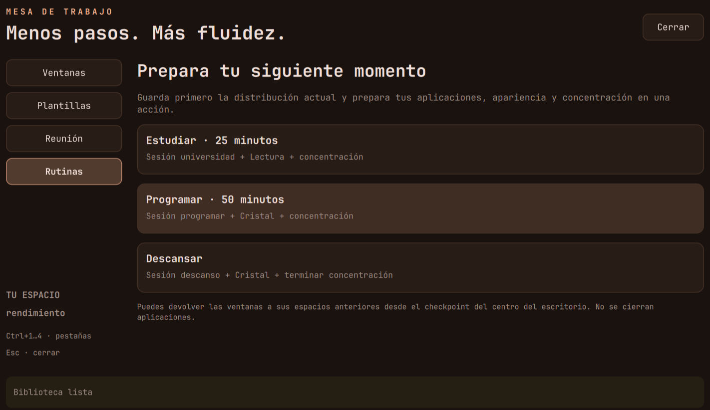
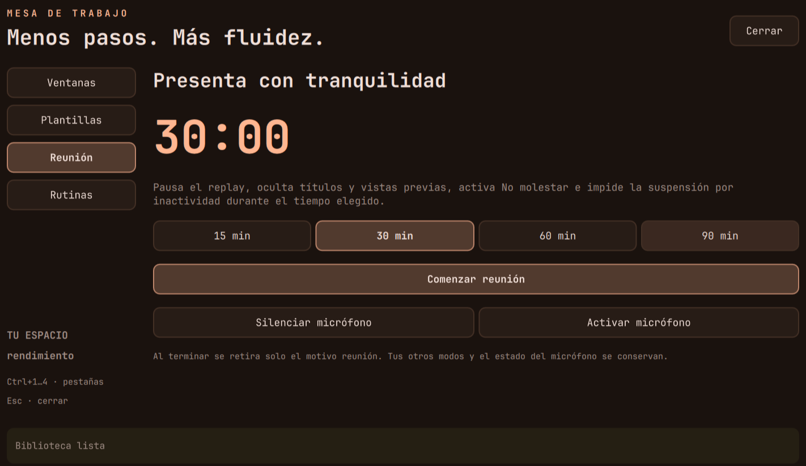

# Mesa de trabajo

Un panel para organizar ventanas, reutilizar textos, preparar reuniones y comenzar una rutina.
Se abre desde el lanzador buscando **Mesa de trabajo**, desde el centro del escritorio o con
**SUPER+ALT+ESPACIO**. Aparece en el monitor enfocado.



## Ventanas: encontrar, mover y aparcar

Escribe para buscar por aplicación o título. Arriba/abajo selecciona y Enter enfoca; también
puedes hacer doble clic. La vista previa en vivo acompaña a la selección.

- **Aparcar** retira la ventana a un espacio especial sin cerrar la aplicación.
- **Recuperar** devuelve esa ventana al espacio anterior si conserva su identidad.
- **Ir a la ventana** también recupera una ventana aparcada antes de enfocarla.
- **Flotante / mosaico** cambia la disposición de la ventana seleccionada.
- Los botones **1–10** la mueven sin llevarte detrás.

Solo se incluyen ventanas normales y las aparcadas por esta herramienta. No se alteran scratchpads
ni ventanas ocultas por concentración. Una ventana que ya se cerró produce un mensaje, no una
acción sobre otra aplicación. La recuperación compara PID y clase además de la dirección.
El registro por instancia guarda destino e identidad; no títulos ni contenido de documentos.

Privacidad y reunión ocultan títulos y desactivan las vistas previas de la mesa y de la vista
general. Esto no oculta el contenido de aplicaciones que compartas directamente en una videollamada.

## Plantillas: tu biblioteca de textos

**SUPER+CTRL+V** abre esta pestaña directamente. Incluye tres ejemplos: plan del día, notas de
reunión y reporte de error. Puedes crear, editar, buscar, copiar o eliminar plantillas.

1. Selecciona una plantilla o pulsa **Nueva plantilla**.
2. Ponle nombre, escribe el contenido y guarda.
3. **Copiar** expande las variables admitidas y deja el resultado en el portapapeles.

| Variable | Resultado al copiar |
|---|---|
| `{{fecha}}` | Fecha local como `2026-11-11` |
| `{{hora}}` | Hora local como `16:30` |
| `{{usuario}}` | Nombre del usuario de la sesión |

Las demás variables quedan literales. No se evalúan scripts ni expresiones del texto.
**Guardar portapapeles** importa texto solamente cuando lo pides. No crea un historial automático.
Eliminar requiere una segunda pulsación de confirmación; elegir otra plantilla con cambios sin
guardar se bloquea hasta que guardes o descartes. Copiar se habilita para el contenido guardado.

La biblioteca vive en `$XDG_STATE_HOME/mesa-trabajo/plantillas.json`, o
`~/.local/state/mesa-trabajo/plantillas.json` si no definiste esa variable. El archivo se escribe
atómicamente con permisos 600. Límite: 200 plantillas, nombre de 100 caracteres y texto de 16 000.
No se publica en GitHub. Los ejemplos solo se usan mientras no exista una biblioteca guardada.
El portapapeles existente del escritorio puede registrar el texto copiado; no uses esta biblioteca
como gestor de contraseñas.

## Reuniones temporizadas



Elige 15, 30, 60 o 90 minutos y pulsa **Comenzar reunión**. Durante ese periodo:

- se añade un motivo independiente de No molestar;
- se pausa el replay incluso si estaba encendido manualmente;
- se ocultan títulos de la barra y vistas previas;
- se mantiene una inhibición `idle:sleep` de systemd para evitar inactividad/suspensión;
- la barra muestra la cuenta atrás y permite volver al panel.

Se termina sola o mediante **Terminar reunión ahora**. Al finalizar solo se retiran los efectos
aportados por reunión: el perfil, la privacidad manual y los otros motivos se conservan.
Las notificaciones críticas siguen la política habitual del escritorio. Una inhibición de sueño
no sustituye el bloqueo y no garantiza comportamiento de todas las aplicaciones o de la tapa.

Los botones de micrófono son explícitos: **Silenciar** y **Activar**. Comenzar o terminar una reunión
no cambia el micrófono, ni la cámara, ni envía mensajes a otros participantes.

La cuenta atrás se guarda por instancia y sobrevive a recargar Hyprland o Quickshell. El supervisor
usa un servicio transitorio de systemd del usuario y limpia el estado al salir. El coordinador también
revisa la caducidad para no conservar indefinidamente el motivo si el supervisor falla.

## Rutinas para empezar con menos pasos

| Rutina | Qué prepara |
|---|---|
| Estudiar | Sesión universidad, perfil Lectura y 25 min de concentración |
| Programar | Sesión programar, perfil Cristal y 50 min de concentración |
| Descansar | Sesión descanso, perfil Cristal y fin de la concentración actual |

Antes de cambiar nada se guarda un checkpoint de los espacios de las ventanas normales. Las
aplicaciones y sus espacios son los configurados en `modulos/sesiones.lua`; siguen dependiendo de
que estén instaladas. No se cierran apps ni se recuperan documentos. Restaurar el checkpoint desde
el centro devuelve las ventanas registradas que sigan abiertas; no revierte todo el perfil ni
elimina las aplicaciones nuevas de la rutina.

## Teclado y comandos

`Ctrl+1…4` cambia de pestaña mientras el panel está abierto. Tab/Shift+Tab recorren controles,
Enter los activa y Escape cierra. La búsqueda y las acciones aparecen también en el lanzador.

```bash
qs ipc call mesa abrir ventanas
qs ipc call mesa abrir plantillas
qs ipc call mesa abrir reunion
qs ipc call mesa abrir rutinas
~/.config/hypr/scripts/mesa.py reunion iniciar --minutos 30
~/.config/hypr/scripts/mesa.py reunion terminar
~/.config/hypr/scripts/mesa.py plantilla lista
```

## Validación y recuperación

Las pruebas cubren biblioteca persistente, permisos, variables, texto que parece código u opciones,
ventanas cerradas, aparcado/recuperación, datos manipulados, duración, limpieza del supervisor y orden
de las rutinas. El motor de modos comprueba **768 combinaciones**, incluyendo reunión.

Se probó en la sesión real iniciar y terminar una reunión, la presencia del inhibidor, la pausa del
replay, la conservación tras reload y la retirada del motivo sin cambiar las preferencias anteriores.
Los cambios de ventanas y lanzamiento de rutinas se validan con comandos simulados para no mover
ventanas personales ni abrir aplicaciones durante las pruebas. No se realizó una suspensión física
ni se modificó el micrófono durante la validación.

```bash
cd ~/dotfiles
python3 -m unittest discover -s tests -v
lua tests/test_politicas.lua
hyprctl configerrors
```

El respaldo de la configuración previa a esta ampliación está en
`~/.local/state/hypr-avanzado/mesa-20261111-160229/`, con su manifiesto. Las plantillas se conservan
aparte del código. Consulta también la [guía del centro del escritorio](escritorio-avanzado.md).
