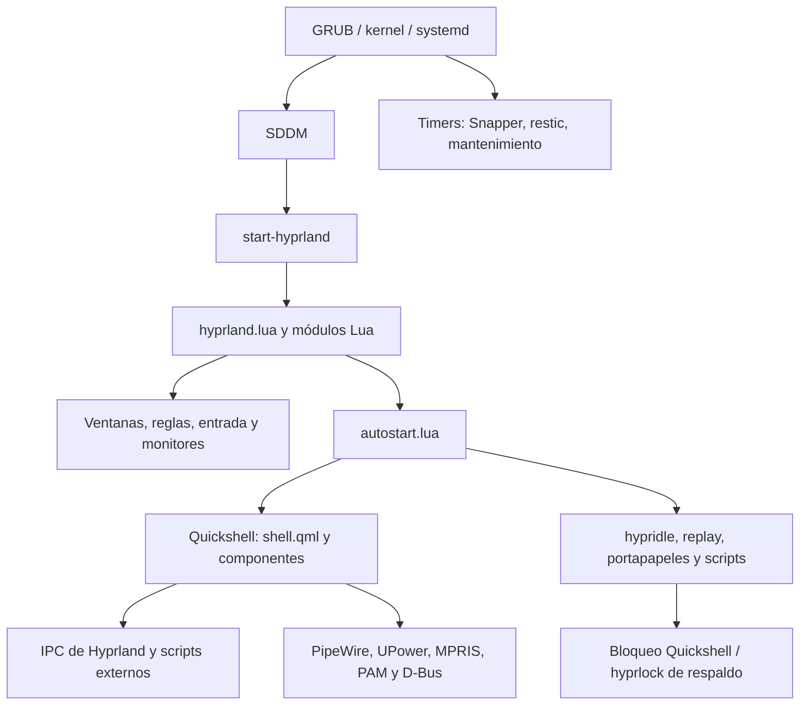

# Revisión de Arch Linux y del escritorio Hyprland

Fecha: **11 de noviembre de 2026**. Repositorio: `EchoStrokes08/dotfiles`.
Continuación práctica: [ruta de Hyprland](ruta-hyprland.md).

## Alcance y conclusión

El escritorio tiene una arquitectura avanzada: configuración Lua modular, shell propia en QML,
automatizaciones, integración de energía y herramientas de recuperación. El siguiente salto consiste
en poder explicar, medir, probar y reconstruir ese conjunto. La complejidad instalada no demuestra
por sí sola el nivel de conocimientos del usuario: la ruta incluye ejercicios para comprobarlo.

Esta fue una revisión de solo lectura del sistema en ejecución y del repositorio: distribución,
kernel, hardware, almacenamiento, paquetes relevantes, servicios, temporizadores, registros del
arranque, configuración de Hyprland, integraciones de Quickshell, instaladores y respaldo.
Se inspeccionaron módulos y scripts clave y se validó sintaxis de todos los Lua, shell y Python del
repositorio. No equivale a una auditoría exhaustiva de cada paquete, cada línea QML o cada archivo
privado del equipo.

No se ejecutaron suspensión, hibernación, reinicios, bloqueo, restauraciones, cambios de firewall ni
instalación real. Tampoco se validaron SMART con privilegios, reglas efectivas del firewall,
Secure Boot, cobertura total del respaldo o comportamiento con monitor externo. Se publica un
resumen; no volcados de registros, títulos de ventanas, direcciones de red, UUID ni credenciales.

## Inventario observado

| Área | Evidencia local |
|---|---|
| Sistema | Arch Linux, x86_64; kernel en ejecución `7.2.14-arch1-1` |
| Kernel alternativo | `linux-lts 6.18.60-1` instalado; arranque alternativo sin probar |
| CPU / GPU | Ryzen 5 7520U, 8 CPU lógicas; Radeon 610M, Mesa `26.2.6` |
| Memoria | Aproximadamente 14 GiB utilizables; 5.5 GiB disponibles en la muestra |
| Swap | zram de 7.5 GiB, prioridad 100; archivo de 16 GiB, prioridad 1 |
| Almacenamiento | SSD de unos 477 GiB; Btrfs; raíz al 11 %; compresión zstd:3 |
| Pantalla activa | `eDP-1`, 1920×1080 a unos 60 Hz, escala 1.5; VRR inactivo |
| Compositor | Hyprland `0.57.2-1`; Aquamarine `0.16.0-1` |
| Shell | Quickshell `0.3.2-1`; 44 archivos QML incluyendo el tema SDDM |
| Configuración | `hyprland.lua`, 22 módulos; enlaces de Hyprland y Quickshell al repositorio |
| Audio | PipeWire `1.6.10`, WirePlumber `0.5.18`; servicios activos |
| Portales | xdg-desktop-portal, backend Hyprland y GTK instalados y activos |
| Acceso gráfico | SDDM habilitado; entrada Hyprland instalada ejecuta `start-hyprland` |
| Red | NetworkManager y systemd-resolved activos; resolv.conf usa el stub de resolved |
| Mantenimiento | UFW, earlyoom, smartd, power-profiles-daemon activos |
| Recuperación | Snapper con configuraciones `root` y `home`; restic instalado |

Los valores de consumo, capacidad libre y servicios representan una muestra, no un presupuesto de
rendimiento. `hyprctl version` indica Hyprcursor compilado contra 0.1.13 y sistema con 0.1.14:
es una diferencia observada, no evidencia de incompatibilidad o fallo.

## Mapa de la arquitectura

`autostart.lua` utiliza el evento `hyprland.start`: evita relanzar sus programas en cada recarga.
`shell.qml` concentra paneles e IPC; los componentes usan servicios QML y procesos externos.
Los modos y temas también pueden recargar Hyprland y modificar opciones compartidas.
La configuración actual está en Lua; la ubicación y carga por módulos coinciden con el
[núcleo documentado de Hyprland](https://wiki.hypr.land/configuring/core/).

## Qué está bien comprobado

- `hyprctl configerrors`: salida vacía en la sesión actual.
- `systemctl --failed` y `systemctl --user --failed`: cero unidades fallidas.
- Snapper timeline/cleanup, respaldo, fstrim, paccache, reflector y firmware tienen timers activos.
  El timer de scrub Btrfs aparece programado; el estado del servicio consultado es `success`.
  Ese estado aislado no demuestra una comprobación completa del disco.
- PipeWire y los portales están activos; falta la prueba funcional de compartir pantalla y audio.
- El bloqueo usa `WlSessionLock`, autenticación PAM y hyprlock como respaldo; hay procedimiento TTY.
  La revisión de código no sustituye una prueba de recuperación del bloqueo.
- Zram tiene prioridad mayor que la swap en disco; ambas aparecen activas.
- El script de respaldo instalado coincide byte a byte con `respaldo/respaldo.sh`.
- Sintaxis correcta en **28 Lua** (`luac -p`), **36 shell** (`bash -n`) y **8 Python** (`ast.parse`).
  No se ejecutaron esos programas ni se certificaron las APIs de Hyprland con `luac`.

## Hallazgos y prioridades

### H1 · Alta: modo de prueba que libera el bloqueo

En [`Bloqueo.qml`](../quickshell/.config/quickshell/Bloqueo.qml), el IPC `probar()` llama al bloqueo
y arranca un temporizador que ejecuta `desbloquear()` a los 12 segundos sin autenticación.
La función también puede invocarse cuando `bloquear()` retorna porque ya está bloqueado.
Es una ruta de liberación accesible a procesos que puedan usar el IPC de esa sesión; no se ha
demostrado acceso remoto ni desde otro usuario. No se invocó durante la revisión.

Acción: separar la previsualización del bloqueo de producción y eliminar de éste la liberación
temporizada. Probar contraseña válida/incorrecta, ausencia de shell y recuperación TTY.
Además, `bloquear.sh` acepta tanto `bloqueado` como `bloqueando`: conviene esperar la confirmación
`secure`, con plazo y respaldo claros. El protocolo diferencia solicitar bloqueo y tenerlo
efectivamente adquirido; consultar el tipo en la
[API de Quickshell 0.3.2](https://quickshell.org/docs/v0.3.2/types/).

### H2 · Alta: errores USB reales y repetidos

El registro del kernel de este arranque contiene **95 líneas USB con `-71`**: lectura de
descriptor, dirección y resets fallidos. Ya hay una regla contra autosuspensión del hub en
`instalar/sistema-base.sh`, pero los errores siguen presentes en este arranque.

Acción: correlacionar hora y dispositivo; probar conexión directa, otro cable, puerto y hub,
una variable cada vez. Comparar kernel normal y LTS si persiste. No atribuirlo a Hyprland ni dar
por resuelto un problema físico por tener una regla udev. Cierre: uso real de teclado/ratón y
reconexiones sin reproducir los errores durante una ventana de observación anotada.

### H3 · Alta: respaldo programado no significa restauración comprobada

`respaldo.service` terminó con `success`, pero el script devuelve 0 también si falta el disco.
La marca local de última copia es del **9 de noviembre de 2026, 10:15**, anterior al último intento
del servicio, del día 11. En la muestra de discos no apareció el disco externo. Esto no prueba
fallo de restic: muestra que el éxito de systemd no garantiza una copia nueva.

Acción: conectar el disco, consultar estado y snapshots, ejecutar `respaldo comprobar` y recuperar
un archivo de prueba a una carpeta nueva. Comparar contenido o hash y anotar duración. La
[guía de restauración de restic](https://restic.readthedocs.io/en/stable/050_restore.html)
explica selección e inclusión de archivos. Conservar la clave fuera del portátil sin publicarla.
Revisar las rutas incluidas: la lista explícita del script no garantiza cubrir todos los
directorios personales. Los snapshots en el mismo SSD no sustituyen una copia externa.

### H4 · Media: simulación del instalador termina con código 1

`./instalar.sh --simular` recorrió las etapas y mostró «Todo en orden», pero devolvió **1**.
La última expresión es `[ "$SIMULAR" = 0 ] && ...`; al simular resulta falsa y queda como estado
de salida. Además, varias etapas registran avisos y continúan, de modo que el código final no
representa necesariamente el resultado acumulado.

Acción: definir salida explícita según errores acumulados; verificar simulación satisfactoria,
fallo de una etapa y argumentos inválidos en un entorno aislado. La simulación no instala paquetes,
no prueba una máquina nueva y no valida por sí sola los scripts anidados que solo muestra.

### H5 · Media: modos que comparten estado sin un coordinador

`modo_juego.lua` deduce si está activo a partir de `animations.enabled`; apagar animaciones por
otro motivo puede confundirse con modo juego. Juego, presentación y concentración escriben el
mismo «No molestar»; salir de uno puede desactivar el estado que otro todavía necesita.
Batería y tema también interactúan con recargas y efectos.

Acción: estado explícito por motivo y cálculo único del resultado efectivo. Ensayar combinaciones:
juego + batería, concentración + presentación, cambio de tema y recarga. Es una conclusión de
lectura de código; no se alteraron los modos en la sesión.

### H6 · Media: medir replay y sondeo antes de optimizar

`autostart.lua` inicia replay continuo de 30 segundos a 60 FPS en RAM. El grabador y su servidor
KMS estaban activos. Hay transparencia/blur y sondeos de sistema cada 2 segundos en QML.
Son costes potenciales en una GPU integrada; no se midió su impacto en autonomía.

Acción: comparar reposo con/sin replay y con/sin efectos, manteniendo brillo, apps y perfil de
energía. Usar muestras repetidas; distinguir CPU de GPU y consumo energético. No diagnosticar
una fuga con una captura de `ps`: una muestra mostró un `qs` breve al 100 %, y la posterior
solo la instancia persistente, alrededor de 3.2 % de CPU acumulada.

### H7 · Media: seguridad e integraciones por verificar

UFW está activo y `ENABLED=yes`; no se leyeron reglas efectivas con privilegios. Se observaron
servicios escuchando fuera de loopback para sincronización, móvil, juegos y red privada; eso
no demuestra que sean alcanzables desde Internet. Ollama y la interfaz web de sincronización
observadas escuchaban en loopback.

`ecosystem.enforce_permissions` devuelve `false`. Activarlo requiere inventario y pruebas, no
solo descomentar ejemplos: los permisos del compositor no aíslan por sí mismos sus sockets IPC,
como advierte la [documentación de permisos](https://wiki.hypr.land/configuring/core/advanced-configuration/permissions/).
Revisar también el historial persistente de cliphist, el replay y las capturas según el uso.
No se extrajeron historiales ni secretos para esta revisión.

### H8 · Media: recuperación e hibernación aún sin ensayo

Hay kernel LTS, Snapper y swapfile de 16 GiB. `mkinitcpio.conf` usa el hook `systemd`.
No hay `resume=` en el arranque actual y `/sys/power/resume` muestra `0:0`, pero esos datos
antes de hibernar no bastan para declarar avería: el instalador contempla detección mediante
systemd/EFI. Falta probar el ciclo completo con trabajo guardado y verificar el arranque de LTS.
La vista de dispositivos no muestra una capa LUKS; no se certificó el cifrado ni Secure Boot.

### H9 · Baja: documentación y portabilidad

Hay cambios locales previos: perfiles EasyEffects, tema/wallpaper, frases del escritorio,
instalador y tres fondos nuevos. Se conservaron fuera del commit documental de esta revisión.
El instalador local tiene desactivada la configuración de keyd; `systemctl is-active keyd`
respondió `inactive`, aunque el README todavía lo presenta como función del escritorio.
El temporizador de fondos usa 17.5 minutos y su comentario habla de 15.
`entorno.lua` contiene una ruta absoluta del usuario para Flatpak.

Acción: distinguir preferencias personales, datos de máquina y valores compartidos. Documentar
el comportamiento vigente y comprobar restauración en otro usuario o una VM.

## Señales del arranque que necesitan contexto

También se observaron avisos ACPI por un nombre duplicado, certificado X.509, gnome-keyring/PAM
y limitaciones multicast de Wi-Fi. Sin síntomas correlacionados no justifican cambiar firmware,
PAM o controladores. Priorizar los resets USB reproducidos; investigar los demás si afectan
conectividad, llavero, suspensión o arranque. Cero unidades fallidas no significa cero errores
en el registro del kernel.

## Validación y trabajo pendiente

| Comprobación | Resultado |
|---|---|
| Configuración de sesión | Sin errores reportados por `hyprctl configerrors` |
| Unidades fallidas | Cero en sistema y usuario |
| Sintaxis Lua / shell / Python | 28 / 36 / 8 archivos correctos |
| Simulación de instalación | Recorrido completo; salida 1, hallazgo H4 |
| QML | Inspección de componentes clave; sin validación estática o funcional completa |
| Respaldo | Script instalado coincide; marca local consultada; restauración pendiente |
| Monitor externo / portales / audio | Componentes presentes; pruebas de uso pendientes |
| Suspensión / hibernación / TTY / LTS | Pendientes para una sesión de pruebas con trabajo guardado |

Las correcciones descritas son tareas propuestas, no cambios ya aplicados al sistema. Para
llevarlas a cabo con evidencias y criterios de cierre, seguir la [ruta](ruta-hyprland.md).
